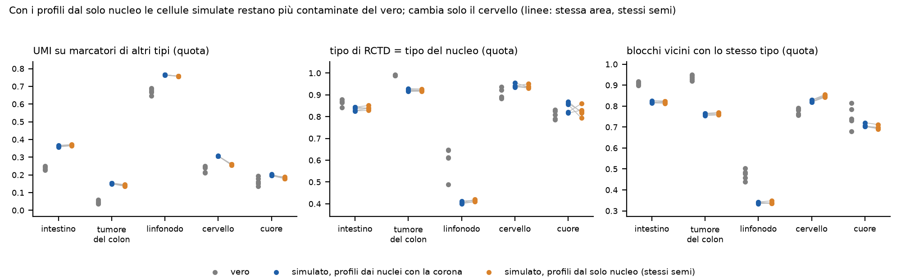
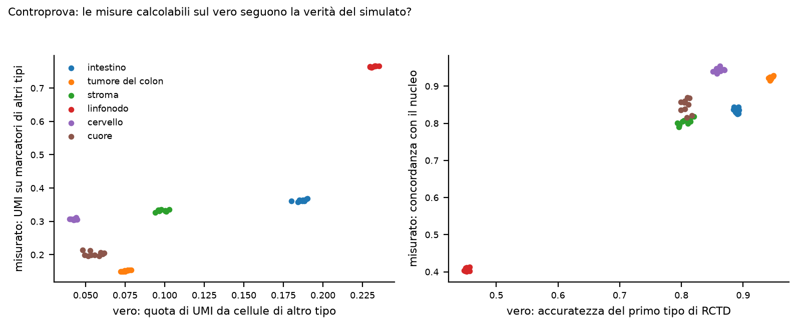
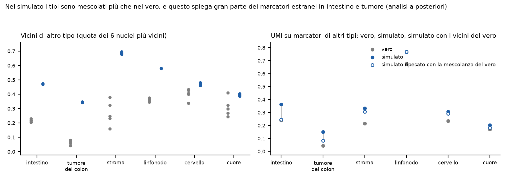



# Dubbi rinviati



# Cancelli, previsioni, controprove

Pre-registrazione: cancelli `fc79131`, previsioni e intervalli `c82580c`; ok di Luca sulle previsioni del 2026-11-12, `ba1ee86`.



# Analisi a posteriori



# Correzioni



# Revisione avversariale



# Deviazioni dichiarate



# Cosa è girato



# Appendice

## Perimetro



## Metodi e misure



## Esplorazioni dichiarate



## Attese pre-registrate



## Da dove vengono i numeri del riassunto


