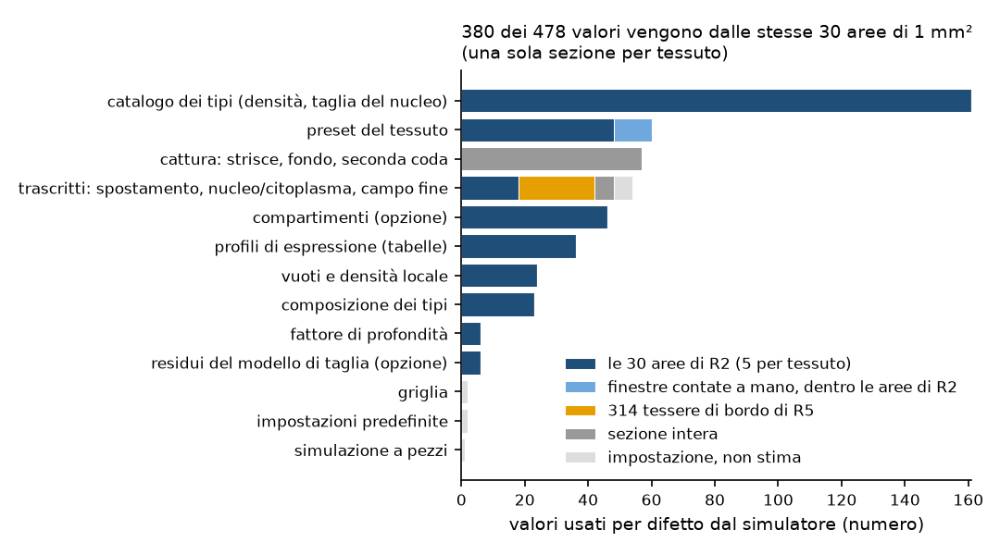
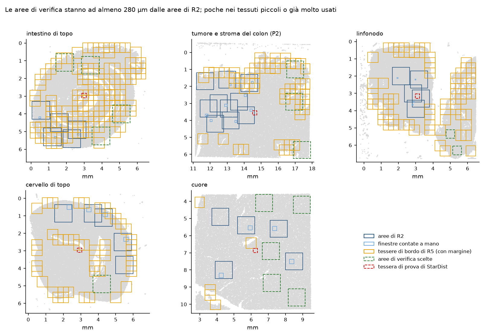



# Dubbi rinviati



# Cancelli e previsioni

Pre-registrazione: cancelli e previsioni `1a7c698`; ok di Luca sulle previsioni del 2026-11-18, `cdd6034` ([DEC-091](../docs/decisions/DEC-091.md)). Modifiche dichiarate durante lo step: seconda regola delle aree `43a0c68` ([DEC-092](../docs/decisions/DEC-092.md)), distanza delle aree nuove `696bced` ([DEC-094](../docs/decisions/DEC-094.md)), scelta delle aree da parte dell'agente `c7a8297` ([DEC-095](../docs/decisions/DEC-095.md)). Errore di pre-registrazione: G-3 chiedeva 6 sezioni di taratura, sono 5.

| id | tipo | tessuto | atteso | intervallo (fonte) | osservato | esito | spiegazione |
|---|---|---|---|---|---|---|---|
| G-1 | cancello | tutti | censimento completo e fedele | 1e-9 relativo; 2 mutanti | 478 valori uguali al pacchetto; 0 senza fonte o aree; mutanti 2/2 | PASS | `tools/F3.2_test.py G-1` |
| G-2 | cancello | tutti | md5 o ETag; md5 di taratura invariati | uguaglianza esatta | 46/46 file (36 md5, 10 ETag); 82 file di taratura identici prima e dopo, 57 uguali ai registri di R1 e F3.1 | PASS | |
| G-3 | cancello | 5 sezioni di taratura | PASS e 3 guasti rilevati | esatta | 5/5 PASS; scala e rotazione 5/5; troncamento a metà 4/5 (tumore: tessuto tutto nella metà superiore), troncamento al centro del tessuto 5/5 | PASS | le 6 sezioni di verifica passano tutte |
| G-4 (a-c) | cancello | tutti | mappa, distanze, fuga | conteggi esatti; 280 µm | 30, 24, 314 righe; distanza minima 280,4 µm dalle aree di R2 e 291,5 µm fra aree; 0 occorrenze fuori dai lettori ammessi; mutante rilevato | PASS | distanza dalle aree di R2 ([DEC-094](../docs/decisions/DEC-094.md)) |
| G-4 (d) | cancello | aree di R2 | prima regola: classe giusta ≥ 28/30 | | 12/30 | **FALLITO come scritto** | soglia relativa ai gruppi di Space Ranger, classe del quadratino, filtro dei lumi |
| G-4 (d') | cancello | aree di R2 | seconda regola: ≥ 28/30, negativi ≥ 14/15, filtri ≥ 28/30, ritaglio scartato | | 18/30; 15/15; 30/30; scartato | **FALLITO come scritto** (i) | insiemi quasi assenti (cuore), fattore 2 più stretto della variabilità vera (tumore, cervello) |
| G-5 | cancello | tutti | ricalcolo indipendente | tolleranze dei cancelli | 13 controlli, 0 discrepanze | PASS | vedi «Revisione avversariale» |
| P-1a | previsione | tumore del colon | 0 | ±0,052 (B-280, R7, /4) | +0,0088 [+0,0081; +0,0096] | confermata | UMI per quadratino, 3.0.0 contro 4.0.1 |
| P-1b | previsione | tumore del colon | 0 | ±0,176 | −0,0147 [−0,0206; −0,0088] | confermata | quadratini vuoti |
| P-1c | previsione | tumore del colon | 0 | ±0,052 (B-282) | +0,0094 [+0,0087; +0,0101] | confermata | geni per quadratino |
| P-1d | previsione | stroma del tumore | 0 | ±0,048 (B-290) | +0,0091 [+0,0068; +0,0114] | confermata | |
| P-1e | previsione | stroma del tumore | 0 | ±0,090 | −0,0119 [−0,0299; +0,0061] | confermata | |
| P-1f | previsione | stroma del tumore | 0 | ±0,048 (B-292) | +0,0087 [+0,0076; +0,0098] | confermata | |

Intervalli: media delle 5 aree ± 2 errori standard fra aree × κ di R7 (1,655 nel tumore, 3,193 nello stroma). Fonte: `results/F3.2/F3.2_bridge_predictions.csv`.

# Controprova

- **CP-1, nessuna lettura dei dati veri fuori dalla mappa**: 146 script che leggono i dati veri o le cartelle derivate, tutti classificati (`results/F3.2/F3.2_readers.csv`): 73 sulle aree di R2, 12 sulle finestre, 5 sulle tessere di bordo, 23 sulla sezione intera, il resto integrità, lanci e strumenti di F3.2. Confermata.
- **CP-2, cambio di versione**: le previsioni P-1, tutte confermate.

# Censimento e regola dell'obiettivo

# Scelta delle aree di verifica



# Revisione avversariale

Un sotto-agente indipendente, con codice proprio e in sola lettura sul server, ha ricalcolato: 20 valori del censimento estratti con seme 20261118 (20/20 uguali al pacchetto), la quota 380 su 478, md5 ed ETag di 3 file, le aree usate per sezione, P-1 per area e per tessuto (differenze relative ≤ 4e-13), accordo e kappa delle letture, le 48 aree tenute, la prova del lato dell'area. Nessuna discrepanza numerica. Due osservazioni accolte: il +0,9 % di P-1 è la somma di due effetti opposti, geni in più nella 3.0.0 e −0,5 % sui geni comuni (BL-269, regola R-8); nel cuore i singoletti valgono 1 ovunque, quindi la prova del lato passa per costruzione in quel caso (19 su 23 casi informativi). Risultato completo: `results/F3.2/F3.2_adversarial_review.json`.

# Cosa è girato

Ramo `f3-methods`; strumenti `tools/F3.2_*` (scaricamento, censimento in R e in Python, aree, compatibilità, StarDist, ponte di versione, controllo di fuga, censimento dei lettori, prova a secco, terza regola, prova del lato, controllo del sesso, selezione, figure, batteria, md5). Semi: 20261118 per estrazioni e revisione. Dati di verifica: 46 file, 137,8 GB su `/mnt/micron/geo_spatialtrans/data_holdout` e `data_bridge`, scaricati in circa un'ora e un quarto. Grandezze derivate dai dati di verifica in `/mnt/micron/geo_spatialtrans/F3.2_sealed`. md5 dei dati di taratura letti: `results/F3.2/F3.2_md5_before.txt` e `_after.txt`, identici (82 file). Batteria: `python3 tools/F3.2_test.py all` (fallisce solo su G-4 d e d', falliti come scritti).

# Appendice

## Da dove vengono i numeri del riassunto


