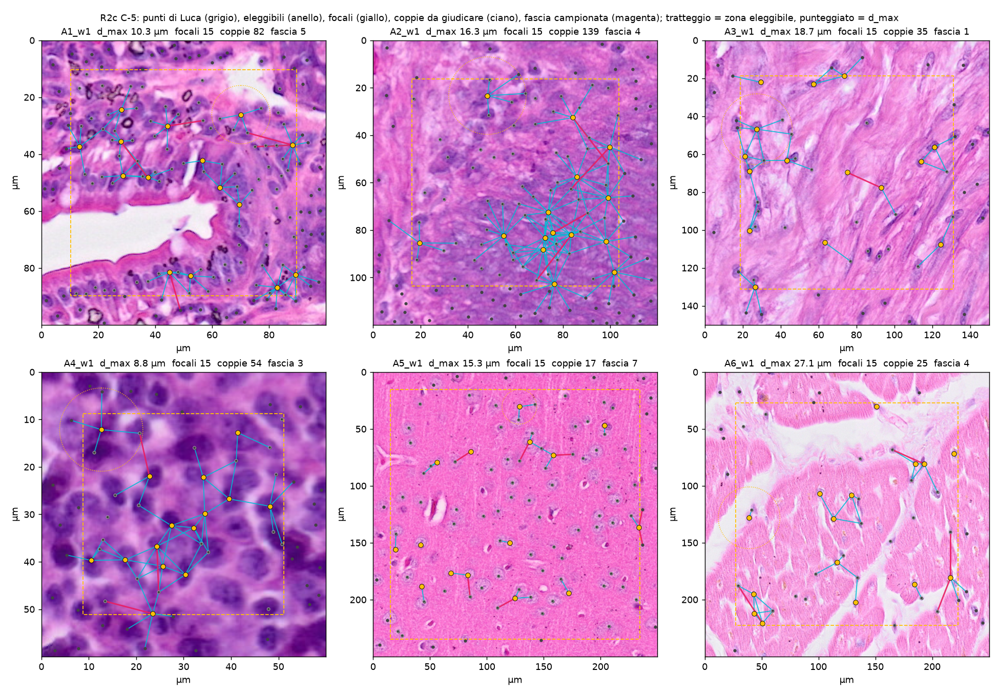
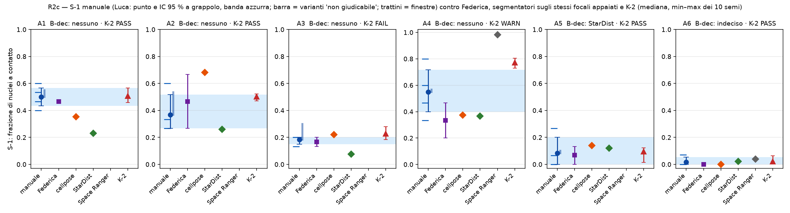
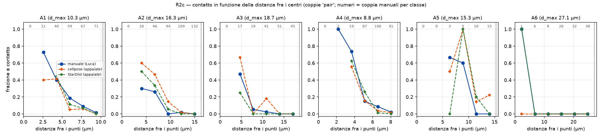

```{r setup}
#| include: false
.libPaths("~/2025.geo_spatialtrans/renv/library/linux-ubuntu-noble/R-4.6/x86_64-pc-linux-gnu")
suppressPackageStartupMessages({library(knitr)})
R <- "../results/R2c/"
rd <- function(f) read.csv(file.path(R, f), check.names = FALSE, na.strings = c("", "NaN"))
f3 <- function(x) ifelse(is.na(x), "–", formatC(x, format = "f", digits = 3))
```

**Obiettivo unico.** Costruire una verità manuale sul contatto fra nuclei sulle 24 finestre di R2b, per decidere per archetipo quale
segmentatore (cellpose_rgb, stardist_he) dà una frazione di nuclei a contatto (S-1) credibile come riferimento, e dove cade K-2 (S1.4c).
Dipendenze: S1.4c chiusa con riserve, finestre e punti R2b presenti — soddisfatte.

# 1. Pre-registrazione

Testo integrale: `results/R2c/R2c_preregistration.md` (commit `1aa0eed`, approvato da Luca il 2026-10-16: «si»), con **addendum
D-1…D-4** (commit `cbd60c2`, approvato da Luca il 2026-10-16: «ok»), scritto dopo il primo run del generatore di candidati e **prima di
qualsiasi annotazione**. D-5 e D-6 (dev notes, commit `ab73391`, `d6fb053`) sono stati trovati dai test prima delle risposte. Il codice
dell'analisi è stato committato in `d6fb053` prima delle risposte ed eseguito senza modifiche (commit dei risultati `c224d0c`).

Disegno scelto da Luca: compito sì/no su coppie proposte (ritaglio ingrandito, due anelli, nessun contorno; «si toccano» / «separati» /
«non giudicabile»); 15 nuclei focali per finestra (60 per archetipo; 59 in A6, una finestra con 14 eleggibili); Federica sulle sue 2
finestre per archetipo di R2b. Ripetute 10 %, trappole 5 %, fascia 15 coppie per archetipo.

| Check | Attesa | Soglia | Fonte |
|---|---|---|---|
| C-1 copertura dei candidati | coppie a contatto dei segmentatori fra punti appaiati coperte | PASS ≥ 0.99, WARN ≥ 0.97 | convenzione |
| C-2 annotatore | ritagli pixel-identici, ordine riproducibile, cecità, test del core JS | tutti PASS | — |
| C-3 operatore | S-1 dei segmentatori = cp2 di S1.4c | identico | S1.4c |
| C-4 mutanti | bootstrap senza reinserimento / non a grappolo / κ marginali scambiate | 3/3 | — |
| C-5 eleggibilità | regole eseguite e ispezionate prima dell'annotatore | eseguito | BL-125a |
| P-1 | S-1 manuale ≥ 0.30 in A1–A4, ≤ 0.15 in A5, A6 | — | P1 di S1.4c (convenzione) |
| P-2 | S-1 manuale fra StarDist e cellpose in ≥ 3 di A1–A4 | — | S1.4c |
| P-3 | sens. cellpose > StarDist, spec. StarDist > cellpose | — | S1.4c |
| B-dec | segmentatore credibile se S-1 nell'IC 95 % manuale; pareggio < 0.02 | — | regola pre-registrata |
| B-K2 | S-1 di K-2 nell'IC manuale (WARN: allargato di \|Luca − Federica\|) | — | regola pre-registrata |
| CP-1 | κ Luca–Federica | ≥ 0.60 PASS, ≥ 0.40 WARN | Landis & Koch 1977, doi:10.2307/2529310 (convenzione) |
| CP-2 | κ intra-annotatore | ≥ 0.70 | convenzione |
| CP-3 | trappole «separati» | ≥ 95 % | convenzione |
| CP-4 | AUC di −d per «si toccano», A1–A4 | ≥ 0.80 | convenzione |
| CP-5 | B-dec con le sole risposte di Federica | stesso esito in ≥ 3/4 di A1–A4 | — |
| D-3 | fascia d_max < d ≤ d_geo: limite sup. Clopper–Pearson 95 % bilaterale di «si toccano» | ≤ 5 % PASS; 1 contatto WARN; ≥ 2 FAIL | addendum |

**Deviazioni dichiarate prima delle risposte.** D-1 candidati senza restrizione di Delaunay (C-1 FAIL in A1/A2 con la regola
pre-registrata, primo run conservato in `results/R2c/prereg_rule/`); D-2 d_max = max(regola pre-registrata, stessa quantità su tutte
le coppie a contatto dei ROI) — in A6 la regola pre-registrata dava 5.09 µm da **una** coppia; D-3 coppie oltre d_max «separate» per
regola, verificate a campione nella fascia (proposta di Luca); D-4 trappole oltre d_geo; D-5 il grep di cecità escludeva a torto la
parola chiave JavaScript `catch (`; D-6 0 contatti con limite > 5 % = «non valutabile» (lacuna della regola trovata dai test).
Correzione di Claude in chat: «0/90 → 3.3 %» era il limite unilaterale, quello bilaterale pre-registrato è 4.0 %.

```{r dmax}
d <- rd("R2c_dmax.csv")
kable(data.frame(archetipo = d$archetype, `coppie manuali a contatto` = d$n_contact_pairs_manual, `d pre-reg (µm)` = f3(d$d_prereg_um),
  `coppie ROI` = d$n_contact_pairs_roi, `d ROI (µm)` = f3(d$d_roi_um), `d_max (µm)` = f3(d$d_max_um), `d_geo (µm)` = f3(d$d_geo_um),
  `lato ritaglio (µm)` = f3(d$crop_um), check.names = FALSE), caption = "d_max (D-2) e limite geometrico della fascia (D-3)")
```

# 2. Check C — correttezza software

Un comando: `bash R/testing/test_R2c.sh` → 9 asserzioni, 0 FAIL (2026-10-16).

| Check | Esito | Valore |
|---|---|---|
| C-1 copertura (regola D-1/D-2) | PASS | 1.000 ovunque tranne A2 cellpose 0.993 (A6 cellpose: 0 coppie, NA); con la regola pre-registrata A1 cellpose 0.970 FAIL, A2 StarDist 0.967 FAIL (`prereg_rule/`) |
| C-2a ritagli = ROI | PASS | 1 475 + 763 immagini, 0 diverse |
| C-2b ritagli = finestra R2b | PASS | 1 475 + 763 confrontate, 0 diverse |
| C-2c marcatori → punti R2b | PASS | errore massimo 1.1e-13 µm |
| C-2d marcatori nel ritaglio | PASS | 1 607/1 607, 834/834 |
| C-2e cecità (grep) | PASS dopo D-5 | 0 parole vietate; 2 `catch (` JavaScript esclusi |
| C-2f immagini e ripetute | PASS | ogni item ha la sua immagine, le ripetute la stessa dell'originale |
| C-2 ordine riproducibile | PASS | md5 di item, coppie e focali identici dopo un nuovo run |
| C-2 core JS | PASS | 13/13 |
| C-3 operatore | PASS | 48/48 ROI × segmentatore, 0 differenze con cp2 di S1.4c |
| C-4 mutanti | PASS | 3/3 (MU1 2 test, MU2 1, MU3 1) |
| C-5 eleggibilità | eseguito | figura sotto; prova a secco su risposte sintetiche (verità piantata recuperata) |
| test dell'analisi | PASS | 24/24 |



# 3. Check B — plausibilità biologica (A1–A6)

```{r answers}
a <- rd("R2c_answers_summary.csv")
kable(data.frame(annotatore = a$rater, tipo = a$kind, n = a$n, `si toccano` = a$touch, separati = a$separate, `non giudicabile` = a$unsure,
  `tempo mediano (s)` = f3(a$t_med_s), check.names = FALSE), caption = "Risposte (complete: Luca 1 607/1 607, Federica 834/834)")
```

```{r s1}
s <- rd("R2c_s1.csv")
kable(data.frame(archetipo = s$archetype, focali = s$n_focal,
  `S-1 manuale [IC 95 %]` = sprintf("%s [%s, %s]", f3(s$s1_primary), f3(s$lo_primary), f3(s$hi_primary)),
  `varianti unsure (sep – touch)` = sprintf("%s – %s", f3(s$s1_unsure_sep), f3(s$s1_unsure_touch)),
  cellpose = sprintf("%s (n %s)", f3(s$seg_cellpose_rgb), s$n_cellpose_rgb), `manuale sugli stessi` = f3(s$manual_on_cellpose_rgb),
  StarDist = sprintf("%s (n %s)", f3(s$seg_stardist_he), s$n_stardist_he), `manuale sugli stessi ` = f3(s$manual_on_stardist_he),
  `Space Ranger` = f3(s$seg_spaceranger), `B-dec` = s$b_dec, `K-2` = f3(s$k2_s1), `allargamento` = f3(s$widen), `B-K2` = s$k2_verdict,
  check.names = FALSE), caption = "S-1 per archetipo (Luca, IC a grappolo per finestra, B = 2000)")
```





```{r senspec}
q <- rd("R2c_sens_spec.csv")
kable(data.frame(archetipo = q$archetype, segmentatore = q$seg, coppie = q$n, `di cui a contatto (manuale)` = q$n_touch,
  sensibilità = f3(q$sens), specificità = f3(q$spec), check.names = FALSE),
  caption = "P-3: coppie con entrambi gli estremi appaiati in entrambi i segmentatori (unsure esclusi)")
```

```{r pred}
pv <- rd("R2c_predictions.csv")
kable(data.frame(previsione = pv$prediction, dettaglio = pv$detail, verdetto = pv$verdict, check.names = FALSE),
  caption = "Previsioni pre-registrate (verdetti scritti dalla pipeline dopo RV-10; P-3: 'non valutabile' se < 3 archetipi con ≥ 10 coppie a contatto, criterio di Claude dichiarato dopo i risultati)")
```

**Lettura (pre-registrata).** B-dec dà «nessuno» in A1–A4: nessun segmentatore ha un S-1 dentro l'IC manuale. In A1 e A4
il giudizio manuale vede **più** contatti di entrambi i segmentatori; in A2 e A3 sta in mezzo (cellpose sopra, StarDist sotto). A5
«StarDist» per 0.0005 sopra la soglia di pareggio (|Δ| 0.056 contro 0.036); A6 «indeciso» (contatti quasi assenti). K-2 dentro
l'IC in A1, A2, A5, A6; FAIL in A3 (0.227 contro [0.150, 0.200]); WARN in A4 (0.773 contro [0.400, 0.717] allargato di 0.133).
P-1 smentita (A3 0.18 < 0.30), P-2 smentita (2/4), P-3 non valutabile (1–12 coppie a contatto fra quelle appaiate in entrambi i
segmentatori; in A4, l'unico informativo, sensibilità uguali e specificità di cellpose maggiore, al contrario della previsione).

Come previsto dalla prova a secco (dev notes), B-dec misura l'S-1 del segmentatore **come riferimento**, recall compresa:
StarDist appaia solo 23–26 dei 60 focali in A1–A3 e i vicini che non vede abbassano il suo S-1.

## Sensibilità post hoc (dopo i risultati e la revisione avversariale; non cambiano i verdetti)

`tools/R2c_posthoc.py` (commit `798c901`). Ogni tabella risponde a un rilievo dei revisori.

```{r ph_ci}
x <- rd("R2c_posthoc_ci.csv")
kable(data.frame(archetipo = x$archetype, IC = x$ci, stima = f3(x$est), lo = f3(x$lo), hi = f3(x$hi), `B-dec` = x$b_dec, `B-K2` = x$k2_verdict, check.names = FALSE),
  caption = "F-1/RV-1: con 4 finestre l'IC percentile a grappolo è limitato da [min, max] delle medie di finestra (l'enumerazione esatta 4^4 lo riproduce); Wilson e due stadi includono la variabilità fra nuclei")
x <- rd("R2c_posthoc_paired.csv")
kable(data.frame(archetipo = x$archetype, segmentatore = x$seg, n = x$n, `S-1 seg` = f3(x$seg_s1), `manuale sugli stessi` = f3(x$manual_same),
  `differenza [IC]` = sprintf("%s [%s, %s]", f3(x$diff), f3(x$lo), f3(x$hi)), `compatibile` = x$compatible, check.names = FALSE),
  caption = "F-3/RV-2: segmentatore − manuale sugli stessi focali appaiati (bootstrap a grappolo)")
x <- rd("R2c_posthoc_lowo.csv")
kable(data.frame(archetipo = x$archetype, `finestra esclusa` = x$left_out, stima = f3(x$est), lo = f3(x$lo), hi = f3(x$hi),
  cellpose = f3(x$cellpose), StarDist = f3(x$stardist), `B-dec` = x$b_dec, check.names = FALSE), caption = "RV-3: lasciando fuori una finestra per volta")
x <- rd("R2c_posthoc_unsure.csv")
kable(data.frame(archetipo = x$archetype, `S-1 (unsure = contatto)` = sprintf("%s [%s, %s]", f3(x$est), f3(x$lo), f3(x$hi)),
  `B-dec` = x$b_dec, `B-dec primaria` = x$b_dec_primary, check.names = FALSE), caption = "RV-4: la primaria coincide con 'unsure = separati' (nessun focale escluso)")
x <- rd("R2c_posthoc_k2.csv")
kable(data.frame(archetipo = x$archetype, `K-2 aggregato` = f3(x$k2_aggregate), `K-2 finestre a peso uguale` = f3(x$k2_equal_windows),
  `semi min–max` = sprintf("%s–%s", f3(x$seed_min), f3(x$seed_max)), `semi nell'IC` = x$seeds_in_ci,
  `verdetto aggregato` = x$verdict_aggregate, `verdetto peso uguale` = x$verdict_equal_windows, check.names = FALSE), caption = "F-2/RV-8: K-2")
x <- rd("R2c_posthoc_partners.csv")
kable(data.frame(archetipo = x$archetype, segmentatore = x$seg, `S-1 (qualunque etichetta)` = f3(x$seg_s1_any_label),
  `S-1 (solo partner di Luca)` = f3(x$seg_s1_luca_partners), `manuale sugli stessi` = f3(x$manual_same), check.names = FALSE),
  caption = "RV-7: definizione asimmetrica del contatto")
```

**Che cosa regge.** (1) A1: S-1 manuale ≈ 0.50 con ogni IC; StarDist sottostima sugli stessi nuclei (−0.23 [−0.37, −0.13]);
B-dec «nessuno» con tutti gli IC e in 4/4 leave-one-window-out. (2) A2: cellpose sovrastima sugli stessi nuclei (+0.36
[0.28, 0.46]: maschere fuse nel tumore, fig. 2); StarDist è compatibile e risulta «credibile» con gli IC Wilson e a due stadi.
(3) A4: K-2 sovrastima (0.77; 0/10 semi nell'IC), verosimilmente per i generatori Space Ranger (n_SR/n_StarDist 1.15–1.40,
BL-121). (4) A5, A6: pochi contatti (≤ 0.10), segmentatori compatibili. **Che cosa è fragile.** A3 (B-dec «cellpose» con IC
onesti; K-2 PASS a finestre di peso uguale; un solo giudizio ribalta K-2), A5 (0.0005 sul pareggio), A4 (dipende dal seme Monte
Carlo nel 3.6 % dei semi, F-4).

# 4. Controprova

```{r cp}
k <- rd("R2c_counterproofs.csv")
kable(data.frame(check = k$check, chi = k$rater, n = k$n, valore = f3(k$value), accordo = f3(k$agree), `limite sup.` = f3(k$upper),
  verdetto = k$verdict, check.names = FALSE), caption = "Controprove e verifica della fascia")
```

```{r cp5}
p <- rd("R2c_cp5.csv"); kable(p, caption = "CP-5: B-dec con le sole risposte di Federica (sue finestre) contro Luca (tutte le finestre)")
f <- rd("R2c_s1_federica.csv")
kable(data.frame(insieme = f$set, archetipo = f$archetype, focali = f$n_focal,
  `S-1 [IC]` = sprintf("%s [%s, %s]", f3(f$s1_primary), f3(f$lo_primary), f3(f$hi_primary)), `B-dec` = f$b_dec, check.names = FALSE),
  caption = "S-1 sulle finestre di Federica: Federica e Luca sugli stessi focali")
```

CP-1 (κ 0.765), CP-2 (Luca 0.810, Federica 1.000), CP-3 (Luca 65/66, «non giudicabile» nel denominatore; Federica 39/39),
CP-4 (AUC 0.83–0.95 in A1–A4) e D-3 (0/90, limite 0.040) sono PASS: la verità manuale esiste e segue la geometria. CP-5 PASS (3/4)
ma poco informativa: con 2 finestre l'IC di Federica è quasi degenere (A1 ampiezza 0; RV-9).

```{r agree}
x <- rd("R2c_posthoc_agreement.csv")
kable(data.frame(ambito = x$scope, n = x$n, `κ 3 categorie` = f3(x$kappa_3cat), `κ 2 categorie` = f3(x$kappa_2cat),
  `touch entrambi` = x$touch_both, `solo Luca` = x$touch_only_Luca, `solo Federica` = x$touch_only_Federica,
  `accordo positivo` = f3(x$pos_agreement), `L sep / F touch` = x$LsepFtouch, `L touch / F sep` = x$LtouchFsep, check.names = FALSE),
  caption = "RV-5/F-9 (post hoc): l'affidabilità sui 'touch' è minore di quanto dica κ a 2 categorie")
```

L'accordo **sui contatti** è moderato: κ a 3 categorie 0.481, accordo positivo 0.667; A2 0.480 (Federica vede più contatti: 8
disaccordi netti «L separati / F si toccano» contro 1 — il revisore F-9 aveva indicato il verso opposto; verificato dal codice).

## CP-6 — riesame delle «separate» veloci (post hoc, regola committata in `798c901` prima del riesame)

```{r cp6}
x <- rd("R2c_cp6.csv")
kable(data.frame(gruppo = x$group, n = x$n, `si toccano` = x$touch, separati = x$separate, `non giudicabile` = x$unsure,
  frazione = f3(x$frac_touch), `tempo mediano (s)` = f3(x$t_med_s), check.names = FALSE),
  caption = sprintf("CP-6: f − c = %s, Fisher unilaterale p = %s → abitudine a 'separati' %s", f3(x$f_minus_c[1]), f3(x$fisher_p_one_sided[1]), x$verdict[1]))
y <- rd("R2c_cp6_s1.csv"); y <- y[y$variant == "primary", ]
kable(data.frame(risposte = y$answers, archetipo = y$archetype, `S-1` = f3(y$s1), `due stadi` = sprintf("[%s, %s]", f3(y$lo_two_stage), f3(y$hi_two_stage)),
  `B-dec (pre-reg)` = y$b_dec_cluster, `B-K2 (pre-reg)` = y$k2_verdict_cluster, check.names = FALSE), caption = "S-1 con le risposte del riesame (sensibilità)")
```

Le risposte veloci reggono quanto le lente (fast 2/64, controlli lenti 1/15). I giudizi «si toccano» si riproducono 12/15: le
incertezze vanno nei due versi, non solo verso il basso. Con il riesame S-1 si sposta di ≤ 0.03 (A3 0.200, A4 0.517, A5 0.100).

# Verdetto

- **Stato: chiusa con riserve.**
- La verità manuale sui contatti esiste (CP-1…CP-4, D-3, CP-6 PASS o non smentita). Per la regola pre-registrata **nessun
  segmentatore è un riferimento credibile per S-1 in A1–A4** → BL-120 risolta: il riferimento è il valore manuale.
- **Decisione di Luca (2026-10-20, ROADMAP §6)**: da S1.4d in poi S-1 si confronta con il valore manuale di Luca per archetipo e
  il suo intervallo del bootstrap a due stadi (B-127…B-132); la variante «non giudicabile = contatto» si riporta ma non decide;
  segmentatori solo descrittivi; S-2/S-3 restano fuori.
- Riserve: (1) 4 finestre e 60 focali per archetipo: margini larghi (A2 0.22–0.57), l'IC pre-registrato era troppo stretto
  (F-1); (2) accordo sui contatti moderato (accordo positivo 0.667; A2 0.480); (3) esiti fragili in A3, A5 (0.0005), A4
  (seme); (4) K-2 sovrastima in A4 (generatori Space Ranger, BL-121) e al limite in A3; (5) P-3 non valutabile; (6) scelte
  d'implementazione dichiarate dopo la revisione (RV-11, dev notes); (7) il confronto di K-2 usa generatori dai segmentatori
  (limite pre-registrato).

# Revisione avversariale

- **Ricalcolo indipendente** (sotto-agente, codice proprio dal solo testo della pre-registrazione, pacchetto
  `R2c_review_bundle.tar.gz`): 170 quantità, **167 identiche** (risposte, κ, AUC, S-1 nelle tre varianti, IC per enumerazione
  esatta, segmentatori su 718 righe focale × segmentatore, K-2 su 240 finestre × seme, B-dec, verdetti, CP-5, P-3); le 3 restanti
  erano i verdetti P-1/P-2/P-3 **non scritti dalla pipeline** (omissione di Claude, RV-10: aggiunti, output preesistenti identici
  al bit, md5 18/18). 12 rilievi (F-1…F-12), nessun bug.
- **Revisione di codice e disegno** (secondo sotto-agente): riproduzione bit a bit di tutti i CSV; 20 mutanti propri (solo 1
  rilevato dai test, 4 cambiano B-dec: test della pipeline deboli, BL-134); 17 rilievi: 1 bug latente (RV-12, non attivo:
  asserzione aggiunta), 1 discrepanza (RV-10), 1 gruppo di scelte non dichiarate (RV-11, ora nelle dev notes), refuso
  dell'addendum («40/40» per 48/48, RV-17, erratum nelle dev notes), rischi interpretativi RV-1…RV-9, RV-13…RV-16.
- **Discrepanze accolte**: RV-10, RV-11, RV-12, RV-17; margine di A5 0.0005 (non 0.001 come scritto da Claude in chat).
  **Respinta con verifica**: verso dei disaccordi in A2 (F-9). **Azioni**: sensibilità post hoc, CP-6 (riesame di Luca).
- Non coperto dai revisori (dichiarato): stadio cp2 e maschere (C-3 verificato dal server), zip/HTML dell'annotatore, test node,
  Space Ranger; analisi post hoc e CP-6 scritte dopo la revisione e non ri-revisionate.

# Riproducibilità

```bash
cd ~/2025.geo_spatialtrans && git checkout <sha di chiusura>
bash R/testing/test_R2c.sh                         # check C (9 asserzioni)
.venv/bin/python tools/R2c_candidates.py           # candidati, focali, item (deterministico, md5 verificato)
.venv/bin/python tools/R2c_annotator.py Luca && .venv/bin/python tools/R2c_annotator.py Federica   # zip in /mnt/micron/geo_spatialtrans/R2c/
.venv/bin/python tools/R2c_refs.py                 # segmentatori sui focali, K-2 nelle finestre
.venv/bin/python tools/R2c_analysis.py             # risposte in results/R2c/annotations/
.venv/bin/python tools/R2c_figures.py && .venv/bin/python tools/R2c_fig_eligibility.py
quarto render reports/R2c.qmd
```
