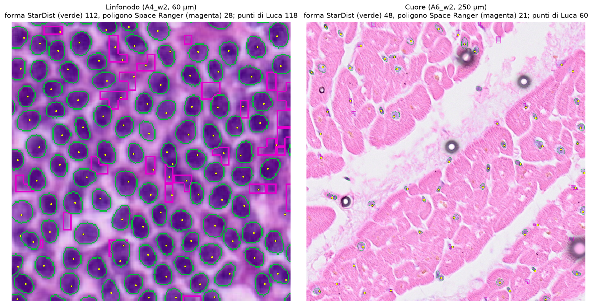

```{r setup}
#| include: false
.libPaths("~/2025.geo_spatialtrans/renv/library/linux-ubuntu-noble/R-4.6/x86_64-pc-linux-gnu")
suppressPackageStartupMessages({ library(ggplot2); library(dplyr); library(knitr) })
theme_set(theme_bw(base_size = 11))
R <- "../results/R3b"; rd <- function(f) read.csv(file.path(R, f))
f3 <- function(x) formatC(x, digits = 3, format = "f")
TN <- c(A4 = "linfonodo", A6 = "cuore")
```



# Decisioni e verifiche di Luca



# Dubbi rinviati



# Cancelli

Pre-registrazione: commit `48573f5` (cancelli e regola), ok di Luca sulle previsioni `ea1e22a` (2026-10-20, «Approvo così»).

| id | controllo | esito | dove |
|---|---|---|---|
| G-1 | batteria di test del costruttore della maschera CO | 26/26 PASS | `bash R/testing/run_R3b.sh test` |
| G-2 | mutanti M1-M5 del costruttore | 5/5 rilevati | `bash R/testing/run_R3b.sh mutants` |
| G-3 | regressione della catena con StarDist e del codice di P-1, P-2 | vedi tabella | `results/R3b/R3b_G3_*.csv` |
| G-4 | invarianti della maschera CO, del nucleo simulato, md5 | vedi tabella | `results/R3b/R3b_gates.csv`, `/mnt/micron/geo_spatialtrans/R3b/check/` |
| G-5 | ricalcolo indipendente | vedi «Revisione avversariale» | |

```{r gates}
kable(rd("R3b_gates.csv"), caption = "Cancelli G-3 e G-4 dal file di analisi")
g3 <- rbind(rd("R3b_G3_p1p2.csv")[, c("check", "equal")], rd("R3b_G3_windows.csv")[, c("check", "equal")])
kable(g3, caption = "G-3, parte Python: con Space Ranger e StarDist il codice di R3b riproduce R2b, R2c e S1.4d")
kable(rd("R3b_G3_R.csv"), caption = "G-3, parte R: generatori, celle e momenti di R3, territori e cellule di S1.4, M2 e nuclei simulati di S1.4d (StarDist)")
kable(rd("R3b_G3_phi_sr.csv"), digits = 4, caption = "G-3: il tetto ricalcolato su Space Ranger ridà B-124 (0.816, n = 99 600) e B-126 (0.180, n = 2 221)")
```

# Previsioni

Esito: stima ± 2 errori standard (P-2: intervallo bootstrap a due stadi) tutta dentro l'intervallo di rilevanza = confermata, tutta fuori = smentita, a cavallo = indeterminata. CO = «nuclei di Space Ranger con la forma di StarDist»; SD = solo StarDist; SR = solo Space Ranger (riferimento).

```{r preds}
p <- rd("R3b_predictions.csv")
p$tessuto <- TN[p$archetype]
kable(transmute(p, id, tessuto, maschera = mask, stima = f3(est), `± 2 SE / IC` = sprintf("%s-%s", f3(lo), f3(hi)),
                intervallo = sprintf("%s-%s", f3(int_lo), f3(int_hi)), unita = unit, esito = verdict),
      caption = "Previsioni pre-registrate e controprova (results/R3b/R3b_predictions.csv)")
kable(rd("R3b_decision.csv"), caption = "Regola di decisione (results/R3b/R3b_decision.csv)")
```

```{r fig-contacts, fig.width = 9, fig.height = 4}
ph <- rd("R3b_posthoc_sdarea_windows.csv") |> group_by(archetype, seed) |> summarise(s1 = mean(s1), .groups = "drop") |>
  group_by(archetype) |> summarise(est = mean(s1), se = sd(s1) / sqrt(n())) |> mutate(id = "post hoc", mask = "CO, taglia solo StarDist", lo = pmax(0, est - 2 * se), hi = est + 2 * se)
d <- bind_rows(p |> filter(id %in% c("P-2", "P-3", "CP-1")) |> select(id, archetype, mask, est, lo, hi), ph |> select(id, archetype, mask, est, lo, hi))
d$lab <- paste(d$id, d$mask); d$tessuto <- TN[d$archetype]
ci <- read.csv("../results/R2c/R2c_posthoc_ci.csv") |> filter(ci == "due stadi", archetype %in% c("A4", "A6")) |> mutate(tessuto = TN[archetype])
ggplot(d, aes(est, lab)) + geom_rect(data = ci, aes(xmin = lo, xmax = hi, ymin = -Inf, ymax = Inf), inherit.aes = FALSE, fill = "grey85") +
  geom_vline(data = ci, aes(xintercept = est), linetype = 2) + geom_pointrange(aes(xmin = lo, xmax = hi)) +
  facet_wrap(~tessuto, scales = "free_x") + labs(x = "frazione di nuclei a contatto", y = NULL)
```

Cosa guardare: in grigio il margine del conteggio manuale di Luca, tratteggiato il suo valore. Nel linfonodo tutte le versioni simulate stanno nella parte alta del margine, anche con i suoi punti come centri (CP-1).

# Controprova

CP-1 (punti di Luca come centri nelle finestre, centri CO altrove): linfonodo `r f3(p$est[p$id == "CP-1" & p$archetype == "A4"])`, cuore `r f3(p$est[p$id == "CP-1" & p$archetype == "A6"])`, entrambe confermate. Con i centri veri il nucleo simulato dà nel linfonodo quasi gli stessi contatti che con i centri CO: l'eccesso rispetto a 0.55 non dipende dai centri, e lo 0.41 di StarDist viene dai nuclei che StarDist non vede (23 % in meno dei punti di Luca).

```{r cp1}
kable(rd("R3b_cp1_inputs.csv"), caption = "CP-1: centri usati per finestra (CO tenuti fuori dalla finestra, CO tolti dentro, punti di Luca)")
```

# Analisi post hoc (scritte dopo i verdetti; non li cambiano)

## Da dove vengono i contatti della maschera CO nel linfonodo (P-2 = 0.75)

```{r ph1}
kable(rd("R3b_posthoc_agreement.csv"), digits = 3, caption = "Stessi nuclei focali: giudizio di Luca contro contatto nella maschera")
pt <- rd("R3b_posthoc_partners.csv")
kable(pt |> group_by(archetype) |> summarise(n = n(), focali_forma_SR = sum(focal_src == "sr"), contatto = mean(contact),
      con_poligono_SR = mean(any_sr_partner), solo_fra_StarDist = mean(contact_sd_sd)), digits = 3,
      caption = "Focali appaiati alla CO: contatti attraverso un poligono Space Ranger e fra soli nuclei di forma StarDist")
```

## Quanti poligoni Space Ranger rimasti sono nuclei veri

```{r ph4}
s <- rd("R3b_posthoc_srprec.csv") |> group_by(archetype, src) |> summarise(contati = sum(n_counted), appaiati_a_un_punto = sum(n_matched_to_point), .groups = "drop") |>
  mutate(precisione = appaiati_a_un_punto / contati)
kable(s, digits = 3, caption = "Nelle 8 finestre: oggetti CO contati e appaiati a un punto di Luca, per forma")
```



Cosa guardare: nel linfonodo una parte dei poligoni magenta cade fra i nuclei, senza un punto di Luca (falsi positivi); un'altra copre nuclei pallidi che StarDist non ha visto.

## Aree dei nuclei di forma Space Ranger e modello di taglia

```{r ph2}
kable(rd("R3b_posthoc_area.csv"), digits = 3, caption = "Modello di taglia M2 e tetto stimati su tutti i nuclei CO o sui soli nuclei di forma StarDist")
lo <- rd("R3b_posthoc_sdarea_loo.csv"); kable(lo, digits = 4, caption = "Variante «taglia solo StarDist»: M2 per fold e phi")
```

## Riferimenti di linfonodo e cuore ricalcolati

Il codice di R3 e S1.4 sulle uscite originali (Space Ranger) ridà le righe di BIO_REFERENCES (colonna `old_recomputed` contro `bio_value`).

```{r refs}
kable(rd("R3b_refs.csv"), digits = 4, caption = "Riferimenti: valore attuale, ricalcolato, maschera CO, CO con taglia dai soli nuclei di forma StarDist")
```

# Revisione avversariale



# Cosa è girato

Commit dei risultati prima della revisione `fdac76a`. Script: `tools/run_R3b.sh` (catena completa, rilanciabile), test `R/testing/run_R3b.sh`. Semi del nucleo simulato `seed_fold + 100000 · s` (s = 1…10, `seed_fold = 20261015 + 1000 · i_tessuto + 10 · k`), appaiati a S1.4d; bootstrap di P-2 B = 2000, seme 20261021. Calcolo su lesexp-server, 4-6 worker a un thread (server condiviso con MMM S6b, Tctl 82-91 °C). Durata: maschera CO e G-4 circa 3 minuti; catena R3, S1.4, S1.4d circa 13 minuti; CP-1, raster e finestre circa 10 minuti; post hoc circa 15 minuti. md5 dei 343 file letti uguali prima e dopo (`/mnt/micron/geo_spatialtrans/R3b/md5_{before,after}.txt`; nota D-1 sul momento dell'istantanea).

# Appendice

```{r app}
kable(rd("R3b_p1p2_summary.csv"), digits = 4, caption = "P-1 e P-2 per maschera")
kable(rd("R3b_phi.csv"), digits = 4, caption = "Tetto phi (q99 del rapporto nucleo/territorio) per maschera")
kable(rd("R3b_p1_windows.csv")[, c("win_id", "method", "n_manual", "n_obj", "tp", "recall", "precision", "ratio")], digits = 3, caption = "P-1 per finestra")
```


