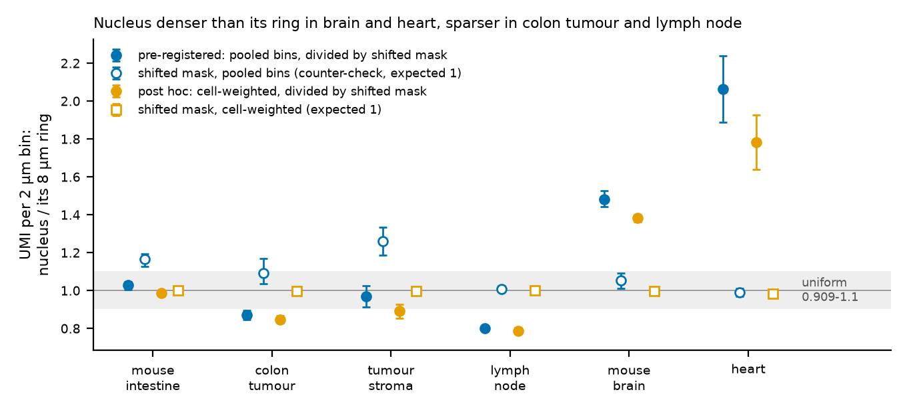
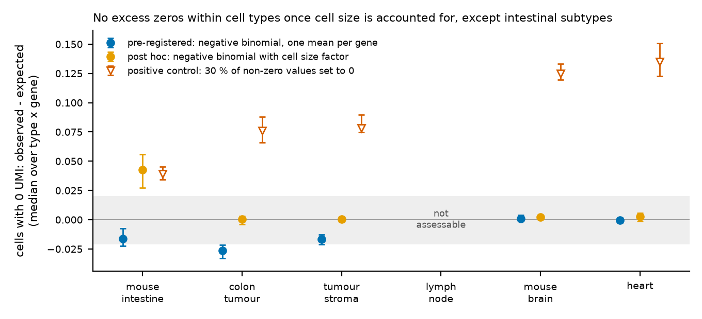
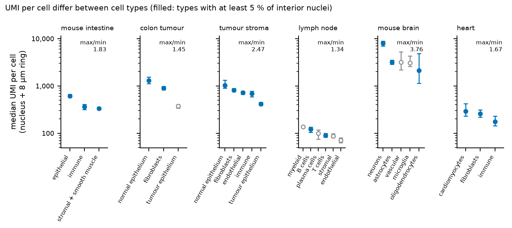
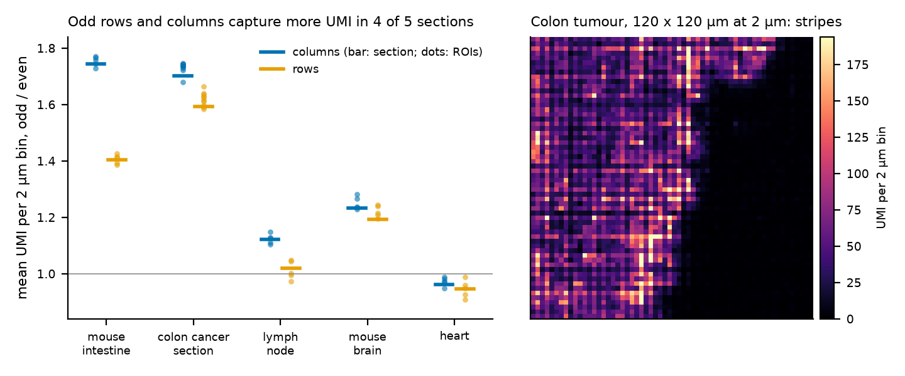
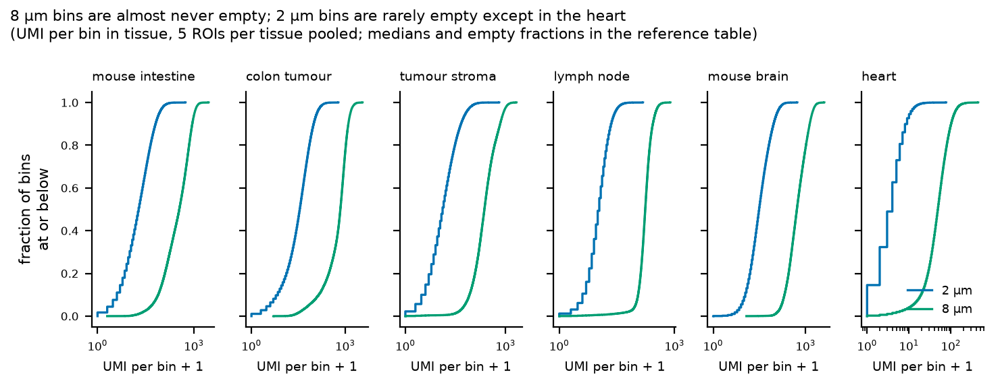

```{r setup}
#| include: false
.libPaths("~/2025.geo_spatialtrans/renv/library/linux-ubuntu-noble/R-4.6/x86_64-pc-linux-gnu")
suppressPackageStartupMessages({ library(knitr) })
R <- "../results/R4"; rd <- function(f) read.csv(file.path(R, f), stringsAsFactors = FALSE, check.names = FALSE)
TIS <- c(A1 = "intestino di topo", A2 = "tumore del colon", A3 = "stroma del tumore", A4 = "linfonodo", A5 = "cervello di topo", A6 = "cuore")
f3 <- function(x) ifelse(is.na(x), "—", formatC(x, digits = 3, format = "f")); f4 <- function(x) ifelse(is.na(x), "—", formatC(x, digits = 4, format = "f"))
P <- rd("R4_predictions.csv"); P$tessuto <- TIS[P$archetype]
```



# Decisioni e verifiche di Luca



# Dubbi rinviati



# Cancelli

Pre-registrazione: commit `ff04e8f` (cancelli e previsioni), ok di Luca il 2026-10-30 («Approvo tutte e quattro»), commit `e0c2341`. Primo calcolo `9c111a8`; correzioni della revisione e calcolo completo rifatto due volte `fee01a1`.

```{r gates}
g2 <- readLines(file.path(R, "R4_G2.txt")); g3 <- readLines(file.path(R, "R4_G3_check.txt")); g4 <- readLines(file.path(R, "R4_G4.txt"))
t1 <- readLines(file.path(R, "R4_test_output.txt"))
kable(data.frame(
  id = c("G-1", "G-2", "G-3", "G-4", "G-5"),
  controllo = c("batteria di test su dati sintetici e mutanti (`tools/R4_test.py`)",
                "md5 di ogni file reale letto, prima e dopo (`tools/R4_md5.sh`)",
                "lettura dei dati: medie per bin = riassunti 10x; 8 µm = somma dei 16 bin a 2 µm; impronte = R6 (`tools/R4_check.py`)",
                "riproducibilità: seconda esecuzione completa (stadi, analisi, post hoc) in un'altra cartella (`tools/R4_repro.sh`)",
                "revisione avversariale: ricalcolo indipendente dei numeri chiave"),
  esito = c(tail(t1, 1), tail(g2, 1), tail(g3, 1), tail(g4, 1), "vedi «Revisione avversariale»")), caption = "Cancelli")
```

# Previsioni per tessuto

Intervalli: bootstrap per blocchi sulle 5 ROI per tessuto (a due stadi, ROI e cellule, per le quantità per cellula), B = 2000, seme 20261030; si riporta il 2.5-97.5 % del bootstrap. P-1 e P-4: intervallo atteso nelle colonne «da», «a»; la regola R-1 dice se la densità è uniforme, R-3 se serve un valore per tipo.

```{r pred}
Q <- P[P$id %in% c("P-1", "P-2", "P-3", "P-4"), ]
Q <- Q[order(Q$id, Q$archetype), ]
kable(data.frame(id = Q$id, tessuto = Q$tessuto, stima = f4(Q$estimate), lo = f4(Q$lo), hi = f4(Q$hi), da = Q$range_lo, a = Q$range_hi,
                 esito = Q$verdict, regola = ifelse(Q$id == "P-1", Q$rule_R1, ifelse(Q$id == "P-4", Q$rule_R3, "")),
                 note = ifelse(Q$id == "P-2", paste0(Q$n_genes, " geni"), ifelse(Q$id == "P-3", paste0("massimo ", Q$max_cell_umi, " UMI"), ifelse(Q$id == "P-4", Q$types, ""))),
                 check.names = FALSE), row.names = FALSE, caption = "Previsioni come scritte (P-4 con la quota dei nuclei come pre-registrato, dopo la correzione RV-1)")
```

Una riga per esito: P-1 confermata in 4 tessuti, smentita nel tumore del colon e nel linfonodo nella direzione opposta all'attesa; P-2 confermata in 2, indeterminata in 2, smentita in 1 (zeri in difetto, non in eccesso), non valutabile nel linfonodo; P-3 confermata in 6; P-4 confermata nei 2 tessuti con un'attesa, sopra 1.25 in altri 2, a cavallo in 2.

# Controprove

```{r cp}
Q <- P[P$id %in% c("CP-1", "CP-2"), ]; Q <- Q[order(Q$id, Q$archetype), ]
kable(data.frame(id = Q$id, tessuto = Q$tessuto, stima = f4(Q$estimate), lo = f4(Q$lo), hi = f4(Q$hi), esito = Q$verdict), row.names = FALSE,
      caption = "CP-1: rapporto nucleo/corona con la maschera spostata di 20 µm, atteso in [0.95, 1.05]. CP-2: zeri in eccesso con il 30 % dei valori non nulli azzerati, atteso sopra 0.02")
```

CP-1 non è superata in intestino, tumore, stroma e cervello: il rapporto sui bin raggruppati contiene un effetto di compartimento (le zone fitte di nuclei sono ricche di trascritti anche a 20 µm). Il rapporto pesato per cellula (sotto) ha il nullo a 0.98-1.00 e dà le stesse direzioni: è il riferimento ([DEC-034](../docs/decisions/DEC-034.md)). CP-2 è superata in tutti i tessuti valutabili.



*Cosa guardare*: i punti pieni arancio (pesati per cellula) stanno dalla stessa parte della banda grigia dei punti pieni blu (pre-registrati) in ogni tessuto, e i quadrati vuoti arancio (nullo pesato per cellula) stanno tutti su 1, a differenza dei cerchi vuoti blu.



*Cosa guardare*: con il fattore di taglia (arancio) gli zeri in eccesso tornano a 0 in quattro tessuti; resta l'intestino (sottotipi); il controllo con dropout (triangoli) è sempre sopra la banda.





*Cosa guardare*: in quattro sezioni su cinque le colonne e le righe dispari raccolgono più trascritti; le ROI (punti) concordano con la sezione (barre); a destra le strisce verticali nei conteggi a 2 µm.



# Analisi post hoc

```{r ph1}
H <- rd("R4_PH1.csv"); H <- H[H$quantity %in% c("cellweighted_star", "cellweighted_shift", "median_cell_ratio_star", "median_cell_ratio_shift"), ]
kable(data.frame(tessuto = TIS[H$archetype], misura = H$quantity, stima = f3(H$estimate), lo = f3(H$lo), hi = f3(H$hi), `rispetto a 0.909-1.1` = H$`class_vs_0.909_1.1`, check.names = FALSE),
      row.names = FALSE, caption = "PH-1: rapporto nucleo/corona pesato per cellula e mediana dei rapporti per cellula, divisi per la maschera spostata; bootstrap sulle ROI")
H2 <- rd("R4_PH2.csv")
kable(data.frame(tessuto = TIS[H2$archetype], dati = H2$kind, modello = H2$model, geni = H2$n_genes, stima = f4(H2$estimate), lo = f4(H2$lo), hi = f4(H2$hi),
                 `classe (bootstrap sulle ROI)` = H2$`class_vs_pm0.02_roi_bootstrap`, check.names = FALSE), row.names = FALSE,
      caption = "PH-2 e PH-3: zeri in eccesso con fattore di taglia per cellula e con soglia 0.5 UMI per cellula, stessi geni e stesso dropout di P-2/CP-2 (obs = dati veri, drop = con dropout del 30 %). Classi non confrontabili con i verdetti di P-2")
A1g <- rd("R4_PH2_A1_genes.csv")
kable(head(A1g, 12), digits = 3, caption = "Intestino: geni con più zeri in eccesso sotto il modello con fattore di taglia (media sulle ROI)")
S <- rd("R4_sensitivity.csv")
kable(data.frame(tessuto = TIS[S$archetype], sensibilità = S$sensitivity, stima = f3(S$estimate), lo = f3(S$lo), hi = f3(S$hi), `come P-1` = S$verdict_as_P1,
                 `regola` = ifelse(is.na(S$rule_R3) | S$rule_R3 == "", S$rule_R1, S$rule_R3), check.names = FALSE), row.names = FALSE,
      caption = "Sensibilità: S-1 corona 4 µm, S-2 senza i bin entro 2 µm dal bordo del nucleo, S-3 solo nuclei di forma StarDist, S-4 senza i bin entro 8 µm dal bordo della ROI, intervalli ± 2 e ± t(4) errori standard, P-4 con la quota fra le cellule tipizzate")
```



# Cosa è girato

Server lesexp-server, `.venv` del progetto (Python 3.12, numpy, scipy, pandas, h5py). Stadi: `tools/R4_roi.py` (5 processi, uno per sezione), `tools/R4_section.py` (5), `tools/R4_posthoc.py roi` (5), `tools/R4_analysis.py`, `tools/R4_posthoc.py summary`; tutto con `tools/R4_run.sh`. Uscite: `/mnt/micron/geo_spatialtrans/R4/run1` (e `run2` per G-4; `run1_prereview` e `run2_prereview` = calcolo prima delle correzioni). Seme 20261030 (per ROI: [20261030, indice della ROI, 1|2]); B = 2000. Durata: stadio per ROI 3-8 minuti per sezione, analisi circa 2 minuti, calcolo completo circa 10 minuti con 10 processi. Figure: `tools/R4_figures.py`. Righe di BIO_REFERENCES: `tools/R4_bio_rows.py`.

# Appendice

```{r app}
Rf <- rd("R4_refs.csv"); Rf$tessuto <- TIS[Rf$archetype]
kable(data.frame(tessuto = Rf$tessuto, quantità = Rf$quantity, stima = signif(Rf$estimate, 4), lo = signif(Rf$lo, 4), hi = signif(Rf$hi, 4)), row.names = FALSE,
      caption = "Riferimenti descrittivi D-1...D-3 (media delle ROI o mediana per cellula)")
Ty <- rd("R4_types.csv")
kable(data.frame(tessuto = TIS[Ty$archetype], tipo = Ty$cell_type, quota = f3(Ty$share), cellule = Ty$n_cells, `nel confronto` = Ty$in_P4, `UMI per cellula` = Ty$median_umi_cell,
                 lo = Ty$lo, hi = Ty$hi, `UMI per bin` = f3(Ty$median_umi_per_bin), check.names = FALSE), row.names = FALSE, caption = "UMI per cellula per tipo (cellule interne)")
kable(rd("R4_D4.csv"), digits = 3, caption = "D-4: media delle ROI contro media della sezione intera")
D5 <- rd("R4_D5.csv")
kable(D5[, intersect(c("dataset", "where", "ratio", "present", "fy", "fx", "offaxis_ratio", "offaxis_present", "n_tiles"), names(D5))], digits = 3,
      caption = "D-5: picco spettrale più alto (compresa la frequenza di Nyquist) e picco fuori dagli assi; presente se oltre 10 volte la mediana della corona")
kable(rd("R4_PH4_parity.csv")[, c("unit", "dataset", "col_odd_over_even", "row_odd_over_even", "mean_umi_per_bin")], digits = 4, caption = "PH-4: alternanza per parità")
kable(t(rd("R4_D6_old_vs_real.csv")), caption = "D-6: vecchia pipeline contro vero")
```

## Da dove vengono i numeri del riassunto

| frase | file e riga | valore letto |
|---|---|---|
| trascritti per cellula 83, 273, 510, 800, 1 125, 6 700 | R4_refs.csv, cell_umi_median | 83.0, 273.0, 510.0, 797.5, 1125.0, 6742.0 |
| da 7 a 100 volte meno di 8 000 | come sopra | 8000/1125 = 7.1; 8000/83 = 96 |
| variano circa tre volte di più | R4_refs.csv, cell_umi_cv; full_test.R | 0.579-0.760 contro 0.22 |
| nessuna cellula oltre 50 000; la più ricca 28 000 | R4_predictions.csv, P-3 | 0 in 6 tessuti; max_cell_umi A5 28126 |
| aree di riferimento 2.4 volte (linfonodo), 0.6 volte (stroma) la media della sezione | R4_D4.csv, square_002um | 2.391; 0.593 |
| zeri ≈ 0 con fattore di taglia in tumore, stroma, cervello, cuore; intestino in più | R4_PH2.csv, obs, NB with cell size factor, mean >= 2 | 0.0006, 0.0003, 0.0021, 0.0026; intestino 0.0425 |
| sottotipi nell'intestino | R4_PH2_A1_genes.csv | Anpep, Apoa1, Krt19, Defa21, Fabp6, Igkc, Igha, Lyz1, Jchain, Reg3b |
| linfonodo troppo pochi trascritti | R4_predictions.csv P-2 A4; R4_PH2.csv | 3 geni; con soglia 0.5 il dropout di controllo non è valutabile (7 geni) |
| dropout del 30 % sempre visto | R4_predictions.csv, CP-2 | superata in 5 tessuti valutabili |
| nucleo +40 % cervello, quasi +80 % cuore, -15 % tumore, un quinto in meno linfonodo | R4_PH1.csv, cellweighted_star | 1.383, 1.784, 0.847, 0.788 |
| intestino uniforme; stroma a cavallo di un decimo | R4_PH1.csv cellweighted_star; R4_predictions.csv P-1 | 0.986 [0.975, 0.997]; stroma 0.892 [0.854, 0.928], pre-registrato 0.969 confermata |
| neuroni quasi 4 volte gli oligodendrociti | R4_types.csv; R4_predictions.csv P-4 A5 | 8039.5 / 2137.5 = 3.76 |
| oltre un quarto in intestino, stroma, cuore | R4_predictions.csv P-4 | 1.83 [1.78, 1.91]; 2.47 [2.19, 3.15]; 1.67 [1.51, 2.01] |
| a cavallo in tumore del colon e linfonodo | R4_predictions.csv P-4 | 1.449 [1.219, 1.676]; 1.344 [1.214, 1.455] |
| colonne dispari 1.7 (intestino, tumore), 1.2 (cervello), 1.1 (linfonodo), cuore rovesciato | R4_PH4_parity.csv, section, col_odd_over_even | 1.744, 1.702, 1.233, 1.122, 0.962 |
| nessun reticolo diagonale | R4_D5.csv, offaxis_present | assente nelle 5 sezioni (sfondo e tessuto); 1 ROI su 25 valutabili (A2_r2, 4 tessere) |
| 373 contro 1 298; 4.7 % dei nuclei | R4_types.csv, A2 | 373.0, 1298.0; quota 0.047 |
| circa tre volte i trascritti veri | R4_refs.csv A2 cell_umi_median / R4_types.csv | 1125 / 373 = 3.0 |
| nel cuore il rapporto passa da 2 a 4 | R4_predictions.csv P-1 A6; R4_sensitivity.csv S-2 A6 | 2.064; 3.929 |
