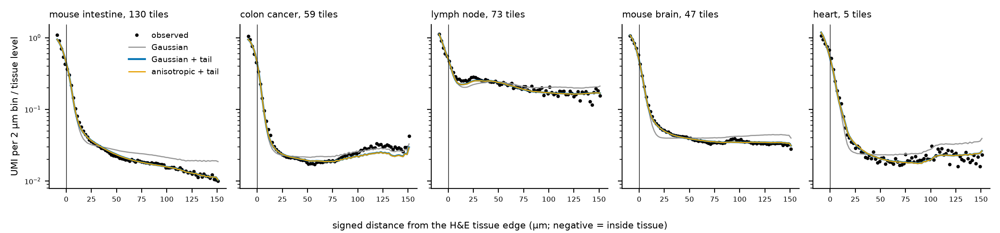
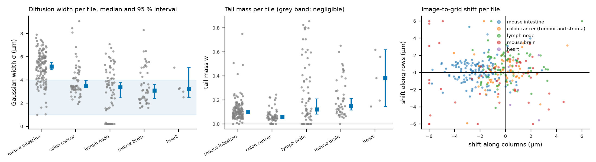
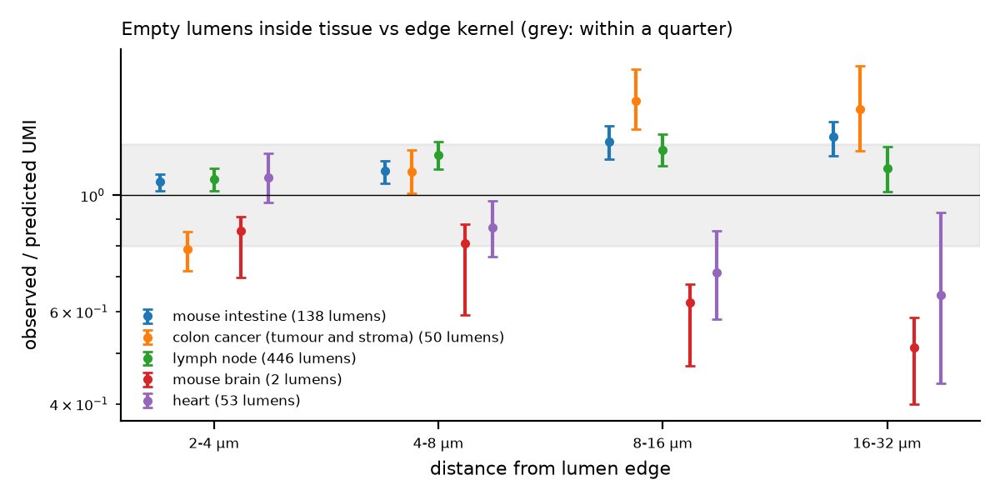
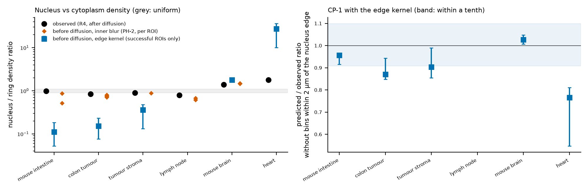
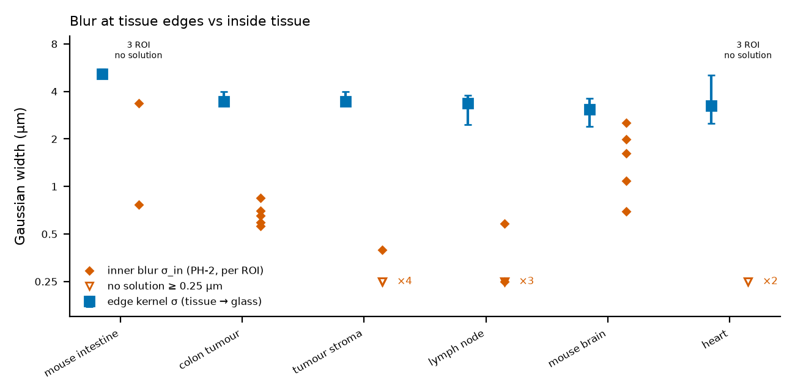

```{r setup}
#| include: false
.libPaths("~/2025.geo_spatialtrans/renv/library/linux-ubuntu-noble/R-4.6/x86_64-pc-linux-gnu")
suppressPackageStartupMessages({ library(knitr) })
R <- "../results/R5"; rd <- function(f) read.csv(file.path(R, f), stringsAsFactors = FALSE, check.names = FALSE)
SEC <- c(A1 = "intestino di topo", A23 = "tumore del colon (e stroma)", A4 = "linfonodo", A5 = "cervello di topo", A6 = "cuore", all = "tutte")
TIS <- c(A1 = "intestino di topo", A2 = "tumore del colon", A3 = "stroma del tumore", A4 = "linfonodo", A5 = "cervello di topo", A6 = "cuore")
f3 <- function(x) ifelse(is.na(x), "—", formatC(x, digits = 3, format = "f"))
```



# Decisioni e verifiche di Luca



# Dubbi rinviati



# Cancelli

```{r gates}
lt <- function(f) { p <- file.path(R, f); if (file.exists(p)) tail(readLines(p), 1) else "—" }
kable(data.frame(
  id = c("G-1", "G-2", "G-3", "G-4", "G-5"),
  controllo = c("batteria di test su dati sintetici e mutanti (`tools/R5_test.py`)",
                "md5 di ogni file letto, prima e dopo (`tools/R5_md5.sh`)",
                "lettura dei dati (`tools/R5_check.py`)",
                "riproducibilità: due esecuzioni complete con il post hoc (`tools/R5_chain2.sh`, `tools/R5_repro2.sh`)",
                "revisione avversariale (codice e numeri)"),
  esito = c(lt("R5_test_output.txt"), lt("R5_G2.txt"), lt("R5_G3.txt"), lt("R5_G4.txt"), "vedi «Revisione avversariale»")), caption = "Cancelli")
```

# Nucleo di diffusione dai bordi del tessuto (P-1...P-4)

```{r edges}
P <- rd("R5_predictions_edges.csv")
kable(data.frame(sezione = SEC[P$key], id = P$prediction, quantità = P$quantity, stima = f3(P$estimate), lo = f3(P$lo), hi = f3(P$hi),
                 intervallo = P$interval, esito = P$verdict, tessere = P$n_tiles, check.names = FALSE), row.names = FALSE,
      caption = "Previsioni sui bordi: mediana delle tessere, bootstrap per blocchi sulle tessere (B = 2000)")
K <- rd("R5_kernel_descriptive.csv")
kable(K, digits = 3, caption = "D-2, D-3, D-4: fondo, coda, spostamento medio, frazione oltre 2...32 µm, variabilità dello scarto fra tessere")
S <- rd("R5_sensitivity_edges.csv")
kable(S[, intersect(names(S), c("key", "variant", "n_tiles", "sigma", "w", "ell", "dr", "dc", "abs_delta", "ratio_K3"))], digits = 3, caption = "Sensibilità")
```



*Cosa guardare*: i conteggi (punti) scendono dal tessuto al vetro in 3-5 µm e poi restano sopra il fondo per decine di µm (coda); la sola gaussiana (K1) non segue la coda.



# Lumi (CP-2) e spostamento della maschera (CP-3)

```{r cp}
kable(rd("R5_CP2_lumens.csv"), digits = 3, caption = "CP-2: UMI osservati/previsti nei lumi interni per fascia di distanza dal bordo")
kable(rd("R5_CP3.csv"), digits = 3, caption = "CP-3: variazione dello scarto stimato con la maschera spostata di (+2, −2) µm")
kable(rd("R5_PH1_cp3_synth.csv"), digits = 3, caption = "PH-1: la stessa prova su tessere sintetiche")
```



# Rapporto nucleo/citoplasma prima della diffusione (P-5, CP-1)

```{r nc}
N <- rd("R5_predictions_nc.csv")
kable(data.frame(tessuto = TIS[N$archetype], id = N$prediction, variante = N$variant, stima = f3(N$estimate), lo = f3(N$lo), hi = f3(N$hi),
                 esito = N$verdict, `ROI fallite` = N$n_roi_failed, check.names = FALSE), row.names = FALSE,
      caption = "P-5 e CP-1 con il nucleo dei bordi: come scritti e con le sole ROI riuscite (sensibilità dichiarata)")
kable(rd("R5_PH3_reach.csv"), digits = 3, caption = "PH-3: intervallo della statistica raggiungibile con il nucleo dei bordi per r da 0.05 a 50")
```



*Cosa guardare*: i rombi arancio (sfocatura interna di PH-2) stanno vicino ai punti neri osservati, un po' più lontano da 1; i quadrati blu (nucleo dei bordi) sono lontanissimi tranne nel cervello.

# Sfocatura dentro il tessuto (post hoc)

```{r ph2}
kable(rd("R5_PH2_inner_summary.csv"), digits = 3, caption = "PH-2: sfocatura interna σ_in* per ROI (gaussiana sola, scarto della sezione)")
kable(rd("R5_PH2_synth.csv"), digits = 3, caption = "PH-2s: controprova sintetica")
kable(rd("R5_PH2_inner_summary_ph2_tail.csv"), digits = 3, caption = "PH-2 con la coda della sezione")
kable(rd("R5_PH2_inner_summary_ph2_d0.csv"), digits = 3, caption = "PH-2 con scarto 0 (intestino, cuore)")
kable(rd("R5_PH5_narrowcore.csv"), digits = 3, caption = "PH-5: bordi con la parte gaussiana fissata a 0.7 µm")
kable(rd("R5_PH4_r4shift_summary.csv"), digits = 4, caption = "PH-4 (regola R-4): rapporto di R4 con le maschere spostate dello scarto della sezione")
```



*Cosa guardare*: i quadrati blu (bordi) stanno a 3-5 µm in tutte le sezioni; i rombi arancio (dentro il tessuto) stanno sotto 1 µm nel tumore, nello stroma e nel linfonodo, fra 0.7 e 2.5 µm nel cervello.



# Cosa è girato

Server lesexp (stessa macchina dei due nomi), `.venv` del progetto. Primo calcolo `/mnt/micron/geo_spatialtrans/R5/run1` (e `run2`), prima della revisione numerica; calcolo finale `run3` e `run4` (G-4) con l'ottimizzatore corretto, ciascuno con `tools/R5_run.sh` e `tools/R5_posthoc.sh`. Seme 20261031, B = 2000. Processi limitati dalla temperatura della CPU (protezione `tools/R5_thermal_guard.sh`).
