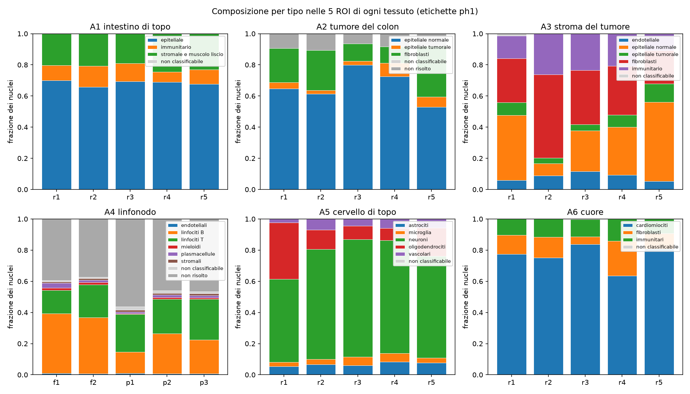
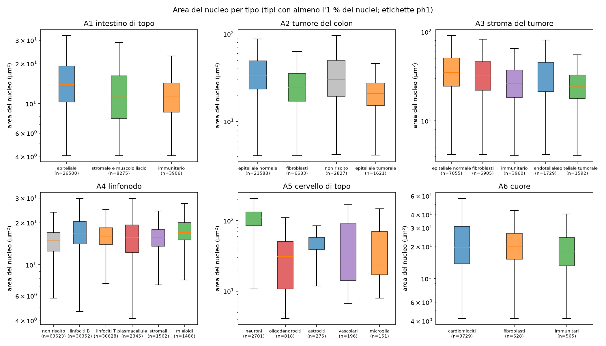
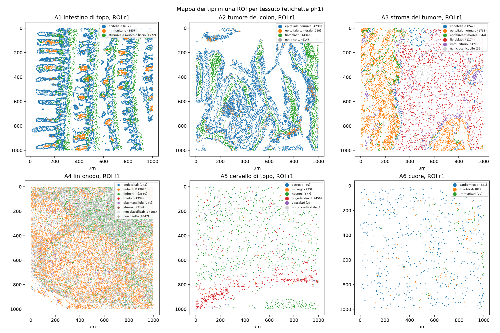
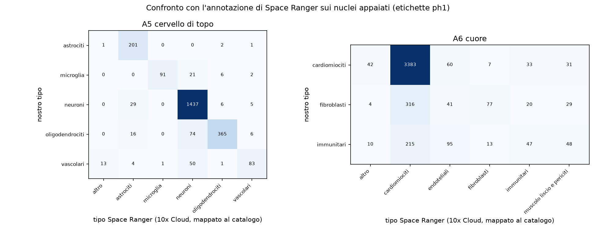

```{r setup}
#| include: false
.libPaths("~/2025.geo_spatialtrans/renv/library/linux-ubuntu-noble/R-4.6/x86_64-pc-linux-gnu")
suppressPackageStartupMessages({ library(knitr) })
R <- "../results/R6"; rd <- function(f) read.csv(file.path(R, f), stringsAsFactors = FALSE, check.names = FALSE)
TIS <- c(A1 = "intestino di topo", A2 = "tumore del colon", A3 = "stroma del tumore", A4 = "linfonodo", A5 = "cervello di topo", A6 = "cuore")
f3 <- function(x) formatC(x, digits = 3, format = "f"); f2 <- function(x) formatC(x, digits = 2, format = "f")
P0 <- rd("R6_predictions.csv"); P1 <- rd("R6_predictions_ph1.csv")
```



# Decisioni e verifiche di Luca



# Dubbi rinviati



# Cancelli

Pre-registrazione: commit `90404d8` (cancelli e previsioni), ok di Luca il 2026-10-23 («si va bene 1 e 2»), commit `424add0`; codice `13cd54a`.

```{r gates}
g3 <- rd("R6_G3_repro.csv"); g4 <- rd("R6_G4_check.csv")
md5 <- identical(sort(readLines(file.path(R, "R6_md5_before.txt"))), sort(readLines(file.path(R, "R6_md5_after.txt"))))
kable(data.frame(
  id = c("G-1", "G-2", "G-3", "G-4", "G-5"),
  controllo = c("batteria di test dell'attribuzione bin→nucleo e 3 mutanti (`tools/R6_test.py`)",
                sprintf("md5 di %d file reali letti, prima e dopo (`tools/R6_md5.sh`)", length(readLines(file.path(R, "R6_md5_before.txt")))),
                "riproducibilità: secondo run con il seme dichiarato, cluster ed etichette per nucleo (`tools/R6_repro.sh`)",
                sprintf("coerenza: %d controlli su conteggi ed etichette (`tools/R6_check.py`)", nrow(g4)),
                "revisione avversariale: ricalcolo indipendente di frazioni, aree mediane e previsioni"),
  esito = c("PASS 17/17 (mutanti 3/3 rilevati)", ifelse(md5, "PASS, identici", "FAIL"),
            sprintf("PASS %d/6 identici", sum(as.logical(toupper(g3$identical)))), sprintf("PASS %d/%d", sum(as.logical(toupper(g4$pass))), nrow(g4)),
            "vedi «Revisione avversariale»")), caption = "Cancelli")
```

# Previsioni

Le previsioni si giudicano con il metodo di etichettatura pre-registrato (punteggio dei marcatori standardizzato fra cluster), come scritto. Il criterio corretto post hoc (PH-1, arricchimento ipergeometrico dei 50 geni più differenziali di ogni cluster nei marcatori PanglaoDB) è riportato accanto, perché è quello che proponiamo come riferimento (decisione 1). Intervalli: bootstrap per blocchi sulle 5 ROI per tessuto (a due stadi per le mediane), B = 2000, seme 20261022; l'intervallo riportato è il 2.5-97.5 % del bootstrap.

```{r pred}
P0$versione <- "pre-registrato"; P1$versione <- "PH-1 (corretto)"
P <- rbind(P0, P1); P <- P[!grepl("all matched", P$id), ]
P$tessuto <- TIS[P$archetype]
P$intervallo <- ifelse(is.na(P$upper), paste0("≥ ", f3(P$lower)), paste0("[", f3(P$lower), ", ", f3(P$upper), "]"))
P$osservato <- paste0(f3(P$estimate), " [", f3(P$lo), ", ", f3(P$hi), "]")
P <- P[order(P$id, P$archetype, P$versione), c("id", "tessuto", "quantity", "intervallo", "versione", "osservato", "verdict")]
names(P) <- c("id", "tessuto", "quantità", "intervallo di rilevanza", "etichette", "osservato [IC 95 %]", "esito")
kable(P, row.names = FALSE, caption = "Previsioni P-1…P-6 per tessuto, con le due etichettature")
```

Conteggio degli esiti con le etichette pre-registrate: `r sum(P0$verdict[!grepl("all matched", P0$id)] == "confermata")` confermate, `r sum(P0$verdict[!grepl("all matched", P0$id)] == "smentita")` smentite, `r sum(P0$verdict[!grepl("all matched", P0$id)] == "indeterminata")` indeterminate su `r sum(!grepl("all matched", P0$id))`. Con PH-1: `r sum(P1$verdict[!grepl("all matched", P1$id)] == "confermata")` confermate, `r sum(P1$verdict[!grepl("all matched", P1$id)] == "smentita")` smentite, `r sum(P1$verdict[!grepl("all matched", P1$id)] == "indeterminata")` indeterminate.

Spiegazioni, una riga per esito non confermato:

- **P-1** (pre-registrato indeterminata, PH-1 confermata): rapporto 2.50 [2.09, 2.95] contro soglia 2.1 con le etichette pre-registrate, 3.22 [2.54, 3.68] con PH-1.
- **P-2 nel linfonodo** (PH-1 smentita, pre-registrato confermata di misura): B e T hanno nuclei di taglia quasi uguale (16.8 e 16.0 µm²); con il criterio pre-registrato il tipo «plasmacellule» (16.5) e «non classificabile» allargavano il rapporto. Risultato: nel linfonodo i tipi non spiegano la taglia; un solo modello di taglia per i linfociti basta.
- **P-2 nel cuore** (smentita con entrambe): il rapporto fra tipi è 1.11-1.22, molto sotto lo scarto fra ROI (1.81). La mediana dei soli cardiomiociti va da 16.1 µm² (ROI r3) a 28.3 (ROI r1): la variabilità del cuore non è composizione. Ipotesi da verificare: orientamento delle fibre nella sezione (nuclei allungati tagliati di traverso o per il lungo), oppure differenze della maschera di consenso fra ROI.
- **P-3** (smentita): i nuclei dei cardiomiociti non sono più allungati degli altri nuclei del cuore (differenza −0.01 a −0.02, intervallo che contiene lo zero; la soglia era 0.104). La forma del nucleo non è un proxy della forma allungata della cellula (BL-064 resta aperta).
- **P-4** (pre-registrato smentita; PH-1 indeterminata): la differenza di quota B fra ROI follicolari e paracorticali è 0.06 (pre-registrato) e 0.17 [0.11, 0.22] (PH-1) su tutti i nuclei; fra i soli nuclei risolti è 0.61 contro 0.42 (PH-5). Il 47 % di nuclei senza tipo nel linfonodo (46 % non risolti, 1 % non classificabili) abbassa tutte le quote.
- **P-5** (smentite in 4-5 tessuti su 6): le quote del design erano ipotesi senza fonte. Intestino 0.37 (pre-registrato, con le Paneth chiamate endoteliali) e 0.68 (PH-1) contro 0.88; tumore del colon: il proxy «tumorale contro normale» non funziona (PH-1 0.05 tumorale) ma l'epitelio totale è 0.71 [0.63, 0.79], dentro l'intervallo del design (PH-4); stroma 0.26-0.32 contro 0.75 (le ROI «stroma» contengono il 41 % di epitelio); linfonodo 0.15-0.37 contro 0.80 (47 % senza tipo; fra i risolti nei follicoli 0.61); cervello 0.61-0.65 contro 0.40 (smentita attesa: Cellpose perde la glia); cuore 0.56 (pre-registrato) e 0.76 (PH-1, indeterminata) contro 0.85.
- **P-6 nel cuore** (indeterminata): accordo 0.77 [0.71, 0.83] (pre-registrato) e 0.79 [0.75, 0.84] (PH-1), a cavallo della soglia 0.75. La matrice di confusione (appendice) mostra che i disaccordi sono soprattutto nuclei che noi chiamiamo fibroblasti o immunitari e Space Ranger cardiomiociti: con il 76 % di cardiomiociti e l'RNA del muscolo ovunque, l'impronta espansa trascina i trascritti dei cardiomiociti anche sui nuclei degli altri tipi.

# Controprove

```{r cp}
C0 <- rd("R6_counterproofs.csv"); C1 <- rd("R6_counterproofs_ph1.csv"); N <- rd("R6_posthoc_null.csv"); K <- rd("R6_posthoc_kappa.csv")
c1 <- rbind(transform(C0[C0$id == "CP-1", ], etichette = "pre-registrato"), transform(C1[C1$id == "CP-1", ], etichette = "PH-1"))
c1$tessuto <- TIS[c1$archetype]
kable(c1[, c("tessuto", "etichette", "quantity", "median_null", "q975_null", "threshold", "verdict")], row.names = FALSE, digits = 3,
      caption = "CP-1 (nullo per permutazione delle etichette dentro ogni ROI, 200 permutazioni): soglia pre-registrata e verdetto come scritto")
```

**CP-1 come scritta fallisce in 4 tessuti su 6.** È un errore di pre-registrazione: la soglia (rapporto ≤ 1.05) era stata fissata come se il nullo del rapporto max/min fra tipi fosse centrato su 1; ma il massimo fra più tipi, alcuni con poche centinaia di nuclei, è distorto verso l'alto anche sotto il nullo (97.5° percentile fino a 1.19-1.22 nel cervello). Il confronto che la controprova voleva fare, se le differenze osservate fra tipi siano spiegabili dal caso, è nella tabella seguente (PH-3): l'osservato è oltre il 97.5° percentile del nullo in tutti i tessuti per il rapporto delle aree, salvo il cuore con PH-1 (limite inferiore 1.05 contro 1.09 del nullo), e non lo è per l'eccentricità dei cardiomiociti, coerentemente con P-3 smentita.

```{r ph3}
N$tessuto <- TIS[N$archetype]
kable(N[, c("variant", "tessuto", "quantity", "observed", "observed_lo", "observed_hi", "null_median", "null_q975", "beyond_null")], row.names = FALSE, digits = 3, caption = "PH-3: osservato contro il nullo per permutazione")
```

```{r cp2}
c2 <- rbind(transform(C0[C0$id == "CP-2", ], etichette = "pre-registrato"), transform(C1[C1$id == "CP-2", ], etichette = "PH-1")); c2$tessuto <- TIS[c2$archetype]
kable(c2[, c("tessuto", "etichette", "primary", "shifted", "agreement_primary", "agreement_shift", "verdict")], row.names = FALSE, digits = 3,
      caption = "CP-2 (impronte spostate di 20 µm): frazione di cluster non risolti e accordo con Space Ranger, soglia pre-registrata < 0.5")
kable(K, row.names = FALSE, digits = 3, caption = "PH-2: accordo con Space Ranger, accordo atteso per caso dalle marginali e kappa di Cohen, impronta giusta contro spostata")
```

**CP-2 come scritta fallisce** nel cervello (0.51-0.53 contro < 0.5) e nel cuore (0.71-0.76). Anche qui la soglia era mal posta: dove un tipo domina (cardiomiociti 76 %, neuroni 65 %) un'impronta spostata di 20 µm cade quasi sempre su una cellula dello stesso tipo e l'accordo per caso è alto (0.71 nel cuore, 0.45 nel cervello). Corretto per il caso, l'accordo con Space Ranger va da kappa 0.83 a 0.13 nel cervello e da 0.29 a 0.10 nel cuore: l'impronta spostata non porta informazione sul nucleo oltre la composizione locale, che è ciò che la controprova voleva mostrare. Il kappa basso del cuore anche con l'impronta giusta (0.29) dice che i tipi minoritari del cuore sono i meno affidabili.

# Il criterio di etichettatura: pre-registrato e corretto (PH-1)

Il criterio pre-registrato (media, sui geni marcatori di un tipo, dell'espressione media del cluster standardizzata fra cluster; «non risolto» se il punteggio migliore è sotto zero) ha due difetti visibili nelle tabelle dei cluster: (1) nell'intestino il cluster delle cellule di Paneth (Defa21, Lyz1, Itln1, Ang4; 5 260 nuclei) ha punteggio «endoteliale» 0.68 contro «epiteliale» 0.06, perché la media su 390 geni epiteliali diluisce i marcatori di Paneth; (2) nel cuore tre cluster con TNNT2, TNNI3, TNNC1 fra i primi geni restano «non risolti» perché, quando un tipo occupa 10 cluster su 13, la standardizzazione fra cluster azzera il suo punteggio nei cluster tipici. Un primo tentativo di correzione con il punteggio per nucleo contro geni di controllo (scanpy `score_genes`) ha fallito nella direzione opposta (tutto il cuore cardiomiociti: i trascritti del muscolo saturano ogni impronta). Il criterio PH-1 (arricchimento ipergeometrico dei 50 geni più differenziali del cluster in ogni insieme di marcatori; tipo = insieme con la p più piccola se p < 0.01/numero di tipi) è relativo fra cluster e insensibile alla taglia degli insiemi; dà etichette coerenti con i geni in tutti i tessuti e un accordo con Space Ranger più alto (P-6). Le tabelle dei cluster con i geni per il controllo umano sono in `/mnt/micron/geo_spatialtrans/R6/labels/*_clusters*.csv`.

```{r sens}
S1 <- rd("R6_sensitivity_ph1.csv"); S1$tessuto <- TIS[S1$archetype]
kable(S1[, c("tessuto", "variant", "n_both_typed", "label_agreement", "ari_clusters", "frac_nontype_alt")], row.names = FALSE, digits = 3,
      caption = "Sensibilità (etichette PH-1): accordo delle etichette per nucleo con il run primario (impronta espansa, UMI ≥ 20, seme 20261022)")
```

Le etichette sono stabili al seme di Leiden (accordo 0.89-0.95) e alla soglia di trascritti (0.76-0.95); l'impronta solo nucleo cambia molto (0.63-0.86 e molti più nuclei non risolti): con 2 µm di passo i bin dentro il solo nucleo sono pochi e poveri.

# Revisione avversariale



# Cosa è girato

- Server lesexp-server, 2026-10-22/23. Commit del codice `13cd54a`; aggregazione 5 processi (143-430 s per dataset); clustering 6 processi × 2 thread (25-70 s per tessuto); sensibilità 30 run; analisi con bootstrap B = 2000 circa 2 h per etichettatura (lento sul linfonodo, 139 000 nuclei). Nessuna annotazione manuale.
- Espansione nucleo→cellula d_exp = 8.0 µm: 95° percentile della distanza bin-nucleo nei bin che Space Ranger 4 assegna alla cellula ma non al nucleo, 4 dataset, 77 542 cellule campionate (`R6_dexp.csv`). Nota: la misura di Space Ranger è centro-a-centro dei bin, la nostra espansione è dal bordo della maschera: la nostra impronta è quindi un po' più generosa.
- Marcatori: PanglaoDB (Franzén et al. 2019) scaricati tramite OmniPath/decoupler il 2026-10-22 (il sito panglaodb.se rispondeva 504); tabelle in `/mnt/micron/geo_spatialtrans/R6/PanglaoDB_omnipath_{human,mouse}.tsv`, md5 in `R6_md5_before.txt`.
- md5 di 84 file letti identici prima e dopo (`R6_md5_before.txt`, `R6_md5_after.txt`).

# Appendice

## Riferimenti per tipo (etichette PH-1)

```{r refs}
T1 <- rd("R6_refs_type_ph1.csv"); T1$tessuto <- TIS[T1$archetype]
T1$frazione <- paste0(f3(T1$fraction), " [", f3(T1$fraction_lo), ", ", f3(T1$fraction_hi), "]")
T1$area <- paste0(f2(T1$median_area_nuc), " [", f2(T1$area_lo), ", ", f2(T1$area_hi), "]")
kable(T1[, c("tessuto", "cell_type", "n", "frazione", "density_mm2_mean_roi", "area", "median_ecc_nuc", "median_a_t_interior", "median_nt", "median_umi")], row.names = FALSE, digits = 3,
      caption = "Per tessuto e tipo: n, frazione [IC], densità media per ROI (nuclei/mm² di tessuto netto), area nucleare mediana [IC], eccentricità mediana, area mediana del territorio (celle interne), N/T mediano, UMI mediani per nucleo")
```

## Riferimenti per tipo (etichette pre-registrate)

```{r refs0}
T0 <- rd("R6_refs_type.csv"); T0$tessuto <- TIS[T0$archetype]
kable(T0[, c("tessuto", "cell_type", "n", "fraction", "median_area_nuc", "median_ecc_nuc", "median_a_t_interior", "median_nt")], row.names = FALSE, digits = 3)
```

## Post hoc PH-4, PH-5, PH-6

```{r ph}
kable(rd("R6_posthoc.csv"), row.names = FALSE, digits = 3, caption = "PH-4 epitelio totale nel colon; PH-5 quote del linfonodo fra i risolti e per ROI; PH-6 dispersione del log dell'area per tipo (sigma; q01, q99)")
```

## Confusione con Space Ranger (PH-1)

```{r conf}
kable(rd("R6_sr_confusion_A5_ph1.csv"), caption = "Cervello di topo: righe = nostro tipo, colonne = tipo Space Ranger (10x Cloud) mappato al catalogo")
kable(rd("R6_sr_confusion_A6_ph1.csv"), caption = "Cuore")
```

## Figure



Cosa guardare: nel cervello la quota di oligodendrociti cambia da ROI a ROI (sostanza bianca); nel linfonodo la quota «non risolto» è grande in tutte le ROI.



Cosa guardare: nel cervello i neuroni sono separati dalla glia; nel linfonodo e nel cuore le scatole dei tipi si sovrappongono.





## Da dove vengono i numeri del riassunto


