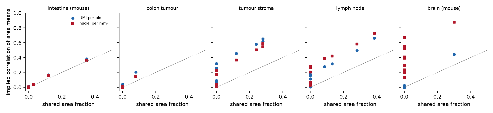
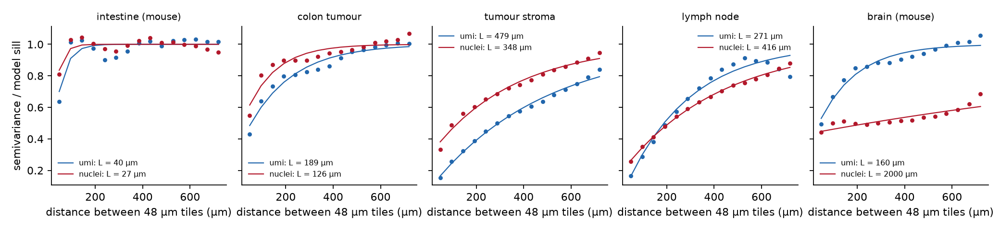
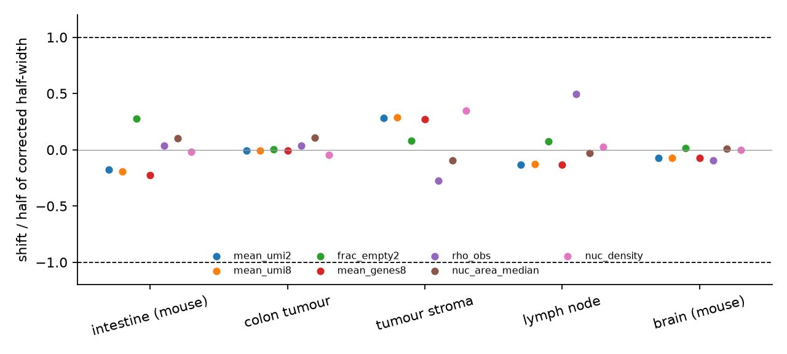

# In breve



# Dubbi rinviati



# Cancelli, regole e previsioni

Pre-registrazione: cancelli nel commit `c4832c2`; ok di Luca sulle previsioni il 2026-11-08 («Ok, come proposte (Recommended)»), commit `e19fd2a`. Perimetro scelto da Luca il 2026-11-08 («Sì, R7 copre sovrapposizioni e poche aree (Recommended)»).



*Cosa guardare*: le barre rosse stanno tutte sotto la fascia grigia (criterio di Bradley); la correzione geometrica ci entra ovunque con valori normali, ma sotto la struttura misurata esce nello stroma e nel linfonodo.

*Cosa guardare*: nell'intestino e nel tumore i punti stanno sulla diagonale (basta la geometria); nello stroma e nel linfonodo stanno molto sopra.

# Controprova e analisi post hoc



# Revisione avversariale



## Correzioni dopo la revisione



## Deviazioni dichiarate



# Cosa è girato

- Ramo `step2-visium-grid`; commit dei cancelli `c4832c2`, dell'ok `e19fd2a`, del calcolo `b63c6eb`, delle correzioni `31ea40d`; commit di chiusura nel file dello step.
- Server lesexp-server, Python del progetto (`.venv`), al massimo 6 processi a un thread; il server era condiviso con un altro utente (carico fino a 521, temperatura 59-71 °C).
- Semi: 20261108 per tutte le simulazioni e i bootstrap di R7 (flussi separati per caso); semi di R4 per la riproduzione G-3.
- md5 dei 248 file letti identici prima e dopo (`results/R7/R7_md5_before.txt`, `R7_md5_after.txt`).
- Script: `tools/R7_*.py`, `tools/R7_M5/` (riesame dei verdetti e riferimenti corretti, scritti dai sotto-agenti); tabelle in `results/R7/`.

## Esplorazioni prima della pre-registrazione



# Appendice

## Riesame dei verdetti per step



## Cambi di regole e controprove



## Bersagli del confronto finale: intervalli vecchi e corretti



## Attese pre-registrate (testo integrale)



## Da dove vengono i numeri del riassunto

| frase del riassunto | fonte | valore letto |
|---|---|---|
| «fra 76 e 84 volte su 100» | `results/R7/coverage/R7_kappa.csv`, `cover_now` | 0.760 (stroma) ... 0.842 (cuore); 5 aree indipendenti 0.837 |
| «76 su 100 nello stroma, 77 nel linfonodo» | idem | 0.7603; 0.7696 |
| «fra 89 e 94 su 100» (minimo-massimo) | idem, `cover_minmax` | 0.8946 ... 0.9395 |
| «1,6-1,9 volte»; «2,6-3,2 volte» | `results/R7/coverage/R7_kappa_final_v4.csv` | cuore 1.624-1.627, tumore 1.655-1.666, intestino 1.837-1.857; stroma 2.817-3.193, linfonodo 2.571-2.966 |
| «strutture di 270-480 µm» | `results/R7/cp1_v2/R7_P2.csv`, `L_um` | stroma 479 e 348; linfonodo 271 e 416 |
| «1,8 per i trascritti, 3,9 per i nuclei» (cervello) | `R7_kappa_final_v4.csv` | 1.818; 3.865 |
| «24 intervalli su circa 240» | `results/R7/Mc/R7_Mc_refs.csv`, `cv_between_areas` | 24 con CV > 0.45 su 237 con valori per area |
| «al più del 7 %», «meno di metà» | `results/R7/pieces/R7_P3.csv` | rel_shift massimo 0.0734 (linfonodo, frac_empty2); shift_over_bound massimo 0.496 |
| «circa 7 900 verdetti di 29 step ne cambiano 709» | `results/R7/report/R7_transitions_by_step.csv`, riga TOTAL | 7 852 righe; 709 cambi fra i tre esiti |
| «circa metà ... non decisi; poco meno di metà ... confermati»; «22» | idem | 168 + 197 = 365; 175 + 147 = 322; indeterminata → smentita 22; confermata → smentita 0 |
| «quattro regole ... pareggio o un punto»; «163 conferme, ne servivano 167» | `results/R7/report/R7_rule_changes.csv`; `R7_review_cons2.md` | S1.5b 15-15 e 6-6; S1.5c regola 1 15-15; S1.5d regola C 37 contro 36; S1.5e quote 58-58 e 47-47; S1.6 163 su 167 |
| «dipende da una sola riga ... torna indietro con piccole variazioni» | `R7_review_cons2.md`, tabella delle regole e sezione fragilità | S1.5d per 8.0e-5; varianti che riportano indietro i cambi |
| contatti: linfonodo, tumore, stroma | `R7_review_cons2.md`, punto 7 e D-1; `results/R7/M5/R7_M5_S13_S14.csv`, `R7_M5_S15_S16.csv` | linfonodo confermata; tumore indeterminata (K2, RV) o confermata (U6); stroma smentita con l'intervallo a uno stadio, indeterminata con quello registrato |
| «da 260-350 a 144-431» | `results/R7/report/R7_S25_targets.csv`, B-291 stroma, UMI medi per bin di 8 µm | 312.4 [259.7, 349.6] → [144.3, 431.3] |
| «fra 74 e 90 volte su 100» (solo geometria) | `R7_P2.csv`, `coverage` | stroma 0.846 e 0.884; linfonodo 0.900 e 0.864; cervello, nuclei 0.742 |
| «60 nuclei contati» | `R7_review_cons2.md`, D-1 | limite binomiale ± 0.098 per 60 nuclei focali |
| «cambiano del 3 %» (cervello, bersagli per bin) | `R7_Mc_summary_v4.txt` | bin boot width × 0.968 con i fattori geometrici |
| «circa 1 ora e 15 minuti con 6 processi» | job di `tools/R7_cp1_v2.py`: avvio del processo 22:03 ora del server (21:03 UTC), notifica di fine 22:20 UTC | 77 minuti |
| «circa 1,2 secondi per un'immagine di 1920 × 1216 pixel» | note del server lesexp-server (compute_details), Cellpose-SAM 2026-09-21 | 1.2 s per immagine |
