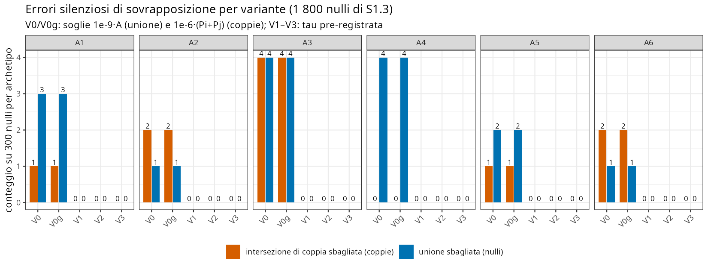
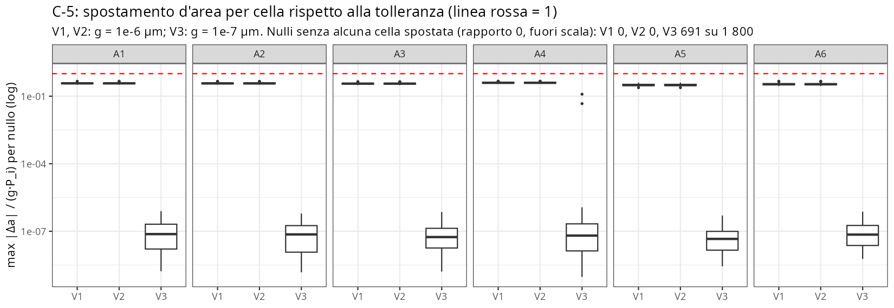
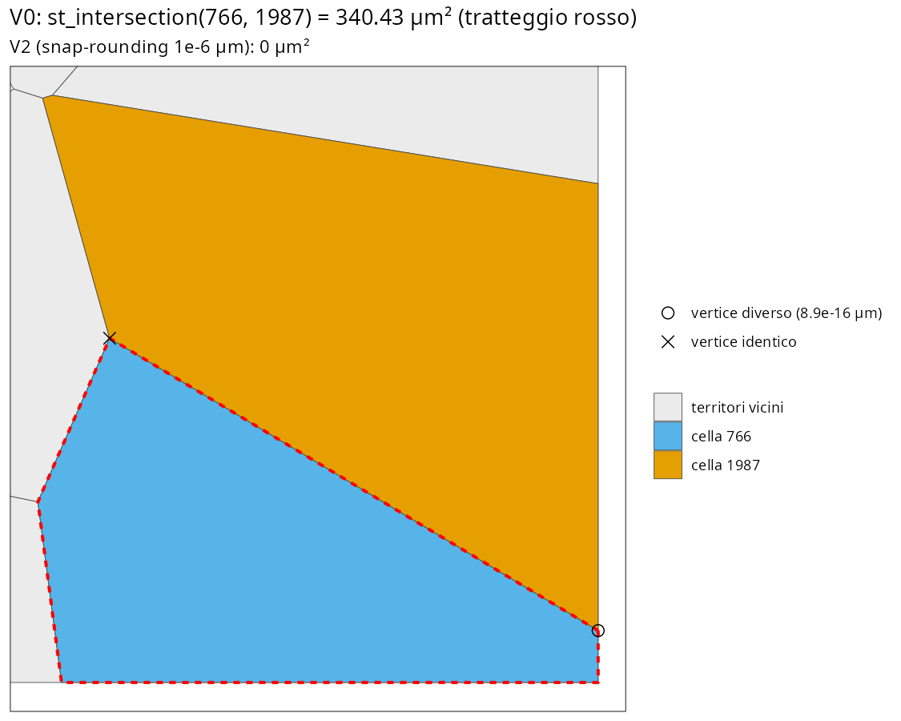
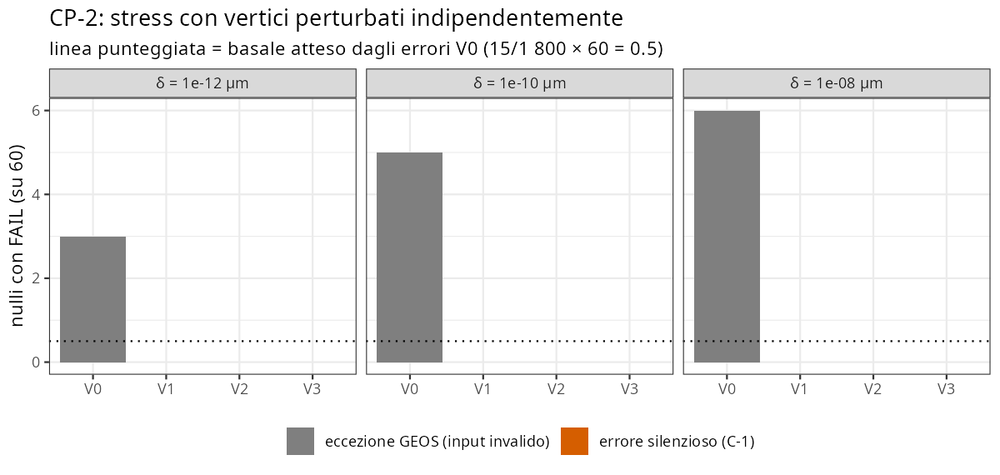

```{r setup}
#| include: false
.libPaths("~/2025.geo_spatialtrans/renv/library/linux-ubuntu-noble/R-4.6/x86_64-pc-linux-gnu")
suppressPackageStartupMessages({ library(knitr) })
R <- "../results/S1.3b"; if (!dir.exists(R)) R <- "results/S1.3b"
V <- read.csv(file.path(R, "S1.3b_verdicts.csv")); tab <- read.csv(file.path(R, "S1.3b_null_table.csv"))
dec <- read.csv(file.path(R, "S1.3b_decision.csv")); p1 <- read.csv(file.path(R, "S1.3b_posthoc_P1_pairs_v0.csv"))
p2 <- read.csv(file.path(R, "S1.3b_posthoc_P2_invalid.csv")); p3 <- read.csv(file.path(R, "S1.3b_posthoc_P3_cp2_exceptions.csv"))
grid <- read.csv(file.path(R, "S1.3b_grid.csv")); ra <- read.csv(file.path(R, "S1.3b_review_actions.csv"))
ex <- read.csv(file.path(R, "review/exact/P1_exact_results.csv"))
show <- function(sec) { d <- V[V$section %in% sec, c("id", "variant", "metric", "value", "threshold", "outcome")]
  kable(d, row.names = FALSE, col.names = c("check", "variante", "misura", "valore", "soglia", "esito")) }
t0 <- tab[tab$variant == "V0", ]; ncell <- sum(t0$n)
cnt <- table(V$outcome[V$outcome != "INFO"])
```

**Obiettivo unico** (perimetro scelto da Luca il 2026-10-10: «S1.3b = solo BL-069»): stabilire la causa degli errori silenziosi di `st_union` e `st_intersection` sui territori di `tessellate_voronoi()`, e scegliere con una regola fissata prima del run come rendere affidabili queste operazioni.

**Sintesi** (dopo la revisione avversariale).

1. **Che cosa sbaglia.** La geometria grezza è corretta. In aritmetica esatta i territori sono una partizione a meno di schegge o lacune di 2e-15–2.4e-14 µm², che stanno 10 ordini sotto la tolleranza. A sbagliare sono le operazioni di GEOS:
   - `st_union` perde **celle intere**, in 15/1 800 nulli;
   - `st_intersection` restituisce **una cella intera** al posto di una scheggia o del vuoto: almeno 11 coppie, e su 1 800 nulli e `r format(ncell, big.mark = " ")` celle il check d'unione di S1.3 ne vedeva 1 su 10.

   GEOS 3.11.1, 3.12.1 e 3.14.1 sbagliano allo stesso modo.
2. **Condizione.** In tutti i casi esaminati due celle ritagliate condividono un vertice sul bordo della regione, calcolato due volte, che differisce di 1–4 ulp. Le prove:
   - annodarlo elimina l'errore (CP-1a);
   - fondere i soli vertici diversi corregge 15/15 unioni (revisione);
   - 1 ulp su quel vertice riproduce l'errore in 24/40 casi, su un vertice interno in 0/80 (revisione).

   La condizione però **non è sufficiente**: l'83 % dei nulli che passano ha vertici simili. **Non è nemmeno specifica**: il placebo corretto CP-1b dà 18/20 < 19/20, perché 2 ulp su un vertice non condiviso fanno sparire l'errore in 2 seed su 20. Il meccanismo interno di GEOS non è identificato.
3. **Step 2.** L'intersezione cella × bin da 2 µm non ha mostrato errori nemmeno nel grezzo: 30 nulli nel run, 10 aggiunti dalla revisione, ~13 M intersezioni. La potenza di C-6 non è verificata con un controllo positivo, e la griglia da 8 µm non è stata provata.
4. **Decisione.** Per la regola pre-registrata è eleggibile solo **V2**, lo snap-rounding di GEOS a 1e-6 µm. V1 e V3 sono esclusi da C-4: le stesse 2 celle su `r format(ncell, big.mark = " ")` diventano invalide. Senza C-4 la regola avrebbe scelto V1. **Applicazione (Luca, risposta registrata il 2026-10-12): al momento dell'overlay.** `tessellate_voronoi()` resta invariato.
5. **Biologia.** I 62 verdetti B di S1.3 sono invariati con tutte le varianti.

Esiti delle asserzioni con soglia: `r paste(names(cnt), cnt, collapse = ", ")`. I FAIL sono elencati nel Verdetto.

# 1. Pre-registrazione

Testo integrale: `results/S1.3b/S1.3b_preregistration.md`, commit `d96fea1`, approvato da Luca il 2026-10-10 («vai») prima di qualsiasi codice. Script del run committati prima del run (`11a8695`). Note di sviluppo e definizioni operative dichiarate prima del run: `results/S1.3b/S1.3b_dev_notes.md`.

| Variante | Cosa fa |
|---|---|
| V0 | grezzo, come S1.3 (sf 1.1.3 + GEOS 3.12.1) |
| V0g | grezzo con il pacchetto `geos` (GEOS 3.11.1) per unione e area; coppie individuate con i predicati di sf |
| V1 | arrotondamento di sf a g = 1e-6 µm (`st_set_precision`, materializzato), su territori e regione |
| V2 | snap-rounding GEOS a g = 1e-6 µm (`geos_set_precision`, `*_prec`) |
| V3 | annodamento esplicito: vertici entro 1e-7 µm fusi, giunzioni a T inserite |

Tolleranza derivata: τ = g·(P_regione + ΣP_territori), con τ_i = g·P_i per cella. **H1**: gli errori nascono da confini condivisi non annodati.

**Regola di decisione.** Una variante è eleggibile se passa C-1…C-6, C-unit e CP-2, e C-4 senza geometrie invalide. Fra le eleggibili si preferisce quella con meno dipendenze nuove (V1, poi V3, poi V2). Se nessuna è eleggibile, la decisione è P0.

**Deviazioni, definizioni e correzioni dichiarate**:

| quando | voce |
|---|---|
| sviluppo, prima del run | B-1 a 1e-6 relativo incompatibile con τ_i per celle piccole: **errore di pre-registrazione**, soglia mantenuta |
| sviluppo, prima del run | C-2 per V0/V0g con τ_ij = 1e-6·(P_i+P_j) |
| sviluppo, prima del run | CP-2: FAIL di V0 se l'errore supera 1e-9·A + √2·δ·ΣP |
| run (dopo che null/grid/cp1 erano su disco) | **post hoc**: un'eccezione GEOS conta come FAIL della variante. La regola non tocca V1–V3, che non hanno eccezioni; il verdetto pre-registrato di V0 è riportato a parte (RC-02) |
| dopo il run | analisi: ordine di preferenza V1→V3→V2 ed etichette (la scelta non cambia); differenza simmetrica vuota = area 0 |
| dopo il run | analisi post hoc P1–P3 (sezione 5) |
| revisione | **bug del placebo CP-1b** (RC-01): spostamenti in valore assoluto sotto l'ulp, quindi nessuna coordinata cambiava. Corretto (spostamento in ulp) e rieseguito |

Difetti del codice trovati e corretti in sviluppo, prima del run: i nomi di lista in `s3b_rebuild()`, il predicato non preparato in C-6 e gli indici double in `factor()` (l'indice 100000 diventava "1e+05").

# 2. Check C — correttezza

```{r}
show("C")
```

**Lettura.**

- **C-0** riproduce S1.3 esattamente.
- **C-3.** V0 ha 0 anomalie di copertura su 1.8e8 punti: il grezzo è una partizione alla risoluzione dei punti (~10 µm²), e sbagliano le operazioni.
- **C-2 V0 smentisce la previsione.** Le coppie sono 10, non 1. Per costruzione C-2 vede solo le coppie con interni sovrapposti, quindi il conteggio è un limite inferiore (sezione 5).
- **C-4.** Sotto V1 e V3 diventano invalide le stesse 2 celle (P2). V2 le tiene valide per costruzione (snap-rounding con conservazione della topologia), quindi C-4 è un vincolo strutturale e non una scoperta empirica (RC-06).
- **C-6.** Nessuna violazione, nemmeno nel grezzo.

I mutanti mostrano che C-1, C-2 e C-5 hanno potenza; C-6 non ha un mutante.





```{r}
g6 <- aggregate(cbind(cell_viol, bin_viol, n_pieces) ~ variant + set, grid, sum)
g6m <- aggregate(cbind(cell_max, bin_max) ~ variant + set, grid, max)
kable(merge(g6, g6m), caption = "C-6: griglia 2 µm su 15 nulli con unione fallita + 15 che passano (1 dei 10 nulli con coppia sbagliata; la revisione ha esteso ai 10: 0 violazioni in V0 e V2)")
```

# 3. Check B — invarianza biologica (A1–A6)

```{r}
show("B")
```

Le aree delle varianti, ripassate nello script d'analisi di S1.3 non modificato, lasciano invariate tutte le 62 previsioni B. Le 98 righe B coincidono alla precisione di stampa; il margine minimo è 0.0056, contro una variazione massima di 4.0e-8 (revisione, RC-09). Il braccio V0 riproduce le 195 righe di S1.3. B-1 fallisce per V1 e V2 (39 celle in 32 nulli, massimo 1.68e-6) per l'errore di pre-registrazione dichiarato prima del run. **Limite**: la forma (ecc_T, n lati) in S1.3 viene dai tile non ritagliati, che le varianti non toccano.

# 4. Controprova

```{r}
show("CP")
```





**Lettura.**

- **D-0 / CP-1a.** 766 e 1987 condividono due vertici: uno identico e uno diverso di 8.9e-16 µm (2 ulp), che sta sul bordo della regione. Annodarlo porta l'intersezione da 340.43 µm² (la cella 766 intera) a 0.
- **CP-1b (corretto e rieseguito): FAIL, 18/20 < 19/20.** Spostare di 2 ulp un vertice **non** condiviso fa sparire l'errore in 2 seed su 20. Il revisore, con un placebo in ulp suo, ha osservato 20/20 su 766/1987 e su ciascuna delle 10 coppie, ma con spostamenti di ~1e-15 l'errore sparisce in 3–5/20 seed in 3/10 coppie. Il vertice diverso è quindi necessario negli esempi visti e innesca l'errore, ma l'esito dipende dalla configurazione in virgola mobile di tutta la coppia.
- **CP-1c.** In A5 r5 rep 15 l'unione grezza è più piccola di 1 358.6 µm², pari alla cella 71 intera (revisione, X8). Annodata con V3, l'errore relativo scende a 1.7e-15. Fondere i soli vertici diversi, senza giunzioni a T, corregge 15/15 unioni (revisione, RC-04), quindi il ramo «giunzione a T» di H1 non serve.
- **CP-3.** I nulli falliti hanno più vertici condivisi diversi (mediana 3 vs 2, p = 0.0024) e non più giunzioni a T (p = 0.37).
- **CP-2: previsione su V0 non confermata e senza potenza.** Gli errori silenziosi sono 0/180. Tutte le eccezioni GEOS stanno su input resi invalidi dalla perturbazione (P3). Con il basale osservato la probabilità di vedere almeno un FAIL era 0.395. V1–V3 non hanno avuto né FAIL né eccezioni. La tolleranza però vale circa 70 volte lo spostamento ammesso, quindi il test esclude solo errori grossolani (RC-13).

# 5. Analisi post hoc e aritmetica esatta

**P1 — coppie V0 con intersezione sbagliata** (con l'area esatta della revisione X1).

```{r}
p1$area_esatta <- ex$inter_exact_float[match(sprintf("%s_%s_%s_%02d", p1$archetype, p1$roi_id, p1$model, p1$rep), ex$case)]
stopifnot(!anyNA(p1$area_esatta))
p1$area_esatta <- formatC(p1$area_esatta, format = "e", digits = 2); p1$d0_dmax <- formatC(p1$d0_dmax, format = "e", digits = 2)
kable(p1[, c("archetype", "roi_id", "model", "rep", "i", "j", "area_v0", "area_i", "area_esatta", "union_fail_v0", "in_both", "d0_diff", "d0_dmax", "area_v2")], digits = 3, row.names = FALSE)
```

In 10/10 coppie:

- `st_intersection` restituisce **l'intera cella i**;
- l'intersezione vera, calcolata in aritmetica razionale, è una scheggia di 2.1e-15–2.4e-14 µm². Quindi `st_relate` (II = 2) ha ragione (revisione, X1);
- c'è un solo vertice diverso, di 1–4 ulp, con entrambe le copie esattamente sul bordo della regione;
- l'area V2 è 0.

La revisione ha trovato un **undicesimo** caso in configurazione a lacuna: in A5 r5 RSA 15, celle 71/175, l'intersezione esatta è 0 e `st_relate` dice correttamente «si toccano», ma `st_intersection` restituisce la cella 175 intera. C-2 non può vederlo (X3). L'errore dipende anche dall'ordine degli argomenti: (j, i) è corretto in 8/10 (X4). GEOS 3.14.1 lo ripete identico, e la griglia 1e-6 lo elimina in 11/11 (X5).

**P2 — geometrie invalide di V1 e V3.** Il meccanismo è verificato in 1 dei 2 casi: due vertici non adiacenti dello stesso anello, distanti 1 ulp, coincidono dopo l'arrotondamento (RC-07).

```{r}
kable(p2[, c("archetype", "roi_id", "model", "rep", "variant", "cell", "reason", "valid_v0", "area_v0")], row.names = FALSE)
```

**P3 — CP-2: eccezioni di V0 e input invalidi.**

```{r}
kable(p3, row.names = FALSE)
```

# 6. Decisione

```{r}
kable(dec, row.names = FALSE)
```

- **Modello di precisione: V2.** Snap-rounding di GEOS a griglia 1e-6 µm, con `geos::geos_set_precision()` e le operazioni `*_prec` del pacchetto `geos`, che incorpora GEOS 3.11.1. La correzione viene dal modello di precisione, non dalla versione di GEOS.
- **Punto d'applicazione (Luca, risposta registrata il 2026-10-12): al momento dell'overlay.** `tessellate_voronoi()` resta invariato. Ogni unione, intersezione o differenza fra territori o con griglie (Step 2, `04b5`) passa per V2. I check di partizione (BL-070) usano predicati e copertura, oppure V2.
- **Fragilità dichiarata.** La scelta poggia su C-4 (2 celle) e su una proprietà di costruzione di V2. Non è stato validato V2 seguito da operazioni sf in virgola mobile, cioè i territori snappati una sola volta.

# Verdetto

**Chiusa con riserve.** L'obiettivo è raggiunto: la condizione che innesca l'errore è caratterizzata, il modello di precisione è scelto con la regola pre-registrata e il punto d'applicazione è deciso da Luca. Riserve:

1. **CP-1b FAIL** (18/20 dopo la correzione del bug del placebo). H1 vale come condizione necessaria osservata e innesco riproducibile, non come causa isolata. Il meccanismo interno di GEOS non è identificato.
2. **CP-2 V0 non confermata** (0/180 errori silenziosi, potenza 0.395). La regola post hoc «eccezione = FAIL» è arrivata dopo che parte delle uscite era su disco.
3. **C-2 V0 smentita**: 10 coppie invece di 1, e almeno 11 contando la configurazione a lacuna. C-2 vede solo le coppie con II = 2 e un solo ordine degli argomenti.
4. **B-1 FAIL** per V1/V2, per errore di pre-registrazione dichiarato prima del run.
5. La decisione dipende da C-4 (2 celle); V2 porta una seconda versione di GEOS (3.11.1, accanto alla 3.12.1 di sf).
6. C-6 non ha un controllo positivo, ed è stata provata solo la griglia da 2 µm.
7. Neanche i predicati GEOS sono sempre esatti: la voce B/B di `st_relate` è sbagliata su 71/175 (X10). La voce II, quella usata, è corretta.

# Revisione avversariale

Due revisori indipendenti hanno lavorato sul server con codice proprio (`results/S1.3b/review/code/`, `results/S1.3b/review/exact/`).

- **Ricalcolo** (`code`) ha ricalcolato dai RDS grezzi, senza lo script d'analisi, tutti i verdetti: 44 grandezze, con tutti i valori del CSV identici e la decisione V2. Ha riletto il codice contro la pre-registrazione e ha aggiunto tre controprove: fusione senza giunzioni a T, test inverso e C-6 esteso. Ha prodotto 14 rilievi: 1 bug (placebo nullo), 1 discrepanza, 8 di metodo, 4 confermati.
- **Esatto** (`exact`) ha esportato le coordinate bit per bit e calcolato con aritmetica razionale. Tre metodi coincidono, validati su 13 casi noti e 300 coppie casuali. Ha confrontato GEOS 3.12.1, 3.11.1 e 3.14.1, e ha verificato in modo esatto la partizione di A5 r5 RSA 15. Ha prodotto 10 rilievi: 3 discrepanze, 1 di metodo, 6 confermati. Limiti dichiarati: solo gli 11 nulli assegnati; il contenimento in A5 è verificato esattamente solo per le 325 celle di bordo.

Il bug è stato corretto e lo stadio rieseguito; il verdetto CP-1b è passato da PASS a FAIL. Nessun'altra conclusione numerica è cambiata, mentre diverse formulazioni sono state corrette.

```{r}
kable(ra[, c("id", "revisore", "gravita", "azione", "stato")], row.names = FALSE)
```

# Riproducibilità

```bash
cd ~/2025.geo_spatialtrans && git checkout <sha di chiusura>
export R_LIBS_SITE=/nonexistent R_LIBS_USER=/nonexistent
Rscript --vanilla R/testing/test_S1.3b.R                                                   # C-unit
for st in md5 null grid cp1 cp2 mutants; do Rscript --vanilla tools/S1.3b_run.R $st; done   # ~45 min su 40 core
Rscript --vanilla tools/S1.3b_b2.R && Rscript --vanilla tools/S1.3b_analysis.R && Rscript --vanilla tools/S1.3b_posthoc.R
Rscript --vanilla tools/S1.3b_figures.R && quarto render reports/S1.3b.qmd
# revisione: results/S1.3b/review/{code,exact}/README.md
```
