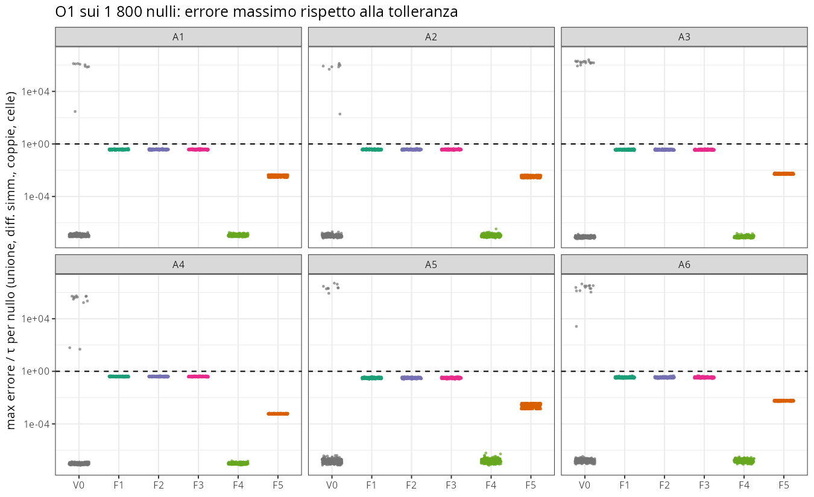
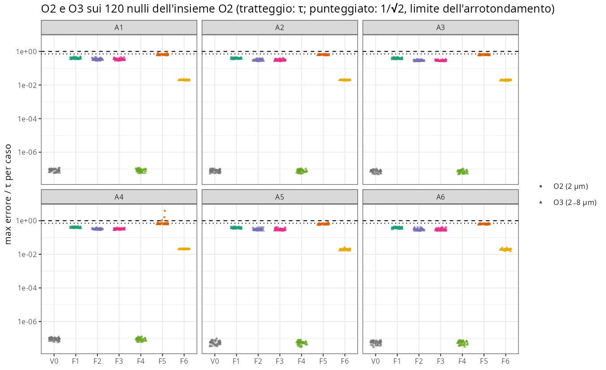
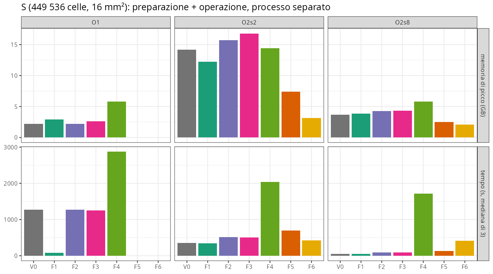
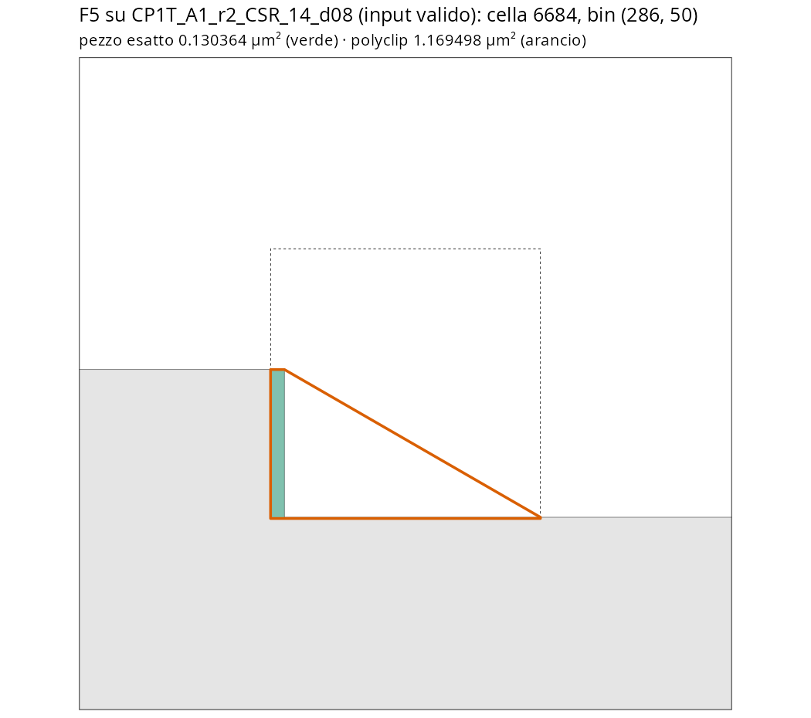
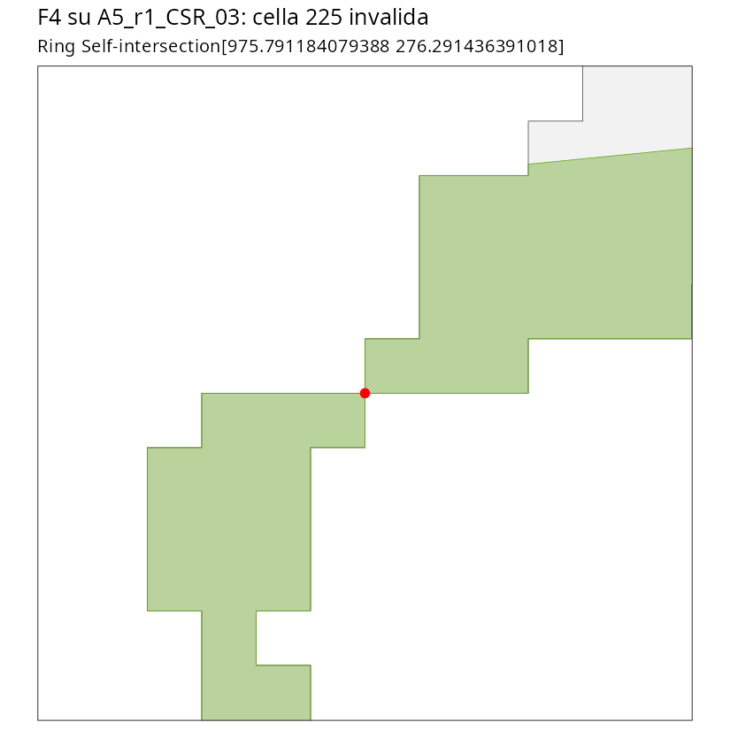
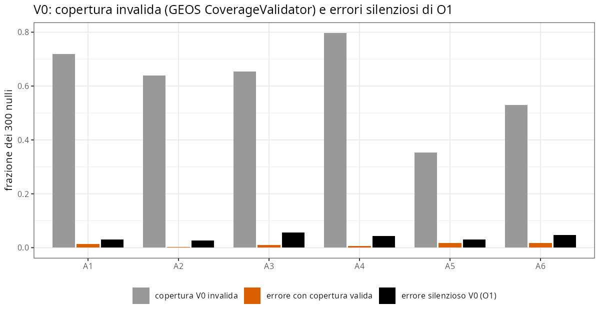

```{r setup}
#| include: false
.libPaths("~/2025.geo_spatialtrans/renv/library/linux-ubuntu-noble/R-4.6/x86_64-pc-linux-gnu")
suppressPackageStartupMessages({ library(knitr) })
R <- "../results/S1.3d"
EL <- read.csv(file.path(R, "S1.3d_eligibility.csv")); DEC <- read.csv(file.path(R, "S1.3d_decision.csv")); V <- read.csv(file.path(R, "S1.3d_verdicts.csv"))
PF <- read.csv(file.path(R, "S1.3d_perf.csv")); B1 <- read.csv(file.path(R, "S1.3d_b1.csv"))
O1 <- read.csv(file.path(R, "S1.3d_o1_long.csv")); O2 <- read.csv(file.path(R, "S1.3d_o2_long.csv"))
vt <- function(sec) { d <- V[V$section == sec, c("id", "cand", "metric", "value", "threshold", "outcome")]; rownames(d) <- NULL; d }
```

**In breve.** Sette metodi di sovrapposizione (V0 grezzo, F1–F6) confrontati con un arbitro in aritmetica razionale esatta su
1 800 nulli, 208 casi costruiti, 360 casi di stress, una sezione da 449 536 celle e — dopo la decisione — 300 nulli nuovi.
**La regola pre-registrata conferma F1** (snap-rounding GEOS a 1e-6 µm, la scelta di S1.3b) per partizione dei territori, cella × bin e aggregazione
2→8 µm, e F1 passa la validazione fuori campione (0 errori in 1 200 confronti). Ora la scelta poggia su una garanzia documentata
e verificata, non solo sull'esclusione di un'alternativa per 2 celle. Tre risultati nuovi: (i) **polyclip/Clipper 6.4.0 sbaglia in silenzio**
cella × bin su input validi (fino a 1.5e8·τ; Clipper 6.4.2 no); (ii) il **taglio unico del Voronoi (F4) dà vertici condivisi identici e
copertura valida in 1 800/1 800 nulli**, ma la mia implementazione produce 14 celle invalide nei punti di strozzatura della regione ed è 46× più lenta
di `04b3` su una sezione; (iii) l'**overlay cella × bin in virgola mobile (V0) non ha mai sbagliato** (7.85 M pezzi su S, 120 + 300 nulli, casi
costruiti): gli errori del grezzo restano confinati alle operazioni cella × cella (O1), dove V0 sbaglia nel 3.9 % dei nulli.

# 1. Pre-registrazione

Attese e regola scritte **prima** del codice: `results/S1.3d/S1.3d_preregistration.md`, commit `ee6208b`, approvate da Luca il 2026-10-14
(«procedi»; perimetro «Completo F1–F6, organizzato per operazione»; criterio di sostituzione «Garanzia per costruzione, poi tempo»).
Definizioni operative e deviazioni: `results/S1.3d/S1.3d_dev_notes.md` (codice committato prima del run, `36c7d5c`; deviazioni D-1, D-2, D-3 datate).

| Elemento | Pre-registrato |
|---|---|
| Operazioni | O1 partizione (unione, diff. simmetrica, coppie che si toccano nei due ordini); O2 cella × bin 2 e 8 µm; O3 aggregazione 2→8 µm |
| Insiemi | K (26 casi noti in 24 nulli), U costruiti (208), N 1 800 nulli, S C-perf 449 536 celle, H 300 nulli nuovi dopo la decisione |
| Arbitro | razionali esatti (`exactgeom.py` di S1.3b, invariato) + Sutherland–Hodgman esatto per O2 |
| Tolleranza | g = 1e-6 µm per tutti: τ_U = g·(P_reg + ΣP), τ_ij = g·(P_i + P_j), τ_pezzo = g·P_pezzo esatto |
| Garanzie documentate | F1 (snap-rounding a precisione fissa, entro ~13 cifre), F5 (aritmetica intera ±1 unità), F4 solo O1 (copertura valida) |
| Regola | eleggibile = 0 errori silenziosi, 0 eccezioni, 0 invalide non riparate, CP-1 pulito, mutanti rilevati; garantiti prima; F1 resta salvo ≥ 2× più veloce con memoria ≤ 1.5×; un solo helper |

# 2. Check C — correttezza del banco

```{r}
kable(vt("C"), caption = "Check C (S1.3d_verdicts.csv)")
```

- **Arbitro** (C-2): le due vie esatte indipendenti coincidono come razionali in tutti i 14 011 confronti; placebo (ordine permutato) e
  mutante (vertice tolto) dell'arbitro 257/257. Su S la verità esatta dà Σa = area della regione = 16 000 000 µm², sovrapposizioni totali 3.8e-14 µm².
- **Mutanti** (C-3): ogni errore piantato a ~2τ è rilevato (M-O1 a 1.998·τ_U).
- **C-4** ha funzionato come previsto da BL-083: in sviluppo ha trovato 28/160 prove inverse che non perturbavano nulla (ulp(0) = 0) e un
  placebo con permutazione identica; corretti prima del run (dev_notes, difetti 4–5).
- **F4 vs `04b3`** (C-5): aree entro 1e-7·τ_i e stessi frammenti in 1 986/1 986 casi, nessuna parità.

# 3. Check B — invarianza dei verdetti biologici (A1–A6)

```{r}
kable(B1, caption = "B-1: i 62 verdetti B di S1.3 ricalcolati con le aree di ogni candidato (S1.3_analysis.R invariato, worktree)")
```

V0 riproduce i verdetti di S1.3 identici (controllo); per ogni candidato 62/62 previsioni e 98/98 valori delle righe B invariati
(per F1–F3 cambiano solo righe C di S1.3, per effetto dell'arrotondamento). Lo step non ha contenuto biologico proprio: la figura 1 e 2
mostrano per archetipo l'errore massimo rispetto a τ.





# 4. Controprove ed esito per candidato

```{r}
kable(vt("CP"), caption = "Controprove")
kable(vt("P"), caption = "Previsioni pre-registrate")
kable(EL[, c("op", "cand", "n_cases", "n_silent", "n_exceptions", "n_still_invalid", "n_cp1_fail", "has_S", "eligible", "guaranteed", "t_S", "rss_S")],
      digits = 2, caption = "Eleggibilità (regola pre-registrata; t_S = s, rss_S = GB su S)")
kable(DEC, caption = "Decisione")
kable(PF, digits = 2, caption = "S: tempo (preparazione + operazione, mediana) e memoria di picco")
```



**Lettura per candidato.**

- **F1** (scelto): 0 errori in K, U, N, S, CP-1 e H; nessuna cella invalida; il più veloce in O1 su S (82 s contro ~1 270 s dei metodi sf, che
  intersecano le 2.7 M coppie una alla volta). Errore massimo 0.51·τ (sotto il limite 0.707 dell'arrotondamento).
- **V0**: in O1 errori silenziosi in 70/1 800 nulli (15 unioni, le stesse di S1.3; 65 con coppie sbagliate quando si contano le coppie che si toccano nei
  due ordini) e 13/300 in H. In O2/O3 **nessun errore** su N, U, S (7.85 M pezzi), CP-1, H.
- **F2, F3** (arrotondamento poi sf): corretti ovunque nel campione di decisione; su H una scheggia sotto la risoluzione (esatto 1.4e-17 µm²,
  candidato 2.1e-14, rapporto 1.07). Non garantiti: non potevano sostituire F1.
- **F4** (taglio unico): vertici identici per costruzione (copertura valida 1 800/1 800 nulli contro 61.6 % di V0 invalida), aree identiche a
  `04b3`; **14 celle invalide** (13 in N, 1 in H: l'anello passa due volte per il punto in cui due anelli della regione si toccano, figura 6; `st_make_valid` le ripara ad area invariata) e costruzione 1 660 s su S
  (contro ~36 s di `04b3`). Non eleggibile come implementato.
- **F5** (polyclip 1.10.7 / Clipper 6.4.0): O1 corretto dove completato, ma **non valutato su S** (due corse senza fine, D-2/D-4); **O2 errori
  topologici su input validi** (figura 5; fino a 1.5e8·τ in U5, 50 FAIL in CP-1). Causa individuata dalla revisione: una guardia mancante in
  `AddLocalMinPoly` di Clipper 6.4.0, corretta in 6.4.2 (il sorgente 6.4.0 riproduce 145/145 errori > 1e-3 µm², con la sola guardia 0/145;
  pyclipper 6.4.2 e Clipper2 corretti). polyclip inoltre **tronca** le coordinate invece di arrotondarle (contro la sua documentazione): difetto
  reale ma non causa degli errori topologici. Le violazioni F5 «a scheggia» su N, H e S vengono invece dal mio wrapper (`pc_area()`: formula
  del laccio in virgola mobile su coordinate assolute, cancellazione): l'uscita intera di Clipper è entro τ (0.13–0.69).
- **F6** (exactextractr): 0 errori in O2/O3, errore massimo 0.11·τ, memoria più bassa (3.2 GB contro 12.2 di F1 a 2 µm su S), ma non
  garantito e non più veloce di F1 su S (425 s contro 348; sui nulli piccoli era il più rapido).







**Due famiglie di errore, da non confondere.** (a) Errori topologici: celle o pezzi interi persi o duplicati (V0 in O1: 1e3–1e6·τ;
F5 in O2: fino a 1.5e8·τ). (b) Schegge sotto la risoluzione: pezzi esatti con estensione ≪ g, dove l'arrotondamento crea un'area
dell'ordine di g² (F2/F3 su H: esatto 1.4e-17 µm², estensione 0.004 g × 0.007 g, candidato 2.1e-14, 1.07·τ). Le violazioni F5 in A4, H e S, che
avevo letto come schegge, sono invece errori di arrotondamento del mio wrapper (revisione R-4). La tolleranza pre-registrata τ = g·P_esatto è troppo stretta per pezzi con
perimetro < g e conta (b) come errore: è un limite della tolleranza, non un difetto del metodo, e va in BACKLOG. La regola è stata applicata
come scritta; la decisione non dipende da (b).

**Previsioni smentite** (non ritoccate; la tabella P controlla l'eleggibilità, il testo qui sotto il testo pre-registrato — rilievo R-11):
F4 «copertura valida 100 %, 0 errori in O1» è **confermata** nel suo testo (1 800/1 800, 0 errori), ma F4 non è eleggibile per le celle invalide,
che la previsione non toccava; F5 «0 errori silenziosi» è **smentita** (errori topologici in O2/O3 su CP1T e U5; O1 non valutato su S); «V0 copertura invalida in ≥ 80 % dei nulli» (61.6 %). Confermate: V0 (≥ 15 unioni e ≥ 11 coppie; 0 in O2), F1, F2 (2 celle
invalide rilevate e riparate, esattamente come in S1.3b), F3, F4 copertura valida, F6.

# Verdetto

- **Stato: chiusa** (verdetto di Luca, 2026-10-15: «Le riserve sono pretenziose»). Nessun punto aperto tocca la decisione: F5 in O1 su S
  non poteva comunque battere F1 (nessuna corsa finita in 6 h 40 min contro 82 s), e F5 resta escluso dagli errori in O2/O3.
- Decisione per regola: **F1 per O1, O2, O3** (snap-rounding GEOS a 1e-6 µm, un solo helper, BL-081); CP-3 su H PASS.
- Punti aperti, come voci di BACKLOG e non come riserve: F5 O1 su S non valutato (D-2, D-4; BL-091); F4 da correggere (BL-092);
  tolleranza per pezzi sotto-griglia (BL-093); difetti dell'analisi D-1, D-3 dichiarati e corretti; prestazioni con 4 processi paralleli
  su macchina condivisa.

# Revisione avversariale

Due revisori indipendenti (sotto-agenti, codice proprio, sola lettura del commit `1431d75`); README, script e log in `results/S1.3d/review/{recalc,exact}/`.

| Revisore | Cosa ha ricalcolato | Esito |
|---|---|---|
| «ricalcolo» | eleggibilità, decisione e CP-3 dai RDS grezzi applicando la regola da sé; V0 e F1 rieseguiti con codice proprio su N ∪ H ∪ S (5 467 righe); τ, K, seed di H, ambito di D-3, validità degli ingressi; arbitro a campione su K (200 944 aree di cella) | 20/20 righe di eleggibilità e decisione identiche; 0 differenze dai res; 15 rilievi (0 bug, 3 discrepanze di documentazione, 5 metodo, 7 confermati) |
| «esatto» | verità con un metodo esatto indipendente (strisce in Fraction): 5 358 pezzi O2, 260 coppie, 519 aree; tutte le 565 violazioni registrate; F5 con Clipper 6.4.0/6.4.2/Clipper2 compilati a parte; celle F4 invalide; errori V0; schegge; D-3 | verità 100 % uguale; 565/565 violazioni reali; F1 0; 9 rilievi (1 bug di polyclip, 1 discrepanza, 2 metodo, 5 confermati) |

Limiti dichiarati dai revisori: «ricalcolo» ha rieseguito dalle geometrie solo V0 e F1 (F2–F6, U, CP-1 controllati dai res); «esatto» ha
ricontrollato in esatto unione e differenza simmetrica solo per le 15 unioni V0 sbagliate di N, e i valori per pezzo di F1 non sono salvati
(controllo per assenza di violazioni e rapporto massimo).

Rilievi che correggono il testo (nessuno cambia la decisione): **R-2** causa del difetto F5 = Clipper 6.4.0 (non il port R); **R-3** polyclip
tronca invece di arrotondare; **R-4** le «schegge» F5 sono errori del mio `pc_area()`; **R-5** celle F4 invalide = 14, riparabili a area
invariata; **R-10** rilancio di F5 O1 non dichiarato (ora D-4); **R-11** righe P di F4/F5; **R-12** conteggio in D-1. Da portare avanti:
**R-15** `cmp_o2` porta a 0 le aree NA/NaN del candidato (nessun caso osservato) → BACKLOG.

# Riproducibilità

Commit del run `36c7d5c` (codice), decisione `d51c337`, risultati `1431d75`.
```bash
cd ~/2025.geo_spatialtrans
R_LIBS_SITE=/nonexistent R_LIBS_USER=/nonexistent Rscript --vanilla R/testing/test_S1.3d.R      # C-1 79/79
bash tools/run_S1.3d.sh main; bash tools/run_S1.3d.sh b1; bash tools/run_S1.3d.sh perf
Rscript --vanilla tools/S1.3d_validity.R; bash tools/run_S1.3d.sh holdout
Rscript --vanilla tools/S1.3d_figures.R && quarto render reports/S1.3d.qmd
```
