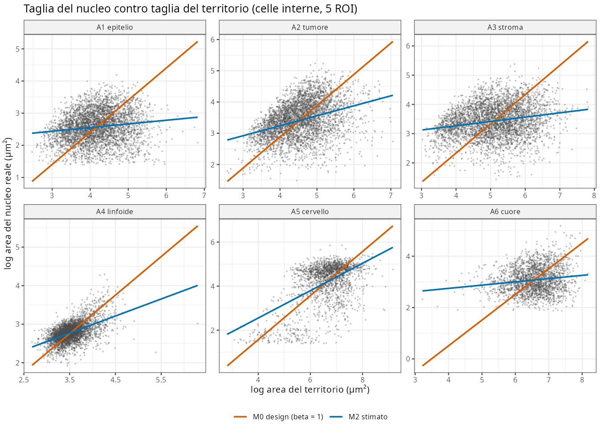
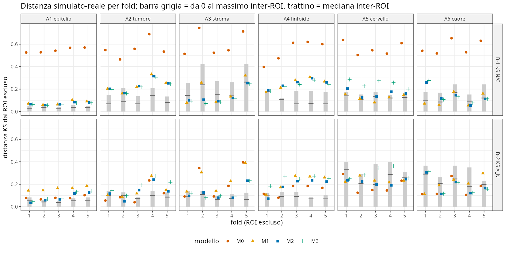
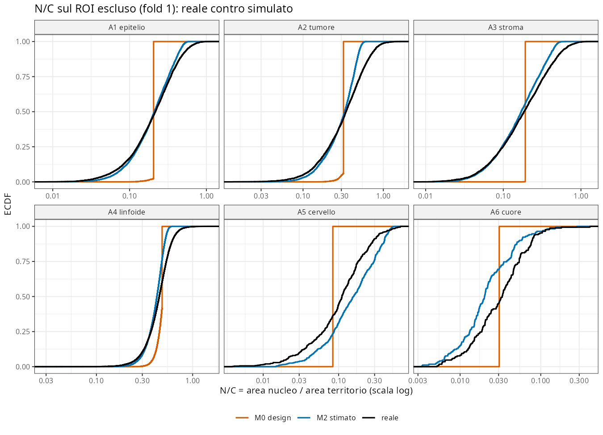
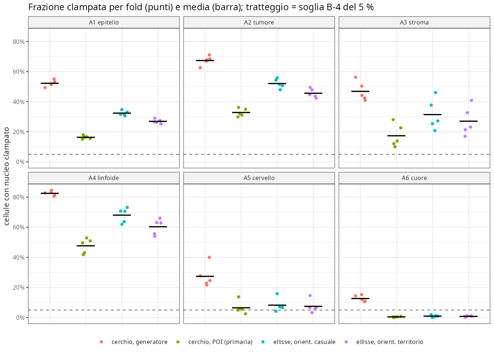
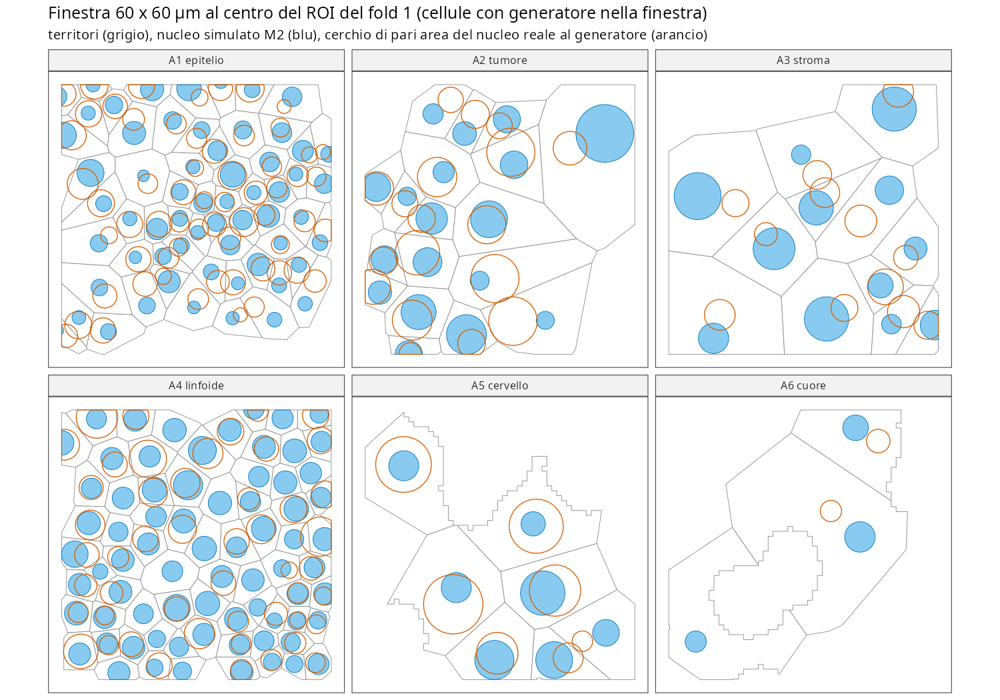

```{r setup}
#| include: false
.libPaths("~/2025.geo_spatialtrans/renv/library/linux-ubuntu-noble/R-4.6/x86_64-pc-linux-gnu")
suppressPackageStartupMessages({ library(knitr) })
R <- "../results/S1.4"
V <- read.csv(file.path(R, "S1.4_verdicts.csv")); CAL <- read.csv(file.path(R, "S1.4_calibration.csv"))
CP1 <- read.csv(file.path(R, "S1.4_cp1.csv")); PH1 <- read.csv(file.path(R, "S1.4_ph1.csv")); PH2 <- read.csv(file.path(R, "S1.4_ph2.csv"))
PH3 <- read.csv(file.path(R, "S1.4_ph3.csv")); C8 <- read.csv(file.path(R, "S1.4_c8.csv")); REC <- read.csv(file.path(R, "S1.4_rec.csv"))
vt <- function(sec) { d <- V[V$section == sec, c("id", "archetype", "metric", "value", "threshold", "outcome", "note")]; rownames(d) <- NULL; d }
arch_v <- function(o) if (sum(o == "PASS") >= 4) "PASS" else if (sum(o == "FAIL") >= 2) "FAIL" else "WARN"
```

**In breve.** `derive_cell_geometry()` (`R/04b4_derive_cell_geometry.R`) colloca un nucleo in ogni territorio di Voronoi con un modello di
taglia a due parametri che contiene il design come caso particolare (D-S1.4.1) e un clamp di contenimento in tutti i modi (D-S1.4.2).
**Il software è corretto**: test analitici 63/63, mutanti 14/14 (5 pre-registrati + 9 proposti dalla revisione), 0 nuclei fuori dal territorio su 347 971 cellule reali e 964 660 dei nulli,
449 536 celle in 44 s. **Il modello del design è smentito** e quello generale lo batte in 30/30 fold: il nucleo reale **non** scala col territorio
(β = 0.11–0.62, non 1) e N/C varia molto da cellula a cellula. **Ma la plausibilità biologica non passa** in A1–A4, e la causa è stata
identificata a posteriori: nei tessuti densi i nuclei reali **non stanno** nei territori di Voronoi dei loro centroidi (33–52 % dei cerchi di pari
area escono dal territorio; 36–55 % delle maschere reali di R3, A1–A3), quindi il vincolo di contenimento tronca le aree nel 16–48 % delle cellule.
Il problema non è il rapporto del preset (calibrato sui dati) ma la geometria: **territorio di Voronoi dei centroidi ≠ cellula** nei tessuti densi.

# 1. Pre-registrazione

`results/S1.4/S1.4_preregistration.md`, commit `c72c01a` (md5 `5abee7a1…`), approvata da Luca il 2026-10-15 («vai»), dopo le scelte
«Modello generale (β, σ) che contiene il design (Recommended)» e «Solo geometria; BL-087 in una sessione dedicata (Recommended)».
Definizioni operative fissate prima degli stadi ufficiali: `results/S1.4/S1.4_dev_notes.md` (commit `2312554`); difetto D-1 corretto prima
degli stadi ufficiali (commit `09349d2`).

| Elemento | Pre-registrato |
|---|---|
| Modello (D-S1.4.1) | `log A_N = log(ρ²·A_ref) + β·(log A_T − log A_ref) + σ·z`, `A_ref = 1e6/density`; default β = 1, σ = 0 (= design) |
| Clamp (D-S1.4.2) | in tutti i modi, raggio circoscritto ≤ 0.85 · distanza dal bordo; ellisse per bisezione |
| Banco | 40 tassellamenti reali di S1.3 rifatti con `tessellate_voronoi()`; leave-one-ROI-out 5 fold × 6 archetipi; nucleo reale per cellula (BL-060 in A4/A6) |
| Check C | C-1, C3, C5, C-area, C-rip, C-rec, C-mut, C7, C-perf |
| Check B | B-1 KS N/C, B-2 KS A_N, B-3 Spearman, contro il metro inter-ROI; B-4 clamp ≤ 5 %; B-5 descrittive; B-6 intervalli C8 |
| Controprove | CP-1 modelli annidati M0–M3; CP-2 placebo (A_T permutata); CP-3 segmentatore in A4/A6 |
| Previsioni | P1 β ∈ (0,1) ≥ 5/6; P2 M0 FAIL B-1 6/6; P3 M2 PASS B-1 e B-2 ≥ 4/6; P4 clamp > 5 % solo in A4; P5 C8 rileva ×2 ≥ 4/6 |

# 2. Check C — correttezza software

```{r}
kable(vt("C"), caption = "Check C (S1.4_verdicts.csv)")
```

- **C-1**: casi analitici (POI del quadrato, dell'esagono, della L — 2√2/(1+√2) — del quadrato con buco, incentro del triangolo sottile; clamp del
  rettangolo 1:10; ellisse 10:1 lungo e contro l'asse; β = 0 e β = 0.5; σ; seme; righe permutate; sfc misto; errori). Il difetto **D-1**
  (territori MULTIPOLYGON in un sfc misto non gestiti, trovato sui ROI reali al primo lancio dello stadio `real`) è stato corretto e coperto da T18
  prima degli stadi ufficiali; nella stessa occasione ho sbagliato l'attesa di T18 (orientazione di un territorio a due parti) e l'ho sostituita con il valore analitico.
  **Dopo la revisione** (CODE-19: 5 difetti plausibili su 9 passavano i 57 test) ho aggiunto T19 (s massimo analitico dell'ellisse clampata), T20
  (flusso casuale esatto), T21 (asse con buco decentrato, momenti analitici), T22 (generatore sul bordo → errore, CODE-05; guardia aggiunta in
  `04b4`, condizione assente nei dati: d minima 0.031 µm) e i 9 mutanti X1–X9 del revisore in `tools/S1.4_mutants.R`: ora 63/63 e 14/14 rilevati.
  La guardia non cambia alcun risultato (C-rip: stesso md5 `ea6c84d6` prima e dopo).
- **C-0**: le aree dei territori ricostruiti coincidono con S1.3 (scarto relativo 0) e le interne sono identiche in 40/40 set.
- **C-rec FAIL (31/36)**: le 5 combinazioni fallite hanno β = 0 in A1, A3, A5, A6, dove il clamp tronca il 5–10 % dei nuclei (la condizione
  «clamp ≈ 0» della pre-registrazione non vale). **PH-2** (post hoc): senza clamp il recupero è 36/36 (|Δβ| max `r sprintf("%.3f", max(PH2$d_beta))`):
  stimatore e implementazione sono corretti; il FAIL misura il troncamento del clamp, lo stesso effetto che domina il check B.
- **C-perf**: 44 s e 3.6 GB per 449 536 celle (cerchio). L'ellisse con bisezione costa 341 s (riportata, non soggetta a soglia).
- **C-mut sui reali**: con il clamp rimosso (M1) lo stadio `loo` va in errore C3 in 40/40 fold.

```{r}
kable(REC[!(REC$d_beta <= 0.05 & REC$d_sig <= 0.05 & REC$d_rho <= 0.02), c("archetype", "beta", "sigma", "beta_hat", "sigma_hat", "rho_hat", "clamp")],
      digits = 3, caption = "C-rec: combinazioni fuori soglia (ρ = 0.3) e frazione clampata")
```

# 3. Check B — plausibilità biologica (A1–A6)

Parametri calibrati su tutte le celle interne appaiate dei 5 ROI (segmentatore primario; A4/A6 posizioni Space Ranger, aree StarDist, BL-060):

```{r}
kable(CAL[, c("archetype", "method", "n", "density_mm2", "rho", "beta", "sigma", "se_beta", "nc_median", "ratio_median", "ecc_n_median")], digits = 3,
      caption = "Modello di taglia stimato (M2) per archetipo — candidati per BIO_REFERENCES")
```



```{r}
kable(vt("B")[vt("B")$id %in% c("B-1", "B-2", "B-3", "B-4"), ], caption = "Check B per archetipo (M2, ROI esclusi; lettere = esito per fold)")
```





- **B-1/B-2/B-3**: PASS solo B-1 in A3, B-2 in A5 e A6; il resto WARN o FAIL. Il metro inter-ROI è severo dove i ROI si somigliano (A1:
  mediana KS N/C 0.02–0.04 fra ROI reali).
- **B-4 FAIL in 5/6**: clamp 16 % (A1), 33 % (A2), 17 % (A3), 48 % (A4), 6.5 % (A5), 0.4 % (A6).
- **B-5 (descrittive)**: Δθ mediano reale nucleo–territorio 32–44° (45° = nessun allineamento): debole allineamento nei tessuti densi, coerente con
  R3 (BL-063). L'ellisse orientata sul territorio aumenta il clamp (A1 0.27, A4 0.60). Il POI dista dal centroide del nucleo reale 0.17–0.44 eq_r (mediana).
- **B-6**: intervalli C8 per archetipo e potenza:

```{r}
kable(C8, digits = 2, caption = "B-6: intervalli C8 = [q05, q95] di eq_r delle interne (µm); rilevamenti su 5 ROI con intervallo dagli altri 4")
```



**Sensibilità al seme** (10 semi aggiuntivi per M2, dichiarata nelle dev notes ma omessa dalla prima stesura: deviazione segnalata dalla revisione, RC-8):

```{r}
SS <- read.csv(file.path(R, "S1.4_seed_sensitivity.csv"))
tb <- function(x) paste(sprintf("%s %d", names(table(x)), table(x)), collapse = ", ")
kable(do.call(rbind, lapply(split(SS, SS$archetype), function(z) data.frame(archetipo = z$archetype[1], B1 = tb(z$B1), B2 = tb(z$B2), B3 = tb(z$B3)))),
      row.names = FALSE, caption = "Verdetti d'archetipo di M2 su 10 semi")
```

Fragili: A5 B-1 (FAIL col seme primario, WARN in 9/10 semi), A6 B-2 (PASS 5/10), A6 B-3 (WARN 7/10). Gli altri verdetti sono identici in 10/10 semi.

## Analisi post hoc (dopo i verdetti; non li modificano)

**PH-1 — i nuclei reali stanno nei loro territori?** Per ogni cellula reale, il cerchio di pari area del nucleo vero:

```{r}
a1 <- aggregate(cbind(circ_poi_085, circ_gen_085, circ_gen_1, r3_frac_out_gt0) ~ archetype, PH1, mean, na.action = na.pass)
sim <- tapply(V$value[V$id == "B-4"], V$archetype[V$id == "B-4"], function(x) x)
a1$clamp_simulato <- as.numeric(sim[a1$archetype])
kable(a1, digits = 3, col.names = c("archetipo", "clampato al POI (0.85)", "clampato al generatore (0.85)", "fuori dal territorio al generatore (1.0)",
      "maschera R3 fuori (frac_out > 0)", "clamp simulato M2"), caption = "PH-1")
```

La frazione clampata dal simulatore coincide con quella che subirebbero i nuclei reali: il clamp non segnala un rapporto del preset sbagliato (il
criterio della ROADMAP §4 per S1.4) ma una **incompatibilità geometrica** fra nuclei reali e territori di Voronoi dei centroidi nei tessuti densi.



**PH-3 — senza clamp il check B passerebbe?**

```{r}
s3 <- do.call(rbind, lapply(split(PH3, list(PH3$archetype, PH3$variant)), function(z) data.frame(archetipo = z$archetype[1], variante = z$variant[1],
  B1 = arch_v(z$v_b1), B2 = arch_v(z$v_b2), B3 = arch_v(z$v_b3), clamp = round(mean(z$clamp), 3), nuclei_fuori_per_fold = round(mean(z$not_within)))))
kable(s3[order(s3$archetipo, s3$variante), ], row.names = FALSE, caption = "PH-3: M2 con clamp 0.85 (primaria), 0.99, senza clamp")
```

Togliere il clamp migliora molto A2–A4 (A4: PASS/WARN/PASS) ma lascia B-1 FAIL in A1 e A5 e mette fino a migliaia di nuclei fuori dal territorio
(C3 violato): non è un'opzione ammissibile, è una diagnosi. In A5 la nube reale è **bimodale** (figura 1: neuroni e glia): un modello a un solo
tipo non può riprodurla; la composizione per tipi è di S1.5.

# 4. Controprove

```{r}
kable(vt("CP"), caption = "Controprove")
```

- **CP-1 non smentita**: M2 batte il design (M0) in 5/5 fold in 6/6 archetipi; robusto al rumore Monte Carlo (z ≥ 6.6 in 29/30 fold, revisione CODE-18).
  Le conclusioni «M1 basta» / «M3 basta» invece stanno dentro il rumore di un solo seme (|z| < 0.8 nella maggior parte dei fold): indicative, non stabilite.
  M0 ha ρ stimato dai dati (media geometrica), quindi è il design con la taglia media corretta: il confronto è conservativo (CODE-16). Il modello più semplice basta in A2 e A5 (M1: β = 1 con σ) e
  in A3 e A6 (M3: β = 0). Avvertenza dalla figura 3: sulla sola KS di A_N il design compete in alcuni fold (A2, A5, A6); il vantaggio di M2 viene da N/C.
- **CP-2**: placebo PASS in 5/6; in A5 |β̂| = 0.022 contro 0.02, con errore standard 0.022 (n = 1 993): la soglia pre-registrata non teneva conto
  di n; il valore è compatibile con 0 (1.0 SE). Con 200–500 permutazioni i revisori stimano P(|β̂| > 0.02 | nessun effetto) = 0.43–0.47 in A5
  e 0.26–0.32 in A6: la controprova non aveva potere in A5/A6. FAIL formale, non evidenza di un difetto.
- **CP-3**: in A4 il segmentatore cambia i parametri (ρ 0.68 → 0.59, β 0.44 → 0.30) e B-1 (FAIL → WARN); in A6 i parametri sono stabili.
  L'appaiamento BL-060 lascia fuori il 24–29 % delle interne in A4 e il 23–53 % in A6 (territori senza nucleo StarDist): selezione non neutra;
  in A4 le escluse hanno territori più piccoli (mediana A_T 26.7–35.3 contro 31.4–36.5 µm², CODE-13), proprio dove il clamp morde di più.

**Minacce e limiti emersi** (nessuno cambia un verdetto): 0.39 % delle celle reali di valutazione ha A_N ≥ A_T, irraggiungibile dal simulatore
(RC-12); i territori del pacchetto differiscono da quelli di R3 in 36/40 set (≤ 305 celle per set, quasi tutte non interne) per la regola dei
frammenti D-S1.3.2, ma le mediane di N/C e del rapporto dei raggi sono identiche alla terza cifra (BL-071, RC-7); `polylabelr` dà un POI subottimale
in 10 territori di bordo con buchi (su 12/40 set controllati; nessuno nell'insieme di valutazione, RC-10); nello stadio dei nulli ρ è usato con l'A_ref
del nullo (spostamento ≤ ~6 % dell'area, solo check strutturali, CODE-20); con coordinate ~1e4 µm l'errore relativo d'area del poligono sale a 1.4e-7
(CODE-9; ROI ≤ 1 000 µm: ≤ 2e-13).

```{r}
kable(vt("P"), caption = "Previsioni (non ritoccate)")
```

# Verdetto

**Chiuso con riserve** (proposta di Claude; Luca può confermare o modificare).

- **Implementazione**: corretta e veloce. Check C tutti PASS tranne C-rec (31/36), il cui FAIL è spiegato dal troncamento del clamp (PH-2: 36/36 senza clamp).
- **Design**: D-S1.4.1 è sostenuta dai dati (CP-1, P1, P2). Il nucleo non scala col territorio (β 0.11–0.62) e il design (β = 1, σ = 0) va sostituito dal modello generale; parametri in BIO_REFERENCES B-091…B-108, intervalli C8 in B-109…B-114 (chiude BL-066).
- **Riserve**:
  1. **Contenimento** (BL-098): B-4 FAIL in A1–A5 e B-1/B-2 FAIL in A1, A2, A4 per troncamento. Il vincolo «nucleo dentro il territorio di Voronoi dei centroidi»
     (C3, design §7.2) è incompatibile con i nuclei reali nei tessuti densi (PH-1). Serve una decisione di design: territori che rispettano la taglia
     del nucleo (diagramma di potenza / Laguerre con peso legato al raggio nucleare), nucleo che può uscire dal territorio, oppure contenimento con
     aree troncate dichiarate.
  2. **A5 bimodale** (neuroni/glia): richiede la composizione per tipi (S1.5) (BL-099).
  3. P3 e P4 smentite. CP-2 in A5 FAIL senza potenza. Verdetti fragili al seme in A5 e A6.
  4. Selezione dell'appaiamento BL-060 in A4/A6 (BL-100).

# Revisione avversariale

Due revisori indipendenti (sotto-agenti, commit `ec2a874`), con codice proprio sul server. I file sono `results/S1.4/review/{recalc,code}/README.md`;
script e output in `/mnt/micron/geo_spatialtrans/S1.4/review_{recalc,code}/`.

- **«recalc»**: ha riscritto la simulazione dalla specifica, senza usare `derive_cell_geometry()` né gli strumenti S1.4, e ha ottenuto 160/160 righe LOO identiche (|Δ| = 0 su KS,
  clamp e metro). Ha ricalcolato con codice proprio la calibrazione (≤ 1e-15), i verdetti B-1…B-4, CP-1, CP-3 e P1…P5, gli intervalli C8 6/6, PH-1 per A1/A4
  (anche con il raggio inscritto massimo di GEOS, |Δ| ≤ 1.8e-4) e l'appaiamento BL-060 con shapely (7/7 set identici). Nessun bug. Rilievi
  RC-7…RC-13: territori diversi da R3 per BL-071; **sensibilità al seme omessa** (deviazione, corretta: tabella in §3); CP-2 senza potenza;
  POI subottimale in territori con buchi; definizione di A_ref; A_N ≥ A_T nello 0.39 %; colonna ALTREP di arrow negli RDS.
  Limiti dichiarati: il POI è stato controllato in modo indipendente su 12 dei 40 set.
- **«code»**: ha letto `04b4`, il banco, l'analisi, il post hoc e i test contro la pre-registrazione. Conferme: formula D-S1.4.1, fattore del poligono, C3 garantito
  per costruzione (monotonia della bisezione per convessità; s massimale nel 100 % di 15–30 mila ellissi clampate), 0 violazioni su 64 casi
  avversari / 38 694 nuclei, convenzione degli angoli pacchetto = R3 (Δ 0.0°; con il segno invertito l'allineamento sparisce), assenza di fughe
  d'informazione nel LOO, 40 fold ricalcolati con stimatori indipendenti (≤ 2.2e-16), nessuna deviazione non dichiarata. Rilievi: **potere dei
  test** (CODE-19, corretto: T19–T22 e X1–X9), **C5 con generatore sul bordo** (CODE-05, guardia aggiunta), C-area dipendente dalla scala, CP-2
  senza potenza, «M1/M3 basta» dentro il rumore del seme, selezione BL-060 verso i territori grandi, ρ/A_ref nei nulli, core oltre il limite
  indicato al revisore (il limite del server per il progetto è 50).
  Limiti dichiarati: stadi `rec`, `null`, `perf` e PH-1/PH-3 letti dai CSV, non ricalcolati; ottimalità della bisezione verificata su 3 set; figure non riviste.
- **Discrepanze che cambiano un verdetto: nessuna.** Correzioni dopo la revisione: test e mutanti, guardia del bordo, `stopifnot` sull'ordine dei
  parquet StarDist nel banco (CODE-12: vero nei dati), tabella dei semi, testo del report.

# Riproducibilità

```bash
cd ~/2025.geo_spatialtrans && git checkout <sha di chiusura>
export R_LIBS_SITE=/nonexistent R_LIBS_USER=/nonexistent
Rscript --vanilla R/testing/test_S1.4.R                                # C-1 (S14_MUTANT=M1..M5 per C-mut)
for s in real loo rec null; do Rscript --vanilla tools/S1.4_bench.R $s; done   # grezzi in /mnt/micron/geo_spatialtrans/S1.4/
S14_STEP=prep Rscript --vanilla tools/S1.4_perf.R; S14_STEP=circle /usr/bin/time -v Rscript --vanilla tools/S1.4_perf.R
Rscript --vanilla tools/S1.4_analysis.R && Rscript --vanilla tools/S1.4_posthoc.R && Rscript --vanilla tools/S1.4_figures.R
quarto render reports/S1.4.qmd
```
