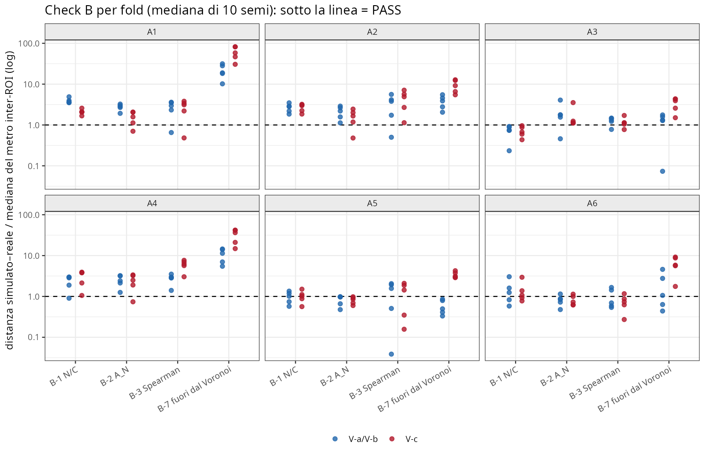
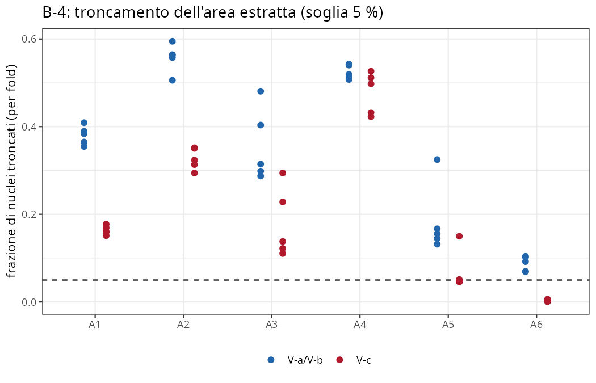
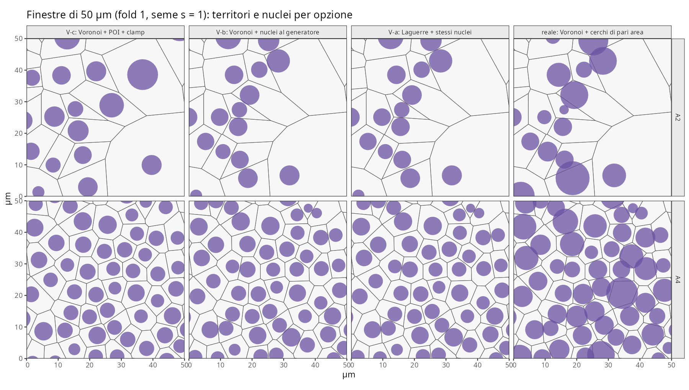
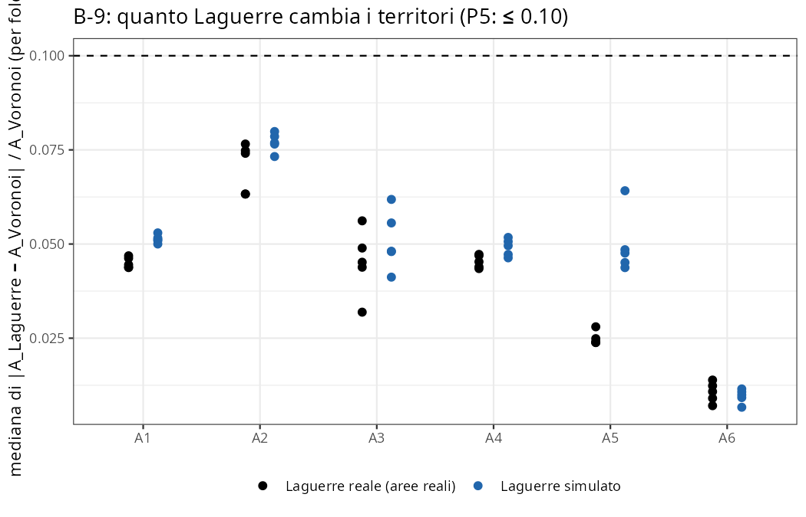
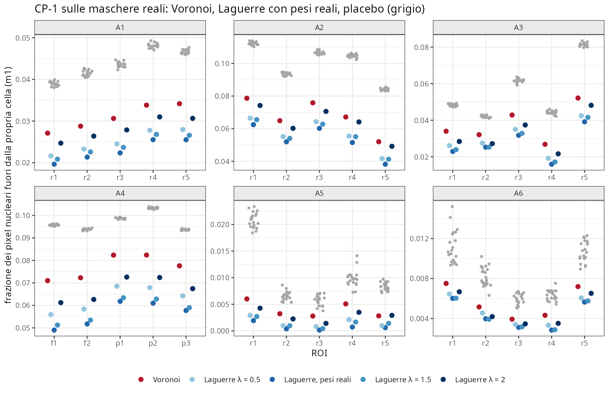

```{r setup}
#| include: false
.libPaths("~/2025.geo_spatialtrans/renv/library/linux-ubuntu-noble/R-4.6/x86_64-pc-linux-gnu")
suppressPackageStartupMessages({ library(knitr) })
R <- "../results/S1.4b"
v <- read.csv(file.path(R, "S1.4b_verdicts.csv"))
tb <- function(x, ...) kable(x, row.names = FALSE, ...)
sel <- function(s, ids = NULL) { z <- v[v$section == s, ]; if (!is.null(ids)) z <- z[z$id %in% ids, ]; z[, c("id", "archetype", "metric", "value", "threshold", "outcome")] }
```

**Obiettivo unico**: decidere BL-098 (con BL-106, posizione del nucleo) con un banco che confronta tre relazioni
nucleo–territorio sui 30 tassellamenti reali di S1.4 (segmentatore primario), parametri M2 e semi di S1.4.
Prototipo in `tools/`; `R/04b3*`, `R/04b4*` non modificati (implementazione in S1.4c).

| Opzione | Territori | Nucleo |
|---|---|---|
| **V-c** = (c) | Voronoi | POI, clamp 0.85 (D-S1.4.2) |
| **V-b** = (b) | Voronoi | al generatore; non sovrapposizione fra nuclei k32·(r_i + r_j) ≤ 0.99·d_ij e bordo della regione |
| **V-a** = (a) | Laguerre, w = (k32·r)² | gli stessi nuclei di V-b |

# 1. Pre-registrazione

Testo integrale: `results/S1.4b/S1.4b_preregistration.md` (commit `ccf1c0e`, md5 `8c0fea88…`), approvato da Luca il
2026-10-15 («vai»), dopo le scelte «Banco + decisione; implementazione in S1.4c» e «Regola pre-registrata, con tuo veto
motivato». Definizioni operative (prima degli stadi ufficiali, commit `230fe74`): `results/S1.4b/S1.4b_dev_notes.md`.
Pre-registrazione, codice e script del run sono stati pubblicati su GitHub prima del run.

**Deviazione di perimetro**: la pre-registrazione cita i 40 tassellamenti di S1.4 (30 del segmentatore primario + 10 di
sensibilità StarDist in A4/A6); il banco ha usato i **30 primari**. La sensibilità StarDist non è stata valutata in S1.4b.

| Check | Attesa | Soglia | Fonte |
|---|---|---|---|
| C-0 | V-c = S1.4 | identico | S1.4 |
| C-L1 / C-L2 / C-L3 | test analitici; arbitro indipendente; partizione | 1e-9; 0 errori + aree entro 4 SE; 1e-9 | — |
| C3 / C-NO | nuclei nella cella (V-a); nuclei disgiunti (V-a, V-b) | 0 / 0 | design §7.2 |
| C-mut | 5 mutanti | 5/5 | prassi S1.3/S1.4 |
| C-perf | 449 536 celle | ≤ 300 s, ≤ 8 GB (solo WARN) | design §6.2 |
| B-1/B-2/B-3 | KS N/C, KS A_N, \|ΔSpearman\| | metro inter-ROI, mediana di 10 semi | S1.4, BL-102 |
| B-4 | frazione troncata | ≤ 5 % | ROADMAP §4 |
| B-7 | frazione fuori dal Voronoi, sim vs reale | metro inter-ROI | S1.4 PH-1 |
| CP-1 | Laguerre con pesi reali batte 20 permutazioni | ≥ 5/6 archetipi | — |
| P1–P6 | previsioni di Claude | — | senza fonte |

**Regola di decisione** (approvata): eleggibili = check C PASS; {a, b} contro (c) sul conteggio dei PASS in archetipo ×
{B-1, B-2, B-3, B-7}; fra (a) e (b) decide CP-1. **Completamento scritto nelle dev notes prima del run** (da confermare
con Luca): a parità resta (c).

# 2. Check C — correttezza software

```{r}
tb(sel("C"))
```

**C-L2 FAIL (22/30) per la definizione operativa, non per la geometria.** I controlli puntuali sono 0/0/0 in tutti i 30
insiemi (5.31 M punti: nessun punto assegnato male, scoperto o doppio oltre 1e-6 µm). Gli 8 FAIL vengono tutti dal
sotto-criterio delle aree (celle con |z| > 4 oltre E + 3√E con E gaussiano). Analisi post hoc (non cambiano il verdetto):

```{r}
pa <- read.csv(file.path(R, "S1.4b_posthoc_arbiter_PHA.csv")); pb <- read.csv(file.path(R, "S1.4b_posthoc_arbiter_PHB.csv"))
tb(pa[, c("set", "n_pts_region", "misassigned", "uncovered", "double", "n_absz_gt4", "exp_absz_gt4", "max_absz", "pass_")], digits = 3,
   caption = "PH-A: arbitro con 4·10⁶ punti sugli insiemi falliti")
tb(pb[pb$set %in% pa$set, c("set", "n_cells", "mean_pts_per_cell", "observed", "gauss_E", "null_mean", "null_q99", "p_value")], digits = 3,
   caption = "PH-B: distribuzione nulla esatta (multinomiale, 500 repliche) della statistica con 2·10⁵ punti")
```

Lettura: con ~6–8 punti per cella (A4) la coda è poissoniana e la nulla esatta ha media 8–12, non 1.5–2 (p = 0.59–0.93).
A1 fold 3 (p < 1/500) non è spiegato dalla nulla, ma con 20× punti passa (max |z| 4.26): un errore d'area reale
crescerebbe come √N (≈ 4.5×), quindi è una fluttuazione di quel campione di punti. **Per la regola, (a) resta non
eleggibile**: è materia per l'eventuale veto di Luca (vedi Verdetto).

Difetti trovati e corretti (dev notes D-1…D-6): griglia mista (D-1, prima del run), sf e precisione geos (D-2, prima),
ricerca dei vicini O(n²) (D-4, durante C-perf; ricalcolo 60/60 RDS identici), «doppi» dell'arbitro (D-5; arbitro
rieseguito identico), unità A1 × MU4 fermata (D-6; MU4 rilevato su 5/5 insiemi valutati).

# 3. Check B — plausibilità biologica (A1–A6)

```{r}
a <- read.csv(file.path(R, "S1.4b_archetypes.csv"))
tb(a[, c("variant", "archetype", "B1", "B2", "B3", "B7", "B4", "B4_v", "loss", "b7_sim", "b7_real", "f_b1", "f_b2", "f_b3", "f_b7")], digits = 3,
   caption = "Verdetti d'archetipo (lettere = verdetti dei 5 fold); B-4 = frazione troncata, loss = perdita media di area")
```





```{r}
tb(sel("B", c("B-8", "B-9", "B-4 det")))
```

Lettura:

- **Nessuna opzione risolve BL-098.** Conteggio dei PASS {B-1, B-2, B-3, B-7}: V-a/V-b 4, V-c 4.
- **V-a/V-b troncano più di V-c** in A1–A4 (38–56 % contro 16–48 %): il vincolo fra nuclei circolari è almeno tanto
  restrittivo quanto il contenimento nel Voronoi.
- **B-8 spiega perché**: i cerchi di pari area dei nuclei *reali*, ai centroidi reali, si sovrappongono a un vicino nel
  33–53 % delle cellule in A1–A4 — quasi la stessa frazione che esce dal Voronoi (B-7 reale 33–53 %). Un nucleo circolare
  che rispetti qualsiasi vincolo di non compenetrazione non può riprodurre i tessuti densi.
- B-7 di V-a/V-b si avvicina al reale (A5 PASS, A3/A6 WARN) ma resta sotto (A1 0.23 vs 0.35; A2 0.31 vs 0.53).
- B-9: Laguerre cambia i territori di poco (mediana 1–8 %); P5 confermata.





**PH-C (post hoc)**: la forma ellittica non basta. Con l'ellisse dei momenti di ogni nucleo reale (stessa area,
eccentricità e orientazione misurate) le sovrapposizioni scendono solo in parte:

```{r}
ph <- read.csv(file.path(R, "S1.4b_phc.csv"))
tb(aggregate(cbind(circle, ellipse, ellipse_90, ecc_med) ~ archetype, ph, mean), digits = 3,
   caption = "Frazione di nuclei reali che intersecano un vicino: cerchio, ellisse dei momenti, ellisse con area −10 %")
```

Le maschere reali sono disgiunte per costruzione: nei tessuti densi i nuclei sono a contatto e **deformati** in modo che
nessuna forma convessa liscia di pari area riproduce.

# 4. Controprova

```{r}
tb(sel("CP"))
```



**CP-1 non smentisce (a)**: in 30/30 ROI Laguerre con i pesi reali batte tutte le 20 permutazioni, su entrambe le
metriche. La taglia del nucleo contiene informazione sul territorio, e le permutazioni sono *peggiori del Voronoi*.
Il guadagno rispetto al Voronoi è però modesto: m2 −4…−23 % in A1–A4 (−66 % in A5). Sweep di λ: su m1 il minimo è a
λ = 1 in 29/30 ROI (un ROI di A6 a λ = 1.5); su m2 in 21/30 (A4: 3/5 a λ = 1.5; A5: 4/5 a λ = 0.5). Il controllo C-cp1 (λ = 0 = `frac_out` di R3) è esatto.

## Previsioni

```{r}
tb(sel("P"))
```

P1–P4 smentite, P5–P6 confermate. Non ritoccate.

# Verdetto

```{r}
tb(sel("D"))
```

- **Decisione per regola: (c) contenimento con troncamento dichiarato.** D-S1.4.2 resta in vigore; B-4 FAIL A1–A5 è
  una proprietà dichiarata del modello. Esito di una **parità fragile** (revisione: RC-2, CODE-07, CODE-05), non
  evidenza a favore di (c): il banco non discrimina le opzioni sul pannello B.
- **Verdetto di Luca (2026-10-15)**: «Nessun veto: resta (c), BL-098 riaperta sulla forma del nucleo». Il criterio di
  parità delle dev notes è quindi accettato.
- **Stato: chiusa con riserve.**
- Riserve: (1) C-L2 FAIL per una soglia mal calibrata (PH-A, PH-B, CODE-05; nessun errore geometrico); (2) parità
  dipendente dai semi e dall'operatore di V-c (RC-2, CODE-07); (3) **BL-098 riaperta in forma nuova**: il collo di
  bottiglia è la forma del nucleo nei tessuti densi, non il territorio (B-8: cerchi reali sovrapposti 33–53 % in A1–A4;
  PH-C: ellissi dei momenti 24–47 %); (4) la non sovrapposizione in una passata tronca ~2× il minimo (CODE-06);
  (5) prototipo Laguerre corretto e veloce (C-perf 54.7 s, 3.6 GB; 0 errori puntuali su 5.3 M punti), resta in `tools/`
  con il bug CODE-01 (n = 1) annotato; (6) BL-106 (posizione del nucleo) resta legata a BL-098.

# Revisione avversariale

Due revisori indipendenti (sotto-agenti, contesto pulito; materiale in `results/S1.4b/review/{recalc,code}/README.md`).

**«recalc»** — ricalcolo da zero dai grezzi: 60/60 righe di fold (diff 0), 48/48 verdetti d'archetipo, B-4, B-8, B-9,
CP-1, P1–P6, regola: **identici**. V-b ricostruita dai dati di S1.4 (A1, A4, A6 fold 1): identica. b7_reale = PH-1 in
30/30 ROI. Rilievi: RC-2 la parità 4–4 è fragile rispetto ai semi (leave-one-seed-out: {a, b} vince in 5/10;
bootstrap dei semi P({a,b} > c) = 0.61, P(parità) = 0.33, P(c > {a,b}) = 0.06; decisive A6 V-c B-2 e B-3, A6 fold 3
B-2 PASS per lo 0.19 %); RC-3 C-L2 mal calibrato; RC-4 V-a e V-b sono identiche su tutto il pannello B per
costruzione; RC-5 B-7 di V-c è 0 per costruzione; RC-6 il placebo di CP-1 è debole (le permutazioni sono peggiori del
Voronoi); RC-7 P1 rapporto delle medie vs media dei rapporti (esito invariato); RC-10 B-8 in A4/A6 dominato da vicini
non appaiati (raggio da `a_own`).

**«code»** — 17 casi avversari × 2 modi contro l'intersezione di tutti i semipiani e una rasterizzazione per forza
bruta: nessun controesempio per `power_diagram()`/`lag_neighbors()` (errore relativo ≤ 4.7e-11). Rilievi principali:

| Id | Gravità | Rilievo | Cambia la decisione? |
|---|---|---|---|
| CODE-01 | bug | `lag_cells()` con n = 1 restituisce la cella in coordinate centrate (area errata); nessun effetto (n ≥ 524) | no |
| CODE-02/03 | osservazione | qhull fallisce su input interamente collineari; fonde generatori a ≤ 1e-10 µm (minimo reale 1.40 µm) | no |
| CODE-05 | metodo | C-L2: attesa binomiale esatta 72.5 celle con \|z\| > 4 (osservate 68; gaussiana 15.28); arbitro esatto ai vertici: 30/30 insiemi corretti. L'ineleggibilità di (a) è un artefatto | sì, se si corregge |
| CODE-06 | metodo | la non sovrapposizione in una passata tronca ~2× il minimo (MILP A2 0.26, A4 0.23 vs 0.56, 0.52); greedy: B-4 A1 0.19, A2 0.29, A3 0.18, A4 0.27, A5 0.12, A6 0.049 (PASS); conteggio invariato 4–4 | no (B-4 di A6) |
| CODE-07 | metodo | per V-c B-1/B-3/B-7 usano il Voronoi dei generatori, non dei centri dei nuclei (POI) come nei reali; con l'operatore comune alla lettera V-c scende a 3 e la regola sceglie (b), o (a) con C-L2 corretto | sì |
| CODE-08 | metodo | la decisione poggia sul criterio di parità aggiunto nelle dev notes, non nella pre-registrazione | — |
| CODE-10 | osservazione | CP-1 corretto; anche il Voronoi batte le 20 permutazioni in 29/30 ROI | no |

**Conclusione della revisione**: nessun errore di calcolo; la decisione per regola (c) **non è robusta** — si ribalta
con un seme in meno (RC-2), con l'operatore comune applicato ai POI (CODE-07) o con C-L2 calibrato più il criterio di
parità. Il banco non discrimina le opzioni sul pannello B: tutte falliscono nei tessuti densi per la stessa causa
(B-8, PH-C).

# Riproducibilità

Commit dei risultati: `1c13c4c` (prima della revisione); chiusura: commit «S1.4b: chiusura…».

```bash
cd ~/2025.geo_spatialtrans
bash tools/run_S1.4b.sh            # test, prep, loo, mut, arbitro, CP-1, perf (rilanciabile)
bash tools/run_S1.4b_recheck.sh    # ricalcolo e confronto (D-4, D-5), post hoc PH-A/PH-B, C-perf
Rscript --vanilla tools/S1.4b_posthoc.R && Rscript --vanilla tools/S1.4b_analysis.R && Rscript --vanilla tools/S1.4b_figures.R
quarto render reports/S1.4b.qmd
```
