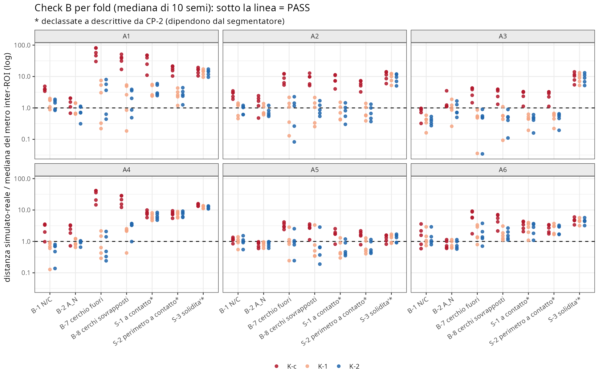
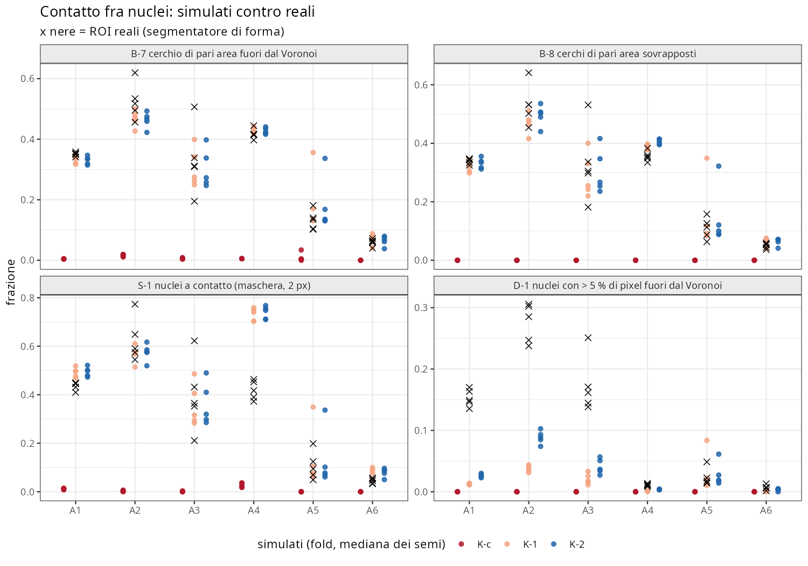
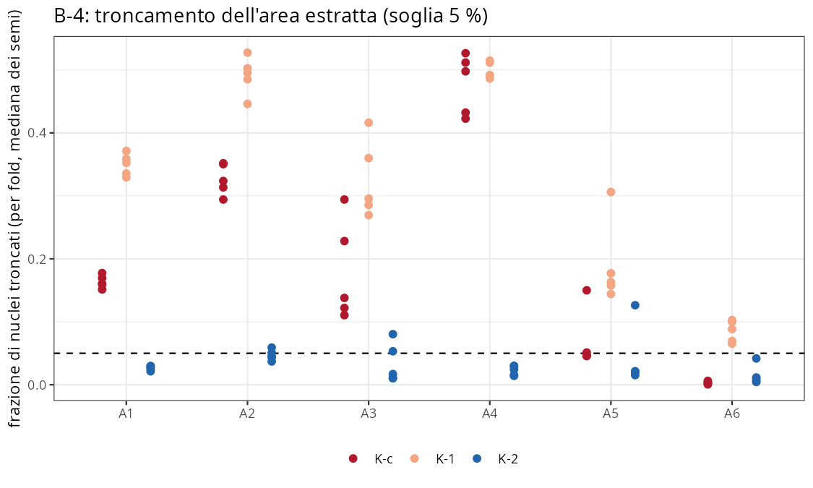
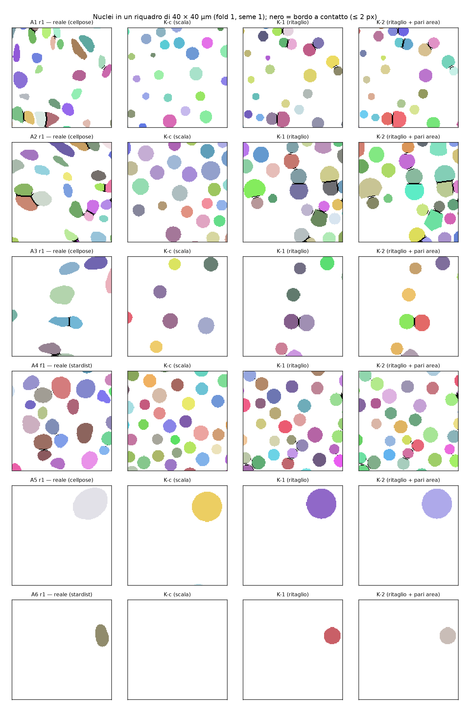
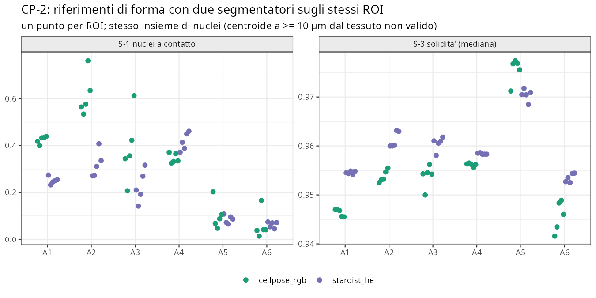

```{r setup}
#| include: false
.libPaths("~/2025.geo_spatialtrans/renv/library/linux-ubuntu-noble/R-4.6/x86_64-pc-linux-gnu")
suppressPackageStartupMessages({ library(knitr) })
R <- "../results/S1.4c"; FIG <- file.path(R, "fig")
rd <- function(f) read.csv(file.path(R, f), check.names = FALSE)
tb <- function(x, ...) kable(x, row.names = FALSE, ...)
vt <- rd("S1.4c_verdicts.csv"); ck <- rd("S1.4c_checks.csv"); dc <- rd("S1.4c_decision.csv"); b4 <- rd("S1.4c_b4.csv")
cp0 <- rd("S1.4c_cp0.csv"); cp1 <- rd("S1.4c_cp1.csv"); cp2 <- rd("S1.4c_cp2.csv"); pr <- rd("S1.4c_predictions.csv")
rf <- rd("S1.4c_real_refs.csv"); ob <- rd("S1.4c_obs_raw.csv"); bs <- rd("S1.4c_bootstrap.csv"); phi <- rd("S1.4c_phi.csv")
wide <- function(m) { z <- vt[vt$metric == m, c("variant", "archetype", "verdict")]
  w <- reshape(z, idvar = "variant", timevar = "archetype", direction = "wide"); names(w) <- sub("verdict.", "", names(w))
  w$metrica <- m; w[order(match(w$variant, c("K-c", "K-1", "K-2"))), c("metrica", "variant", paste0("A", 1:6))] }
```

**Obiettivo unico**: decidere il modello di forma del nucleo nei tessuti densi — **scalare** (K-c, pacchetto attuale,
D-S1.4.2) contro **ritagliare nel territorio** (K-1, K-2) — sui 30 tassellamenti primari di S1.4, parametri M2 e semi di
S1.4, misurando reali e simulati con **lo stesso operatore** (nuclei simulati rasterizzati sulla griglia nativa del ROI).
Prototipo in `tools/`; `R/04b3*`, `R/04b4*` non modificati (implementazione in S1.4d).

| Variante | Centro | Forma |
|---|---|---|
| **K-c** | POI | 32-gono di area M2, scala ridotta dal clamp 0.85 (= V-c di S1.4b) |
| **K-1** | generatore | 32-gono di area M2 ∩ territorio di Voronoi (solo ritaglio) |
| **K-2** | generatore | come K-1, raggio aumentato finché l'area ritagliata = target; tetto φ·A_T, φ = min(1, q99 di N/C dei ROI di addestramento) |

# 1. Pre-registrazione

Testo integrale: `results/S1.4c/S1.4c_preregistration.md` (commit `c41cf8b`), approvato da Luca il 2026-10-15 («vai»),
dopo le scelte «Banco + decisione; implementazione in 04b4 nella sessione dopo» e «K-c, K-1, K-2 nel Voronoi».
Definizioni operative e difetti di sviluppo: `results/S1.4c/S1.4c_dev_notes.md` (commit `e76cb6d`, prima degli stadi
ufficiali, con il codice di analisi e decisione e i loro test — BL-090 d).

| Check | Attesa | Soglia | Fonte |
|---|---|---|---|
| C-0 | K-c = V-c di S1.4b | identico | S1.4b |
| C3 / C-NO / C-area | K-1, K-2 nel territorio; disgiunti; K-2 area = target | 0 / 0 / ≤ 1e-6 | design §7.2 |
| C-R | operatore raster su casi analitici | dev notes | — |
| C-mut | 5 mutanti | 5/5 | prassi |
| C-perf | K-2 su 449 536 celle | ≤ 300 s, ≤ 8 GB (solo WARN) | design §6.2 |
| B-1, B-2 | KS di N/C e A_N | metro inter-ROI, mediana di 10 semi | S1.4 |
| B-7, B-8 | cerchio di pari area fuori dal Voronoi dei centroidi; cerchi sovrapposti | metro inter-ROI | S1.4 PH-1, S1.4b |
| S-1, S-2, S-3 | nuclei a contatto (2 px); perimetro a contatto; solidità | metro inter-ROI | nuove |
| B-4 | frazione troncata | ≤ 5 % (fuori dal punteggio) | ROADMAP §4 |
| CP-0 | sovrapposizione dei cerchi predice il contatto reale | AUC ≥ 0.75 in ≥ 3 di A1–A4 | convenzione |
| CP-1 | guadagno K-2 su K-c specifico dei tessuti densi | guadagno A5+A6 < guadagno per coppia A1–A4 | — |
| CP-2 | riferimenti di forma robusti al segmentatore | altrimenti metrica S descrittiva | — |
| Regola | punteggio ≥ K-c + 3 e P(bootstrap) ≥ 0.9; parità → la più semplice | — | convenzioni senza fonte |

**Difetti trovati in sviluppo** (prima del run, dev notes D-1…D-5): ritaglio sulla griglia F1 (C3 36/~1 000 → territorio
rientrato di 1e-5 µm), buffer negativo con modello di precisione che restituisce poligoni vuoti in silenzio (23/674),
sentinella dell'operatore raster (contatti spuri), tolleranza di K-2, mutante MU2 con n = 1.
**Difetti trovati dopo il run, nel codice di analisi** (D-6, D-7): (D-6) K-2 risultava non eleggibile perché il filtro
dell'eleggibilità includeva la riga di C-perf (WARN), contro il testo «C-perf solo WARN»; la prima analisi riportava
quindi «scelta: K-1». Corretto, la scelta per regola è **K-2**. (D-7) AUC di CP-0 in A4 = NA per overflow di interi;
corretto (0.974). Entrambe le correzioni sono dichiarate; la tabella prima della correzione è conservata.

# 2. Check C — correttezza software

```{r}
tb(ck[, c("check", "what", "value", "threshold", "verdict")])
```

C-perf è un **WARN** (622.7 s contro 300 s): la bisezione su 449 536 celle esegue fino a 53 intersezioni GEOS per cella
ritagliata; per S1.4d serve un punto di partenza analitico o una bisezione limitata alle celle ritagliate.

# 3. Check B — plausibilità biologica (A1–A6)

CP-2 (§4) ha declassato **S-1, S-2 e S-3** a descrittive: il pannello della decisione è {B-1, B-2, B-7, B-8} (24 celle).

```{r}
tb(do.call(rbind, lapply(c("B1", "B2", "B7", "B8"), wide)), caption = "Verdetti d'archetipo, pannello della decisione")
tb(do.call(rbind, lapply(c("S1", "S2", "S3", "S1d1", "S2d1", "D1m1", "D1m2"), wide)), caption = "Metriche descrittive (fuori dal punteggio)")
```





```{r}
s <- aggregate(cbind(b7, b8, s1, sol_med, m2) ~ archetype + variant, ob, median)
r <- aggregate(cbind(b7, b8, s1, s3_median, m2) ~ archetype, rf, mean)
names(r) <- c("archetype", "b7 reale", "b8 reale", "s1 reale", "solidità reale", "m2 reale")
x <- merge(s, r); x[, -(1:2)] <- round(x[, -(1:2)], 3)
tb(x[order(x$archetype, match(x$variant, c("K-c", "K-1", "K-2"))), ], caption = "Valori (mediana dei fold × semi; reali: media dei 5 ROI)")
b4$trunc_all <- round(b4$trunc_all, 3); b4$loss_all <- round(b4$loss_all, 4)
tb(b4[order(b4$archetype, match(b4$variant, c("K-c", "K-1", "K-2"))), ], caption = "B-4: frazione troncata e perdita media d'area")
```





**Lettura.**

- **K-c non produce contatti**: B-7 ≈ 0.005, B-8 = 0 e S-1 ≈ 0.01 in tutti gli archetipi, contro valori reali da 0.05
  (A6) a 0.6 (A2). K-1 e K-2 portano B-7 e B-8 vicino ai reali ovunque.
- **A1 resta FAIL**: i 5 ROI di A1 sono molto omogenei (mediana del metro di B-7 0.006), quindi anche uno scarto
  di 0.02 su 0.35 fallisce.
- **K-2 elimina il troncamento**: 1.5–4.7 % contro 16–48 % di K-c in A1–A4. Migliora anche B-1/B-2 in A2, A4 e A6.
- **Discrepanze che restano con ogni variante**:
  - D-1: i nuclei reali sconfinano oltre il Voronoi dei centroidi molto più dei simulati (m2 0.15–0.28 contro
    0.03–0.09 in A1–A3). La faccia di contatto reale non cade sulla bisettrice, il che rimanda a Laguerre (BL-117).
  - I nuclei simulati sono più convessi (solidità 0.960–0.976 contro 0.947–0.975) e circolari, mentre i reali sono allungati.
  - In A4 S-1 simulato vale 0.75 contro 0.42, perché i simulati stanno sui generatori Space Ranger (circa il 40 % in più dei
    nuclei StarDist che fanno da vicini reali).

```{r}
tb(aggregate(cbind(q99, phi) ~ archetype, phi, function(z) round(median(z), 3)), caption = "Tetto di K-2: q99 di N/C reale dei ROI di addestramento (mediana dei 5 fold)")
```

# 4. Controprova

**CP-0 (premessa di BL-098 riformulata, senza modello).** Sulle coppie di Delaunay dei nuclei reali, la sovrapposizione
dei cerchi di pari area predice il contatto in maschera con AUC 0.95–0.97 in A1–A4: **premessa non smentita**.

```{r}
cp0$auc <- round(cp0$auc, 3); cp0$frac_contact <- round(cp0$frac_contact, 3); tb(cp0)
```

**CP-1 (controllo negativo).**

```{r}
tb(cp1)
```

**Smentita, al limite.** Sulle 7 metriche il guadagno in A5 + A6 (3 PASS) è uguale al guadagno medio per coppia in
A1–A4 (6/2 = 3), e la regola pre-registrata usa «≥». Sul pannello della decisione è 1 contro 4/2 = 2.

Il guadagno dipende dal fatto che K-c non ammette alcun contatto, e questo vale anche nei tessuti radi, dove i contatti
reali sono il 5–11 %. Il miglioramento di K-2 è quindi **generale** (ammettere il contatto) e non legato alla densità.
Come prova di una deformazione legata alla densità, la controprova non regge.

**CP-2 (robustezza dei riferimenti al segmentatore).**

```{r}
tb(cp2[, c("metric", "archetype", "primary", "d_seg", "yard_max", "n_roi_above", "exceeds", "primary_value", "other_value")])
```



Le tre metriche di forma superano il massimo del metro inter-ROI in almeno 3/6 archetipi:

- S-1 e S-2 in 4/6;
- S-3 in 6/6, con StarDist sistematicamente più convesso (forme stellate per costruzione).

In A1–A3 la frequenza di contatto reale cambia di 1.5–2× fra i due segmentatori. Per regola, S-1, S-2 e S-3 sono
diventate descrittive. **I riferimenti di forma a livello di maschera non sono un bersaglio affidabile** finché non c'è
una verità di riferimento (BL-024 / R2b).

## Previsioni

```{r}
tb(pr[, c("id", "text", "observed", "confirmed")])
```

## Decisione

```{r}
tb(dc[, c("variant", "eligible", "score", "score_Kc", "margin_ok", "p_boot", "p_ok", "wins", "choice")])
tb(data.frame(variante = names(bs), media = round(colMeans(bs), 2), min = apply(bs, 2, min), max = apply(bs, 2, max)), caption = "Bootstrap sui semi (200 repliche, appaiato)")
```

Per regola: **K-2**. K-2 resta **contenuto** nel territorio (C3 = 0), quindi design §7.2 e lo Step 2 non cambiano.

# Verdetto

```{r}
#| echo: false
vf <- file.path(R, "review", "S1.4c_verdict.md"); if (file.exists(vf)) cat(readLines(vf), sep = "\n")
```

# Revisione avversariale

```{r}
#| echo: false
rv <- file.path(R, "review", "S1.4c_review_summary.csv"); if (file.exists(rv)) tb(read.csv(rv, check.names = FALSE))
rm_ <- file.path(R, "review", "S1.4c_review.md"); if (file.exists(rm_)) cat(readLines(rm_), sep = "\n")
```

# Riproducibilità

Commit: vedi `git log` (pre-registrazione `c41cf8b`, codice `e76cb6d`, risultati `d710cfb`). Comandi dalla root del repo:

```bash
bash tools/run_S1.4c.sh            # test, prep, real, cp2, gen, sim, obs, mut, perf; grezzi in /mnt/micron/geo_spatialtrans/S1.4c/
R_LIBS_SITE=/nonexistent R_LIBS_USER=/nonexistent Rscript --vanilla tools/S1.4c_analysis.R
R_LIBS_SITE=/nonexistent R_LIBS_USER=/nonexistent Rscript --vanilla tools/S1.4c_figures.R && .venv/bin/python tools/S1.4c_fig_maps.py
quarto render reports/S1.4c.qmd
```
