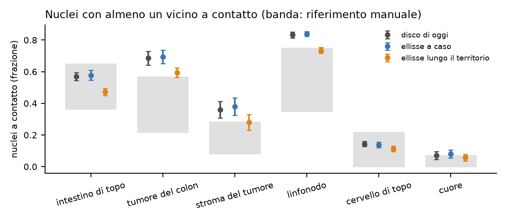
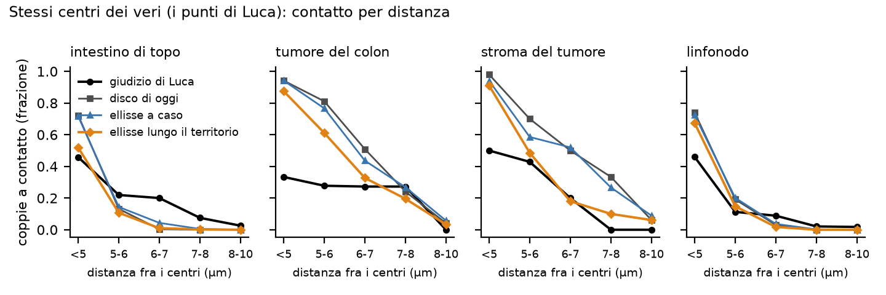
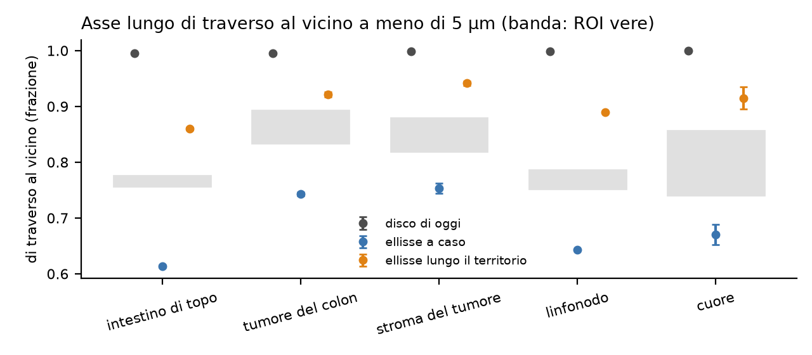

```{r setup}
#| include: false
.libPaths("~/2025.geo_spatialtrans/renv/library/linux-ubuntu-noble/R-4.6/x86_64-pc-linux-gnu")
suppressPackageStartupMessages({ library(knitr) })
R <- "../results/S1.4e"; rd <- function(f) read.csv(file.path(R, f), stringsAsFactors = FALSE, check.names = FALSE)
TIS <- c(A1 = "intestino di topo", A2 = "tumore del colon", A3 = "stroma del tumore", A4 = "linfonodo", A5 = "cervello di topo", A6 = "cuore")
V <- rd("S1.4e_verdicts.csv")
```



# Decisioni e verifiche di Luca



# Dubbi rinviati



# Cancelli, previsioni e regola

Pre-registrazione: cancelli al commit `250b31d`; ok di Luca il 2026-10-28 («vai», commit `932f883`). Codice e test al commit `174f08e`; risultati prima della revisione `9a198a8`; correzioni della revisione `9c30d16`.

Bracci: **K2** il disco di oggi, ritagliato nel territorio e riportato all'area giusta; **ER** ellisse con l'eccentricità vera del tessuto, orientata a caso; **ET** la stessa ellisse lungo l'asse maggiore del territorio. Stessi centri, territori, semi e aree bersaglio.

```{r pred}
w <- reshape(V[, c("id", "archetype", "arm", "est", "se", "lo", "hi", "verdict")], idvar = c("id", "archetype", "lo", "hi"), timevar = "arm", direction = "wide")
f <- function(e, s, v) ifelse(is.na(e), "", sprintf("%.3f ± %.3f %s", e, 2 * s, v))
tab <- data.frame(id = w$id, tessuto = TIS[w$archetype], intervallo = sprintf("%.3f-%.3f", w$lo, w$hi),
                  K2 = f(w$est.K2, w$se.K2, w$verdict.K2), ER = f(w$est.ER, w$se.ER, w$verdict.ER), ET = f(w$est.ET, w$se.ET, w$verdict.ET), check.names = FALSE)
tab <- tab[order(tab$id, names(TIS)[match(tab$tessuto, TIS)]), ]
kable(tab, row.names = FALSE, caption = "Previsioni: stima ± 2 errori standard ed esito per braccio (P-1, P-2: seme; P-3, P-4: ROI; P-3 di K2 descrittiva)")
kable(rd("S1.4e_ruleN.csv"), caption = "Regola N: conferme in P-1 e P-2 per braccio; condizioni (a) almeno K2 + 2, (b) nessun tessuto confermato da K2 in P-1 diventa smentito")
```



Cosa guardare: nei quattro tessuti densi l'ellisse lungo il territorio (arancione) scende di circa un decimo e porta tumore del colon, stroma e linfonodo al bordo della banda; l'ellisse a caso (blu) coincide con il disco.



Cosa guardare: nell'intestino l'ellisse orientata segue il giudizio manuale sotto i 6 µm; nel tumore del colon e nello stroma, a meno di 6 µm, tutti i disegni si toccano molto più del giudizio di Luca.



Cosa guardare: il vero sta fra l'ellisse a caso e l'ellisse orientata, che allinea troppo.

# Dopo il risultato: cancelli, controprove, post hoc e revisione avversariale



```{r cp}
cp <- rd("S1.4e_cp.csv"); kable(cp[, intersect(c("id", "archetype", "contrast", "est", "se", "lo2", "hi2", "below_zero", "n_pairs", "verdict", "lo", "hi", "est_no_noise"), names(cp))], digits = 3, row.names = FALSE,
  caption = "Controprove: CP-1 (stessi centri, differenze per finestra; due letture) e CP-2 (P-2 con il rumore dei punti manuali)")
kable(rd("S1.4e_PH1_raters.csv"), digits = 3, row.names = FALSE, caption = "PH-1: Luca e Federica sulle stesse coppie (classi di distanza fra i punti di Luca)")
```

# Cosa è girato

- Banco B: 300 unità (30 ROI × 10 semi, seme = 20261021 + 1000 · i + s come S1.5d e S1.5e) e 3 ridisegni del nucleo per unità; banco A: 24 finestre × 10 semi × 3 bracci; lesexp-server, 20 worker a un thread (9.6 + 5.8 minuti, catena completa circa un quarto d'ora). Test, mutanti e regressioni circa un'ora, due volte (prima e dopo la revisione).
- md5 dei 310 file letti (dati veri, annotazioni, modelli di taglia di S1.4 e R3b, nuclei della CP-1 di R3b) identici prima e dopo.
- Comandi esatti nella sezione «Riproduzione» del file dello step.

```{r gates}
kable(rd("S1.4e_G3_check.csv"), row.names = FALSE, caption = "G-3: identità e invarianti")
kable(rd("S1.4e_G4_check.csv"), digits = 4, row.names = FALSE, caption = "G-4: seconda implementazione delle misure")
```

# Appendice

## Dubbi ricevuti



## Esplorazione prima della pre-registrazione



## Pre-registrazione (testo del file dello step)



## Descrittive

```{r desc}
d <- rd("S1.4e_desc.csv"); kable(d[d$desc != "banco A curva", ], digits = 4, row.names = FALSE, caption = "Descrittive senza verdetto (curve del banco A nella figura 2)")
kable(rd("S1.4e_refs.csv"), digits = 3, row.names = FALSE, caption = "Intervalli calcolati sui dati veri prima del banco (R-1 bootstrap a due stadi; R-2, R-3 minimo-massimo dei ROI)")
```

## Da dove vengono i numeri del riassunto


