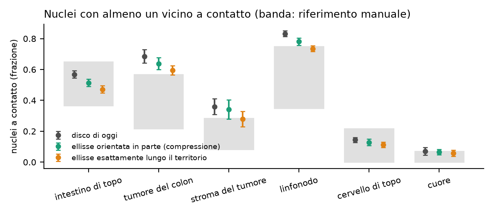
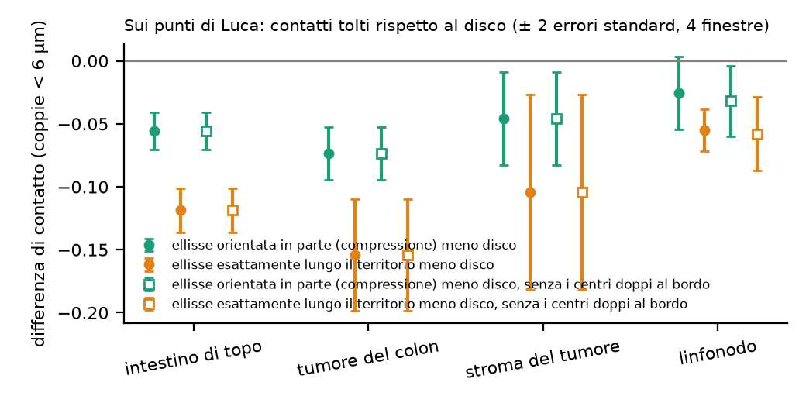

```{r setup}
#| include: false
.libPaths("~/2025.geo_spatialtrans/renv/library/linux-ubuntu-noble/R-4.6/x86_64-pc-linux-gnu")
suppressPackageStartupMessages({ library(knitr) })
R <- "../results/S1.4f"; rd <- function(f) read.csv(file.path(R, f), stringsAsFactors = FALSE, check.names = FALSE)
TIS <- c(A1 = "intestino di topo", A2 = "tumore del colon", A3 = "stroma del tumore", A4 = "linfonodo", A5 = "cervello di topo", A6 = "cuore")
V <- rd("S1.4f_verdicts.csv")
```



# Decisioni e verifiche di Luca



# Dubbi rinviati



# Cancelli, previsioni e regole

Pre-registrazione al commit `ebb2b34`; ok di Luca il 2026-10-28 («vai», commit `5577770`). Codice e test al commit `ea26c00`; risultati prima della revisione `176e93c`.

Bracci: **K2** il disco di oggi, ritagliato nel territorio e riportato all'area giusta; **ET** ellisse con l'allungamento vero del tessuto, esattamente lungo l'asse maggiore del territorio; **EP** la stessa ellisse orientata in parte: angolo del territorio più una deviazione dalla Cauchy avvolta, con concentrazione legata alla compressione della cellula (legge scelta dalla regola O) e tarata sull'allineamento vero sotto i 5 µm con pieghe lascia-fuori-un-ROI. Stessi centri, territori, semi e aree bersaglio.

```{r pred}
w <- V[V$arm %in% c("K2", "EP", "ET"), ]
w <- reshape(w[, c("id", "archetype", "cls", "arm", "est", "se", "lo", "hi", "verdict")], idvar = c("id", "archetype", "cls", "lo", "hi"), timevar = "arm", direction = "wide")
f <- function(e, s, v) ifelse(is.na(e), "", sprintf("%.3f ± %.3f %s", e, 2 * s, v))
tab <- data.frame(id = w$id, tessuto = TIS[w$archetype], classe = w$cls, intervallo = sprintf("%.3f-%.3f", w$lo, w$hi),
                  K2 = f(w$est.K2, w$se.K2, w$verdict.K2), EP = f(w$est.EP, w$se.EP, w$verdict.EP), ET = f(w$est.ET, w$se.ET, w$verdict.ET), check.names = FALSE)
tab <- tab[order(tab$id, names(TIS)[match(tab$tessuto, TIS)], tab$classe), ]
kable(tab, row.names = FALSE, caption = "Previsioni: stima ± 2 errori standard ed esito per braccio (P-1, P-2: seme; P-3, P-4, P-5: ROI)")
p5 <- V[V$id == "P-5" & V$arm %in% c("V0", "V1", "V2"), ]
kable(data.frame(legge = p5$arm, tessuto = TIS[p5$archetype], classe = p5$cls, stima = sprintf("%.3f ± %.3f", p5$est, 2 * p5$se), intervallo = sprintf("%.3f-%.3f", p5$lo, p5$hi), esito = p5$verdict),
      row.names = FALSE, caption = "P-5 per le tre leggi (V0 costante, V1 allungamento del territorio, V2 compressione = EP)")
kable(rd("S1.4f_ruleO.csv"), digits = 3, row.names = FALSE, caption = "Regola O: caselle di P-5 dentro R-4 con i semi 1-5; pari punteggio deciso dalla somma degli scarti")
kable(rd("S1.4f_ruleN2.csv"), row.names = FALSE, caption = "Regola N2: conferme in P-1 e P-2; condizioni (a) almeno K2 + 2, (b) nessun tessuto confermato da K2 in P-1 diventa smentito, (c) P-3 smentita al più in 2 tessuti")
```



Cosa guardare: il nucleo orientato in parte (verde) sta circa a metà fra il disco (grigio) e l'ellisse orientata esattamente (arancione); nel tumore del colon e nel linfonodo resta sopra la banda.


Cosa guardare: sotto i 5 µm le tre leggi coincidono con il vero (è la classe della taratura); a 5-8 µm il vero cala verso il caso mentre i nuclei simulati restano più allineati; l'asse del territorio è di traverso al vicino allo stesso modo nei tessuti veri e nei simulati.



Cosa guardare: il nucleo orientato in parte toglie circa la metà dei contatti tolti dall'ellisse orientata esattamente; togliere i doppioni al bordo non sposta nulla.

# Dopo il risultato: taratura, cancelli, controprove, post hoc e revisione avversariale



```{r cp}
cp <- rd("S1.4f_cp.csv"); kable(cp[, intersect(c("id", "archetype", "contrast", "est", "se", "lo2", "hi2", "below_zero", "n_pairs", "verdict"), names(cp))], digits = 3, row.names = FALSE,
  caption = "Controprova CP-1 (stessi centri), sensibilità S-1 (senza i doppioni al bordo) e cuore")
kable(rd("S1.4f_S1.csv"), digits = 4, row.names = FALSE, caption = "S-1: variazione dei contrasti di CP-1 togliendo i doppioni (entro 2 errori standard)")
kable(rd("S1.4f_PH2_verdicts.csv"), digits = 3, row.names = FALSE, caption = "PH-2: contatti della legge perdente della regola O (V1) contro EP")
ph <- rd("S1.4f_PH1_territory_nn.csv"); a <- aggregate(frac ~ source + what + archetype + cls, data = aggregate(frac ~ source + what + archetype + roi_id + cls, data = ph, FUN = mean), FUN = mean)
kable(reshape(a, idvar = c("source", "what", "archetype"), timevar = "cls", direction = "wide"), digits = 3, row.names = FALSE, caption = "PH-1: quota di traverso al vicino per classe di distanza; asse del territorio (veri e simulati) e asse del nucleo vero")
```

# Cosa è girato

- Taratura: 150 unità (30 ROI × semi 1-5) × 3 leggi × 12 valori di λ = 5 400 ridisegni, 24.5 minuti; banco B: 300 unità (seme = 20261021 + 1000 · i + s, come S1.5d, S1.5e, S1.4e) × 5 bracci, 12.2 minuti; banco A: 24 finestre × 10 semi × 3 bracci × 2 versioni (con e senza doppioni), 8.3 minuti; lesexp-server, 20 worker a un thread. Catena completa circa un'ora (una ripresa dopo un errore di serializzazione nello stadio delle coppie). Test, mutanti e regressioni circa mezz'ora per passata, tre passate.
- md5 dei 4 147 file letti (dati veri, annotazioni, modelli di taglia di S1.4 e R3b, nuclei, raster e coppie di S1.4e) identici prima e dopo.
- Comandi esatti nella sezione «Riproduzione» del file dello step.

```{r gates}
kable(rd("S1.4f_G3_check.csv"), row.names = FALSE, caption = "G-3: identità e invarianti")
kable(rd("S1.4f_G4_check.csv"), digits = 4, row.names = FALSE, caption = "G-4: seconda implementazione della legge e dell'estrazione")
kable(rd("S1.4f_G4_ks.csv"), digits = 4, row.names = FALSE, caption = "G-4 per legge e tessuto")
```

# Appendice

## Dubbi ricevuti



## Esplorazione prima della pre-registrazione



## Pre-registrazione (testo del file dello step)



## Descrittive e riferimenti

```{r desc}
kable(rd("S1.4f_desc.csv"), digits = 4, row.names = FALSE, caption = "Descrittive senza verdetto")
L <- rd("S1.4f_lambda.csv"); kable(L[, c("law", "archetype", "roi_id", "t", "lambda", "clamped", "target")], digits = 4, row.names = FALSE, caption = "Taratura lascia-fuori-un-ROI: lambda per legge e ROI di prova")
r <- rd("S1.4f_refs.csv"); kable(r[, c("ref", "archetype", "cls", "n", "n_roi", "est", "lo", "hi")], digits = 3, row.names = FALSE, caption = "Intervalli R-2 e R-4 calcolati sui dati veri prima del banco")
```

## Da dove vengono i numeri del riassunto


