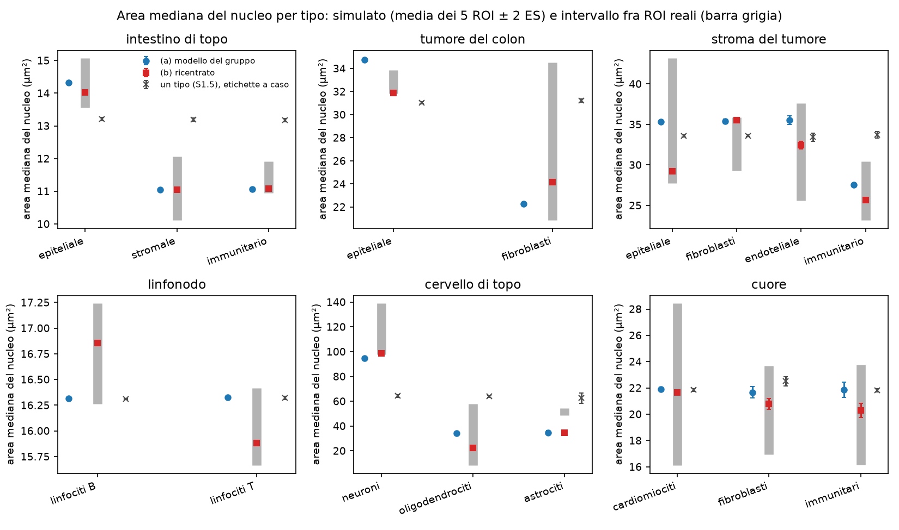
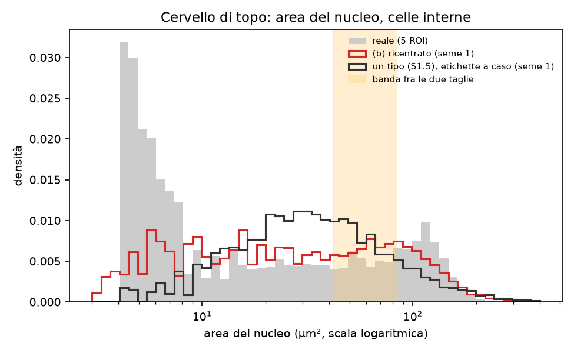
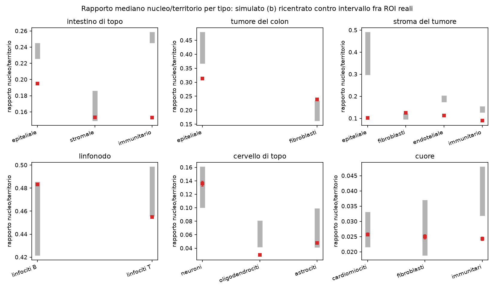
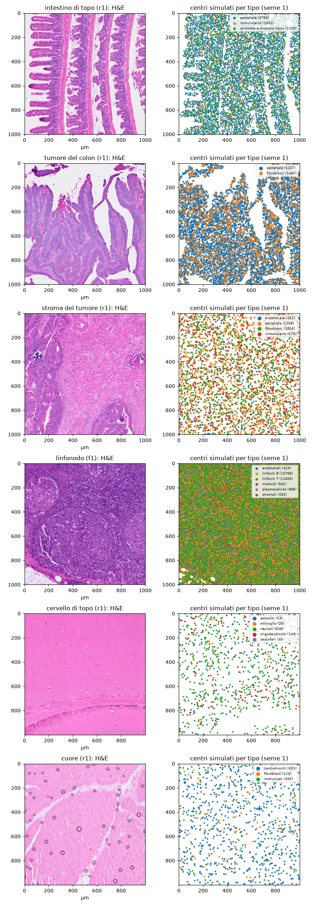

```{r setup}
#| include: false
.libPaths("~/2025.geo_spatialtrans/renv/library/linux-ubuntu-noble/R-4.6/x86_64-pc-linux-gnu")
suppressPackageStartupMessages({ library(knitr) })
R <- "../results/S1.5b"; rd <- function(f) read.csv(file.path(R, f), stringsAsFactors = FALSE, check.names = FALSE)
TIS <- c(A1 = "intestino di topo", A2 = "tumore del colon", A3 = "stroma del tumore", A4 = "linfonodo", A5 = "cervello di topo", A6 = "cuore")
V <- rd("S1.5b_verdicts.csv"); AR <- rd("S1.5b_arm_rule.csv")
```



# Decisioni e verifiche di Luca



# Dubbi rinviati



# Cancelli

Pre-registrazione: commit `e0e015e` (cancelli e previsioni); ok di Luca il 2026-10-22 («Approvo così»), commit `9b92488`. Codice `fe432e8`; correzioni dopo la revisione `858dd1c`, predefiniti `946df1d`.

```{r gates}
g3 <- rd("S1.5b_G3_check.csv"); g4 <- rd("S1.5b_G4_calcheck.csv")
b <- rd("S1.5b_md5_before.csv"); a <- rd("S1.5b_md5_after.csv")
l1 <- readLines(file.path(R, "S1.5b_G1_test.log")); l2 <- readLines(file.path(R, "S1.5b_G2_mutants.log"))
kable(data.frame(
  id = paste0("G-", 1:5),
  controllo = c("batteria di test (`R/testing/run_S1.5b.sh test`): test_S1.5b, test_S1.5, test_S1.4d, regressioni S1.1-S1.4, OKF",
                "mutanti (`run_S1.5b.sh mutants`)", "invarianti, riproducibilità, compatibilità sul banco (`tools/S1.5b_bench.R check`, md5)",
                "calibrazione ricalcolata in R (`tools/S1.5b_calcheck.R`)", "ricalcolo indipendente della revisione avversariale"),
  esito = c(paste(grep("^RISULTATO|^GATE G-1 PASS$", l1, value = TRUE), collapse = "; "), grep("^mutanti rilevati", l2, value = TRUE),
            sprintf("%s; md5 dei dati %d/%d", paste(sprintf("%s %s/%s", g3$check, g3$value, g3$expected), collapse = "; "), sum(a$md5 == b$md5[match(a$file, b$file)]), nrow(b)),
            sprintf("%d/%d confronti applicabili entro tolleranza", sum(g4$pass & g4$applies), sum(g4$applies)),
            "3 583/3 583 confronti identici (secondo giro); 92 unità rigenerate, md5 identico")), caption = "Cancelli (giro finale)")
```

# Previsioni

Unità indipendente: ROI (valore del ROI = media dei 10 semi); stima = media dei 5 ROI ± 2 errori standard. Intervalli = minimo e massimo fra le 5 ROI reali, dall'insieme di calibrazione (P-2, P-3, P-4, P-7) o da S1.5 (P-1, P-5, P-8). Il braccio vincente è «ricentrato»; gli altri due bracci si riportano accanto.

```{r rule}
kable(AR, caption = "Regola del braccio: tipi confermati in P-2 (17 tipi principali), poi tessuti confermati in P-1")
```

```{r pred}
w <- reshape(V[, c("id", "archetype", "unit", "arm", "est", "se", "lo", "hi", "verdict")], idvar = c("id", "archetype", "unit", "lo", "hi"), timevar = "arm", direction = "wide")
f <- function(e, s) sprintf("%.4g ± %.2g", e, 2 * s)
tab <- data.frame(id = w$id, tessuto = TIS[w$archetype], unità = w$unit, intervallo = sprintf("%.4g-%.4g", w$lo, w$hi),
                  ricentrato = f(w$est.recentred, w$se.recentred), esito = w$verdict.recentred,
                  gruppo = paste(f(w$est.group, w$se.group), w$verdict.group), `un tipo (nullo)` = paste(f(w$est.single, w$se.single), w$verdict.single), check.names = FALSE)
tab <- tab[order(tab$id, names(TIS)[match(tab$tessuto, TIS)]), ]
kable(tab, row.names = FALSE, caption = "Previsioni P-1...P-8: stima ± 2 errori standard ed esito, tre bracci")
```



Cosa guardare: i quadrati rossi (braccio ricentrato) stanno nelle barre grigie in quasi tutti i tipi; le croci (un tipo, etichette a caso) no nell'intestino, nel tumore e nel cervello; gli astrociti restano sotto in entrambi i bracci per tipo.



Cosa guardare: il simulato ha le due taglie ma riempie la banda fra le due; nel reale il picco a 4-8 µm² sono gli oggetti minuscoli di PH-2.



Cosa guardare: nei tessuti dove i tipi veri hanno territori diversi (intestino, tumore, stroma) il simulato sta fuori dalle barre: lo spazio attorno al nucleo dipende dalla semina, non dal modello di taglia.

# Controprova

CP-1 (nessun tipo): il braccio a un tipo, con le etichette estratte a caso secondo la composizione, conferma P-2 in `r AR$p2_confirmed[AR$arm == "single"]` tipi su 17 contro `r AR$p2_confirmed[AR$arm == "recentred"]` del braccio vincente, con smentite in intestino, tumore del colon e cervello; rapporto neuroni/glia `r sprintf("%.2f", V$est[V$id == "P-3" & V$arm == "single"])`. Superata.

# Dopo il risultato: scelte, deviazioni, post hoc e revisione avversariale



# Cosa è girato

- Banco v2: 900 unità (30 ROI × 10 semi × 3 bracci), seme = 20261021 + 1000 · i + s come S1.5, generato al commit `858dd1c` su lesexp-server con 16 worker a un thread in 17.2 minuti; banco v1 (prima della correzione della semina) al commit `fe432e8`, 81.9 minuti con 3-6 worker, conservato in `results/S1.5b/_v1_before_review/`.
- md5 dei 101 file reali letti: identici prima e dopo (`S1.5b_md5_before.csv`, `S1.5b_md5_after.csv`).
- Tempi per unità (mediana, secondi):

```{r times}
kable(rd("S1.5b_desc_time.csv"), caption = "Tempo di place_cells() per unità (mediana, s)")
```



# Appendice

## Gruppi di taglia e modelli per tipo

```{r cal}
cal <- rd("S1.5b_type_calibration.csv")
kable(data.frame(tessuto = TIS[cal$archetype], tipo = cal$cell_type, gruppo = cal$size_group, frazione = round(cal$fraction_tissue, 3),
                 rho = round(cal$rho_group, 4), beta = round(cal$beta_group, 4), sigma = round(cal$sigma_group, 4), m_t = round(cal$median_a_t_eval, 1),
                 densità_tipo = round(cal$density_type), rho_ricentrato = round(cal$rho_catalog_recentred, 4)), row.names = FALSE,
      caption = "Righe B-186...B-208: composizione, gruppo di taglia, modello del gruppo, territorio reale del tipo, densità del tipo puro, rho del catalogo")
kable(rd("S1.5b_size_groups.csv"), caption = "Traccia della regola dei gruppi di taglia")
```

## Distanza dal vicino più vicino per tipo

```{r nn}
nn <- rd("S1.5b_desc_nn.csv"); a <- aggregate(nn_median ~ archetype + cell_type + source, nn, mean)
kable(reshape(a, idvar = c("archetype", "cell_type"), timevar = "source", direction = "wide"), digits = 2, row.names = FALSE, caption = "Mediana della distanza dal vicino più vicino (µm), media dei ROI")
```

## Composizione del cervello (DEC-017) e post hoc

```{r a5}
kable(rd("S1.5b_a5_composition.csv"), digits = 3, caption = "Nuclei persi da Cellpose tipizzati dall'espressione")
kable(rd("S1.5b_posthoc_a5.csv"), digits = 3, caption = "PH-1: quota dei persi corretta per l'errore del trasferimento")
kable(rd("S1.5b_posthoc_a5_small.csv"), digits = 3, caption = "PH-2: oggetti di area < 8 µm² nel cervello")
```

## Da dove vengono i numeri del riassunto


