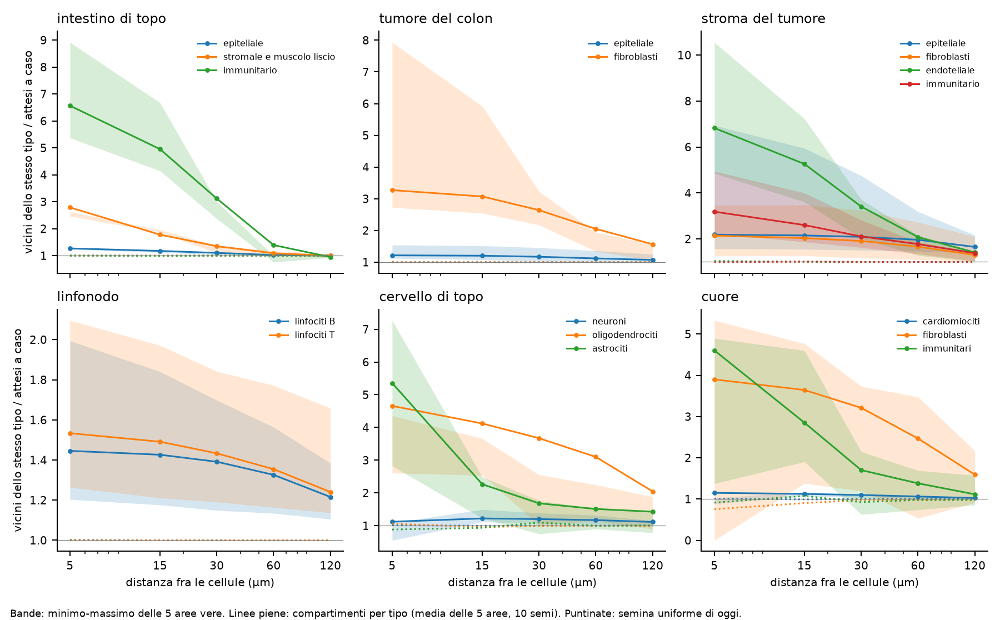
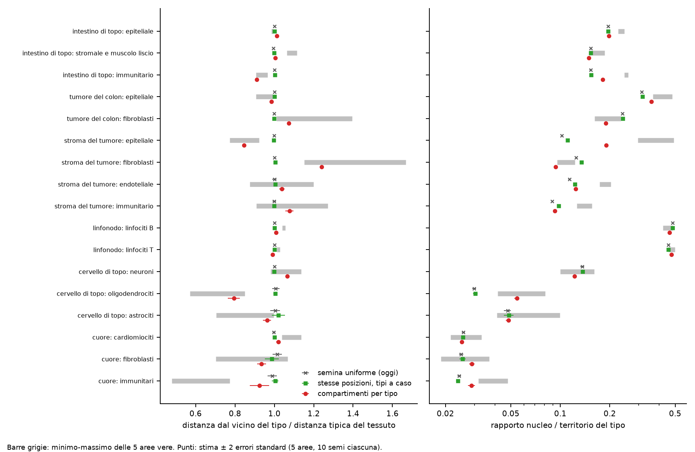
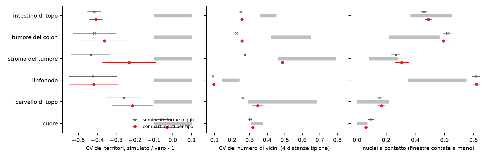
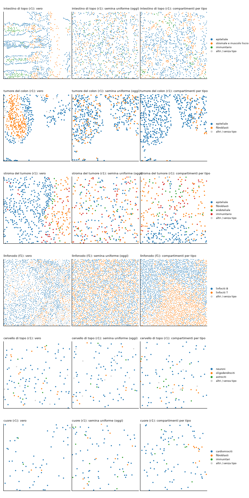

```{r setup}
#| include: false
.libPaths("~/2025.geo_spatialtrans/renv/library/linux-ubuntu-noble/R-4.6/x86_64-pc-linux-gnu")
suppressPackageStartupMessages({ library(knitr) })
R <- "../results/S1.5c"; rd <- function(f) read.csv(file.path(R, f), stringsAsFactors = FALSE, check.names = FALSE)
TIS <- c(A1 = "intestino di topo", A2 = "tumore del colon", A3 = "stroma del tumore", A4 = "linfonodo", A5 = "cervello di topo", A6 = "cuore")
V <- rd("S1.5c_verdicts.csv"); RU <- rd("S1.5c_rules.csv"); CP <- rd("S1.5c_cp1.csv")
```



# Decisioni e verifiche di Luca



# Dubbi rinviati



# Cancelli

Pre-registrazione: commit `1142efa` (cancelli e previsioni); ok di Luca il 2026-10-23 («Approvo così»), commit `0054ac9`. Codice `be0b9a3` (banco); analisi `0aaffb1`; test e ripieghi dopo la revisione nel commit di questo report.

```{r gates}
g3 <- rd("S1.5c_G3_check.csv"); g3b <- rd("S1.5c_G3_check_after_review.csv"); g4 <- rd("S1.5c_G4_calcheck.csv")
b <- rd("S1.5c_md5_before.csv"); a <- rd("S1.5c_md5_after.csv")
l1 <- readLines(file.path(R, "S1.5c_G1_test.log")); l2 <- readLines(file.path(R, "S1.5c_G2_mutants.log"))
g4a <- g4[g4$part == "a" & g4$checked %in% c(TRUE, "TRUE"), ]; g4p <- g4[g4$part == "b", ]
kable(data.frame(
  id = paste0("G-", 1:5),
  controllo = c("batteria di test (`R/testing/run_S1.5c.sh test`): test_S1.5c, batteria di S1.5b (S1.5b, S1.5, S1.4d, regressioni S1.1-S1.4, OKF)",
                "mutanti (`run_S1.5c.sh mutants`; M1-M8 pre-registrati, M9-M12 del revisore)", "invarianti, riproducibilità, compatibilità sul banco, md5 dei dati",
                "calibrazione rifatta in R (parte a) e parametri della piega nel banco (parte b)", "ricalcolo indipendente della revisione avversariale"),
  esito = c(paste(grep("^RESULT", l1, value = TRUE), "(dopo la revisione; 22/22 al primo giro ufficiale); batteria di S1.5b: GATE G-1 PASS"),
            grep("^mutanti rilevati", l2, value = TRUE),
            sprintf("%s; dopo la revisione: rerun %s/6; md5 dei dati %d/%d", paste(sprintf("%s %s/%s", g3$check, g3$value, g3$expected), collapse = "; "), g3b$value[g3b$check == "rerun_identical"],
                    sum(a$md5 == b$md5[match(a$file, b$file)]), nrow(b)),
            sprintf("**parte a FALLITA come scritta: %d/%d bin entro 0.10**; parte b %d/%d", sum(g4a$pass %in% c(TRUE, "TRUE")), nrow(g4a), sum(g4p$pass %in% c(TRUE, "TRUE")), nrow(g4p)),
            "768/768 verdetti, 3/3 regole, 78/78 celle della controprova, 12/12 unità rigenerate identici")), caption = "Cancelli")
```

# Previsioni

Unità indipendente: ROI (valore del ROI = media dei 10 semi); stima = media dei 5 ROI ± 2 errori standard; contatti: seme. Bracci: U semina uniforme di S1.5b; C compartimenti con la distanza del tessuto; N compartimenti con la distanza per nucleo; -a modello di taglia del gruppo, -b ricentrato; G stesse posizioni di C-b con i tipi mescolati (controprova). Il braccio vincente è N-a.

```{r rule}
kable(RU, caption = "Le tre regole pre-registrate")
kable(CP, caption = "Conferme per previsione e braccio (spatial = P-1...P-7, size = P-8)")
```

```{r pred}
w <- reshape(V[V$arm %in% c("U", "N-a", "C-a", "G"), c("id", "archetype", "unit", "arm", "est", "se", "lo", "hi", "verdict")], idvar = c("id", "archetype", "unit", "lo", "hi"), timevar = "arm", direction = "wide")
f <- function(e, s) sprintf("%.4g ± %.2g", e, 2 * s)
tab <- data.frame(id = w$id, tessuto = TIS[w$archetype], unità = w$unit, intervallo = sprintf("%.4g-%.4g", w$lo, w$hi),
                  `N-a (vincente)` = f(w$`est.N-a`, w$`se.N-a`), esito = w$`verdict.N-a`, U = paste(f(w$est.U, w$se.U), w$verdict.U),
                  `C-a` = paste(f(w$`est.C-a`, w$`se.C-a`), w$`verdict.C-a`), G = paste(f(w$est.G, w$se.G), w$verdict.G), check.names = FALSE)
ord <- c("P-1", "P-2", "P-3", "P-4", "P-5", "P-6", "P-7", "P-8a", "P-8b", "P-8c", "P-9", "P-10")
tab <- tab[order(match(tab$id, ord), names(TIS)[match(tab$tessuto, TIS)]), ]
kable(tab, row.names = FALSE, caption = "Previsioni P-1...P-10: stima ± 2 errori standard ed esito, quattro bracci (tutti e sei in S1.5c_verdicts.csv)")
```



Cosa guardare: con la semina uniforme tutte le curve stanno a 1; con i compartimenti la maggior parte entra nelle bande, con eccezioni a grande distanza (immunitarie dell'intestino) e nel cervello.



Cosa guardare: i punti rossi (compartimenti) si spostano verso le barre grigie dove i tipi hanno densità diverse (stroma, tumore, cervello); i quadrati verdi (stesse posizioni, tipi a caso) restano sulle croci della semina di oggi.



Cosa guardare: la variabilità dei territori resta lontana dalla banda in quattro tessuti; i contatti del linfonodo non cambiano.

# Controprova

CP-1 (stesse posizioni, tipi a caso): conferme spaziali `r CP$spatial[CP$arm == "G"]` contro `r CP$spatial[CP$arm == "N-a"]` del vincente; raggruppamento `r CP[["P-6"]][CP$arm == "G"]` contro `r CP[["P-6"]][CP$arm == "C-b"]` del braccio con le stesse posizioni (C-b). Dettagli nella sezione seguente.

# Dopo il risultato: scelte, deviazioni, post hoc e revisione avversariale





Cosa guardare: nei tessuti veri intestino e tumore del colon hanno spazi vuoti (lumi) dentro il tessuto, che la semina riempie; i compartimenti danno zone per tipo ma rotonde, non le bande delle cripte.

# Cosa è girato

- Banco: 1 800 unità (30 ROI × 10 semi × 6 bracci), seme = 20261021 + 1000 · i + s come S1.5 e S1.5b, generato al commit `be0b9a3` su lesexp-server con 3 worker a un thread in 248.7 minuti (con MMM in corsa).
- Calibrazione dei compartimenti al commit `1142efa` (prima della pre-registrazione), 6 tessuti in parallelo.
- md5 degli 88 file letti: identici prima e dopo.

```{r times}
d <- rd("S1.5c_desc.csv"); d <- d[grepl("D-desc-4", d$desc), c("archetype", "arm", "est")]
kable(reshape(d, idvar = "archetype", timevar = "arm", direction = "wide"), digits = 1, row.names = FALSE, caption = "Tempo mediano di place_cells() per unità (s)")
```

# Appendice

## Pre-registrazione (testo del file dello step)



## Calibrazione dei compartimenti

```{r calib}
P <- do.call(rbind, lapply(names(TIS), function(A) rd(sprintf("S1.5c_compartments_%s.csv", A))))
kable(P[P$fold == "pooled", c("archetype", "cell_type", "ell_um", "s", "f_t", "loss", "loss_null")], digits = 3, row.names = FALSE, caption = "Parametri su tutte le ROI (preset, B-209...B-231)")
L <- aggregate(cbind(ell_um, s) ~ archetype + cell_type, P[P$fold != "pooled", ], function(x) paste(range(x), collapse = "-"))
kable(L, row.names = FALSE, caption = "Intervallo dei parametri fra le 5 pieghe lascia-fuori")
```

## Post hoc: coda dei territori

```{r ph}
ph <- rd("S1.5c_posthoc_terr.csv"); a <- aggregate(cbind(q10, q90, q99, frac_gt3, cv, cv_trim) ~ archetype + source, ph, mean)
kable(a, digits = 3, row.names = FALSE, caption = "Area del territorio / mediana (celle interne), media dei 5 ROI")
```

## Controllo della calibrazione (G-4) e indagine Monte Carlo

```{r g4}
m <- rd("S1.5c_G4_mc.csv")
kable(m[, c("archetype", "cell_type", "bin", "real_pairs", "R_real", "R_fit_py3", "py10_mean", "R_fit_R10", "sd_log_3rep", "z_R10_vs_py10")], digits = 3, row.names = FALSE,
      caption = "Curve adattate: Python a 3 repliche (calibrazione), Python a 50 repliche (5 lotti), R a 10 repliche (G-4)")
```

## Da dove vengono i numeri del riassunto


