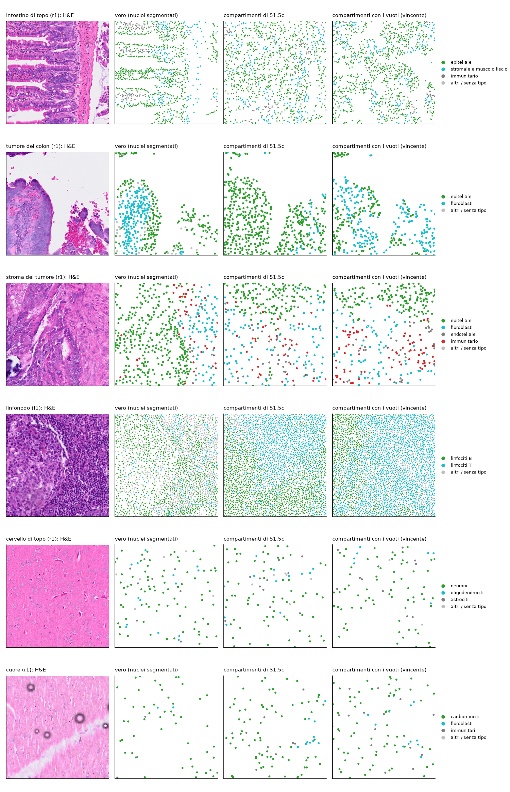

```{r setup}
#| include: false
.libPaths("~/2025.geo_spatialtrans/renv/library/linux-ubuntu-noble/R-4.6/x86_64-pc-linux-gnu")
suppressPackageStartupMessages({ library(knitr) })
R <- "../results/S1.5d"; rd <- function(f) read.csv(file.path(R, f), stringsAsFactors = FALSE, check.names = FALSE)
TIS <- c(A1 = "intestino di topo", A2 = "tumore del colon", A3 = "stroma del tumore", A4 = "linfonodo", A5 = "cervello di topo", A6 = "cuore")
V <- rd("S1.5d_verdicts.csv"); K <- rd("S1.5d_counts.csv")
```



# Decisioni e verifiche di Luca



# Dubbi rinviati



# Cancelli e regole

Pre-registrazione: commit `c9dc20d`; ok di Luca il 2026-10-25 sulle previsioni spaziali e sull'aggiunta del modello di taglia (commit `f234bb2`). Banco al commit `830e90e`; test, braccio di sensibilità e controlli dopo la revisione al commit `2866cd6`. Il dettaglio dei cinque cancelli è nella sezione «Dopo il risultato».

```{r rules}
kable(rd("S1.5d_ruleA.csv"), caption = "Regola A: famiglia dell'eterogeneità (conferme in P-1, P-2, P-7, P-13)")
kable(rd("S1.5d_ruleC.csv"), caption = "Regola C: modello di taglia (gaussian = modello di oggi; empirical = residui empirici per decimo di territorio)")
kable(rd("S1.5d_ruleC_sensitivity_U3c.csv"), caption = "Sensibilità della regola C sulla semina uniforme con il decimo cercato sul territorio ricentrato (U3c, D-14; non sostituisce la regola)")
kable(rd("S1.5d_ruleB.csv"), caption = "Regola B: predefinito dei preset")
kable(K, caption = "Conferme per previsione e braccio (spatial = P-1...P-7; size = P-8a, P-8b, P-8c; size_C = insieme della regola C)")
```

# Previsioni

Unità indipendente: ROI (valore della ROI = media dei 10 semi); stima = media delle 5 ROI ± 2 errori standard; contatti: seme. Bracci: U semina uniforme (predefinito); N compartimenti di S1.5c; R compartimenti ricalibrati; RV con i vuoti (vincente); RD con la densità variabile; RVD con entrambi; VF vuoti fini (controprova); W3, U3 residui empirici; W3p residui senza decimi (controprova); Q senza quote; U3c sensibilità.

```{r pred}
w <- reshape(V[V$arm %in% c("U", "N", "RV", "W3"), c("id", "archetype", "unit", "arm", "est", "se", "lo", "hi", "verdict")], idvar = c("id", "archetype", "unit", "lo", "hi"), timevar = "arm", direction = "wide")
f <- function(e, s) sprintf("%.4g ± %.2g", e, 2 * s)
tab <- data.frame(id = w$id, tessuto = TIS[w$archetype], unità = w$unit, intervallo = sprintf("%.4g-%.4g", w$lo, w$hi),
                  `RV (vincente)` = f(w$est.RV, w$se.RV), esito = w$verdict.RV, U = paste(f(w$est.U, w$se.U), w$verdict.U),
                  N = paste(f(w$est.N, w$se.N), w$verdict.N), W3 = paste(f(w$est.W3, w$se.W3), w$verdict.W3), check.names = FALSE)
ord <- c("P-1", "P-2", "P-3", "P-4", "P-5", "P-6", "P-7", "P-8a", "P-8b", "P-8c", "P-9", "P-10", "P-11", "P-12", "P-13", "P-14")
tab <- tab[order(match(tab$id, ord), names(TIS)[match(tab$tessuto, TIS)]), ]
kable(tab, row.names = FALSE, caption = "Previsioni: stima ± 2 errori standard ed esito, quattro bracci (tutti i dodici in S1.5d_verdicts.csv)")
```


Cosa guardare: con i vuoti (arancione) spazio vuoto e territori grandi entrano nelle bande dove prima (quadrati blu) stavano a zero; la variabilità dei territori dell'intestino arriva a zero; i contatti di tumore del colon e stroma escono dalla banda a destra.



Cosa guardare: i vuoti simulati sono macchie tondeggianti; nell'intestino i vuoti veri sono i lumi allungati fra i villi, che nessuna delle due semine riproduce.


Cosa guardare: a sinistra solo la semina uniforme di oggi e i vuoti con i residui empirici cadono nella gamma vera; i residui empirici sulla semina uniforme (triangolo, croce) vanno sotto, la controprova senza decimi (triangolo rovesciato) torna sopra. A destra le due versioni si spostano poco e le smentite sono negli stessi tipi.

# Dopo il risultato: cancelli, regole, controprove, post hoc e revisione avversariale



# Cosa è girato

- Banco: 3 600 unità (30 ROI × 10 semi × 12 bracci), seme = 20261021 + 1000 · i + s come S1.5c; bracci pre-registrati generati al commit `830e90e`, U3c al commit `2866cd6`, su lesexp-server con 20-24 worker a un thread (temperatura del processore 68-78 °C).
- Calibrazioni: compartimenti per tipo (20 repliche, campi indipendenti per ROI) e vuoti e densità (6 300 + 3 470 semine, 0 errori), pieghe lascia-fuori-una-ROI.
- md5 dei 115 file letti prima e dopo: 114 identici; cambia solo `docs/BIO_REFERENCES.md` per le righe aggiunte da questo step.

```{r times}
d <- rd("S1.5d_desc.csv"); d <- d[grepl("D-desc-4", d$desc) & d$arm %in% c("U", "N", "RV", "W3", "Q"), c("archetype", "arm", "est")]
kable(reshape(d, idvar = "archetype", timevar = "arm", direction = "wide"), digits = 1, row.names = FALSE, caption = "Tempo mediano di place_cells() per unità (s)")
```

# Appendice

## Esplorazione prima della pre-registrazione



## Pre-registrazione (testo del file dello step)



## Calibrazione dell'eterogeneità

```{r het}
H <- do.call(rbind, lapply(c("RV", "RD", "RVD"), function(f) { x <- rd(sprintf("S1.5d_het_%s.csv", f)); x$famiglia <- f; x }))
kable(H[H$fold == "pooled", ], digits = 3, row.names = FALSE, caption = "Parametri su tutte le ROI per famiglia (i preset usano RV, righe B-259...B-264); NA = lunghezza di un campo non usato (σ o φ uguale a 0)")
```

## Descrittive

```{r desc}
d <- rd("S1.5d_desc.csv"); d <- d[d$arm %in% c("U", "N", "RV", "Q") & !grepl("D-desc-4", d$desc), ]
kable(reshape(d[, c("desc", "archetype", "arm", "est")], idvar = c("desc", "archetype"), timevar = "arm", direction = "wide"), digits = 4, row.names = FALSE,
      caption = "Descrittive senza verdetto (D-desc-7 non pre-registrata); NA = non definita nel braccio (la semina uniforme non ha quote)")
```

## Da dove vengono i numeri del riassunto


