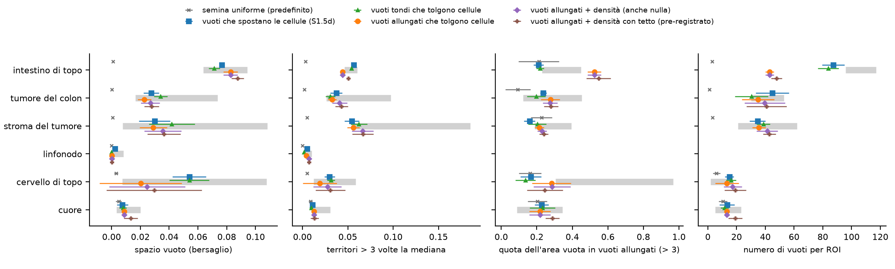
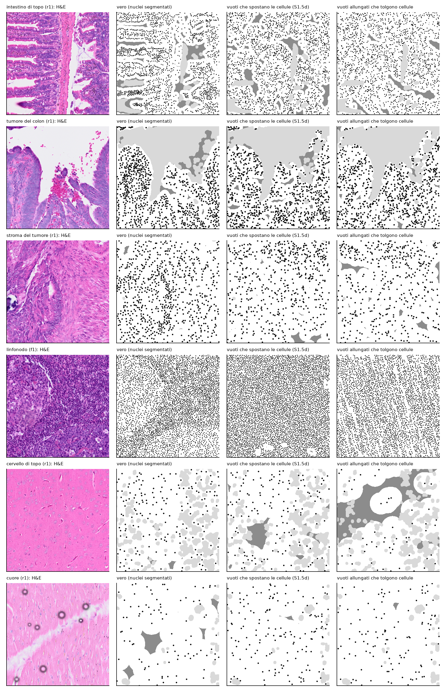

```{r setup}
#| include: false
.libPaths("~/2025.geo_spatialtrans/renv/library/linux-ubuntu-noble/R-4.6/x86_64-pc-linux-gnu")
suppressPackageStartupMessages({ library(knitr) })
R <- "../results/S1.5e"; rd <- function(f) read.csv(file.path(R, f), stringsAsFactors = FALSE, check.names = FALSE)
TIS <- c(A1 = "intestino di topo", A2 = "tumore del colon", A3 = "stroma del tumore", A4 = "linfonodo", A5 = "cervello di topo", A6 = "cuore")
V <- rd("S1.5e_verdicts.csv"); K <- rd("S1.5e_counts.csv")
```



# Decisioni e verifiche di Luca



# Dubbi rinviati



# Cancelli e regole

Pre-registrazione: commit `89c8579`; ok di Luca il 2026-10-26 sulle previsioni e sul perimetro del calcolo (commit `e932aae`). Codice e test al commit `7cbbb06`; calibrazioni e banco al commit `6bdadc4`; risultati prima della revisione al commit `14bb3a0`; correzioni della revisione (braccio XADs, test e mutanti nuovi, nessun taglio degli intervalli) nel commit di chiusura. Il dettaglio dei cinque cancelli è nella sezione «Dopo il risultato».

Bracci: U semina uniforme (predefinito); RV vuoti che spostano le cellule (S1.5d, nei preset come opzione); X vuoti tondi che tolgono cellule; XA vuoti allungati che tolgono cellule; XADs XA più una densità variabile con il tetto (come pre-registrato); XAD lo stesso con densità nulla ammessa (sensibilità, nota D-5); Q il vincente senza quote.

```{r rules}
kable(rd("S1.5e_ruleA.csv"), caption = "Regola A: modello dei vuoti (conferme in P-1, P-2, P-7, P-13, P-15, P-16, P-17; sens_XAD = XAD con densità nulla ammessa)")
kable(rd("S1.5e_ruleQ.csv"), caption = "Regola Q: quote per tipo sul vincente")
kable(rd("S1.5e_ruleB.csv"), caption = "Regola B: predefinito dei preset")
kable(K, caption = "Conferme per previsione e braccio (spatial = P-1...P-7; size = P-8a, P-8b, P-8c; types = P-4, P-5, P-6; ruleA = insieme della regola A)")
```

# Previsioni

Unità indipendente: ROI (valore della ROI = media dei 10 semi); stima = media delle 5 ROI ± 2 errori standard (P-15: 4 ROI con una finestra manuale); contatti: seme.

```{r pred}
w <- reshape(V[V$arm %in% c("RV", "X", "XA", "XADs"), c("id", "archetype", "unit", "arm", "est", "se", "lo", "hi", "verdict")], idvar = c("id", "archetype", "unit", "lo", "hi"), timevar = "arm", direction = "wide")
f <- function(e, s) ifelse(is.na(e), "", sprintf("%.4g ± %.2g", e, 2 * s))
g <- function(e, s, v) ifelse(is.na(e), "", paste(f(e, s), v))
tab <- data.frame(id = w$id, tessuto = TIS[w$archetype], unità = w$unit, intervallo = sprintf("%.4g-%.4g", w$lo, w$hi),
                  `RV (vincente)` = f(w$est.RV, w$se.RV), esito = w$verdict.RV, X = g(w$est.X, w$se.X, w$verdict.X),
                  XA = g(w$est.XA, w$se.XA, w$verdict.XA), XADs = g(w$est.XADs, w$se.XADs, w$verdict.XADs), check.names = FALSE)
ord <- c("P-1", "P-2", "P-3", "P-4", "P-5", "P-6", "P-7", "P-8a", "P-8b", "P-8c", "P-9", "P-10", "P-11", "P-12", "P-13", "P-14", "P-15", "P-16", "P-17")
tab <- tab[order(match(tab$id, ord), names(TIS)[match(tab$tessuto, TIS)]), ]
kable(tab[tab$unità == "tessuto", ], row.names = FALSE, caption = "Previsioni per tessuto: stima ± 2 errori standard ed esito, quattro bracci (tutti i bracci e le misure per tipo in S1.5e_verdicts.csv)")
```


Cosa guardare: nel tumore del colon i contatti restano sopra la banda in tutti i bracci, anche togliendo cellule; la densità dell'intestino scende verso la banda solo con i vuoti che tolgono cellule, e nel linfonodo i bracci che tolgono cellule escono sotto la banda (nel cervello la scala non lo mostra: 795-799 contro almeno 917); a destra, nel linfonodo il numero di vicini entra nella banda solo togliendo cellule.



Cosa guardare: nel cervello i vuoti allungati salgono verso la banda; nell'intestino superano la banda per allungamento e restano sotto per numero (pochi vuoti grandi).


Cosa guardare: nel tumore del colon, nello stroma e nel linfonodo, a pari distanza dal vicino, i nuclei simulati si toccano molto più dei veri; le due curve simulate quasi coincidono, quindi togliere cellule non cambia il modo in cui i nuclei si toccano a una data distanza. Nel cervello e nel cuore i focali veri vicini sono pochissimi e i punti neri non pesano.



Cosa guardare: nel linfonodo i vuoti allungati sono strisce sottili parallele senza cellule che nel tessuto vero non ci sono (PH-1).

# Dopo il risultato: cancelli, regole, controprove, post hoc e revisione avversariale



# Cosa è girato

- Banco: 2 100 unità (30 ROI × 10 semi × 7 bracci, compreso XADs dopo la revisione), seme = 20261021 + 1000 · i + s come S1.5c e S1.5d, su lesexp-server con 14-22 worker a un thread.
- Calibrazioni: X e XA 6 720 semine più 770 di estensione, XAD 2 700 più 150, 0 errori; seme 20261026 + 1000 · i + r; pieghe lascia-fuori-una-ROI.
- md5 dei 93 file letti prima e dopo: identici.
- Tempo: circa 4 ore e mezza di calcolo con 20-22 worker prima della revisione; dopo la revisione 12 minuti per XADs (14 worker) e 72 minuti per test, mutanti e controlli.

```{r times}
d <- rd("S1.5e_desc.csv"); d <- d[grepl("D-desc-4", d$desc), c("archetype", "arm", "est")]
kable(reshape(d, idvar = "archetype", timevar = "arm", direction = "wide"), digits = 1, row.names = FALSE, caption = "Tempo mediano di place_cells() per unità (s)")
```

# Appendice

## Dubbi ricevuti



## Esplorazione prima della pre-registrazione



## Pre-registrazione (testo del file dello step)



## Calibrazione dei vuoti

```{r het}
H <- do.call(rbind, lapply(c("X", "XA", "XAD", "XADs"), function(f) { x <- rd(sprintf("S1.5e_het_%s.csv", f)); x$famiglia <- f; x }))
kable(H[H$fold == "pooled", setdiff(names(H), "combo")], digits = 3, row.names = FALSE, caption = "Parametri su tutte le ROI per famiglia (i preset restano a RV di S1.5d); NA = lunghezza di un campo non usato")
p <- rd("S1.5e_posthoc_loss.csv"); kable(p[, setdiff(names(p), "combo")], digits = 1, row.names = FALSE, caption = "PH-1: perdita della calibrazione per bersaglio, ottimo contro miglior punto con pochi vuoti")
```

## Descrittive

```{r desc}
d <- rd("S1.5e_desc.csv"); d <- d[!grepl("D-desc-4|D-desc-3", d$desc), ]
kable(reshape(d[, c("desc", "archetype", "arm", "est")], idvar = c("desc", "archetype"), timevar = "arm", direction = "wide"), digits = 4, row.names = FALSE,
      caption = "Descrittive senza verdetto (contatto per classe di distanza nella figura 3)")
```

## Da dove vengono i numeri del riassunto


