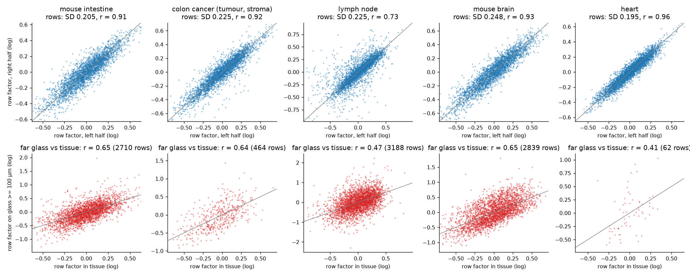
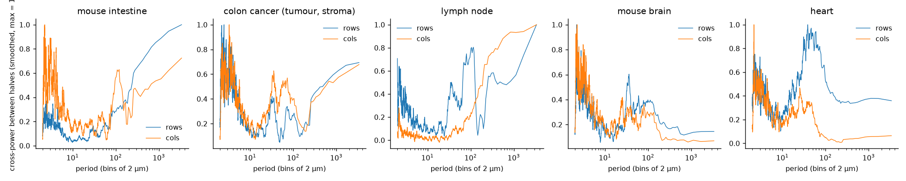
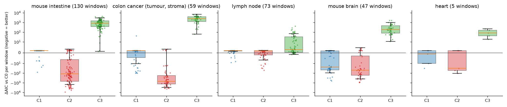
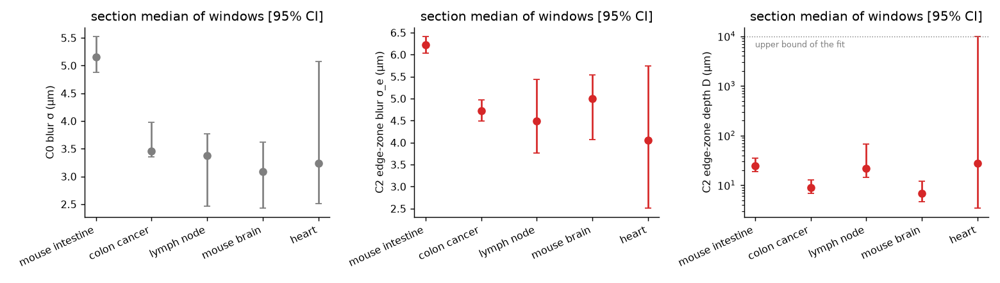
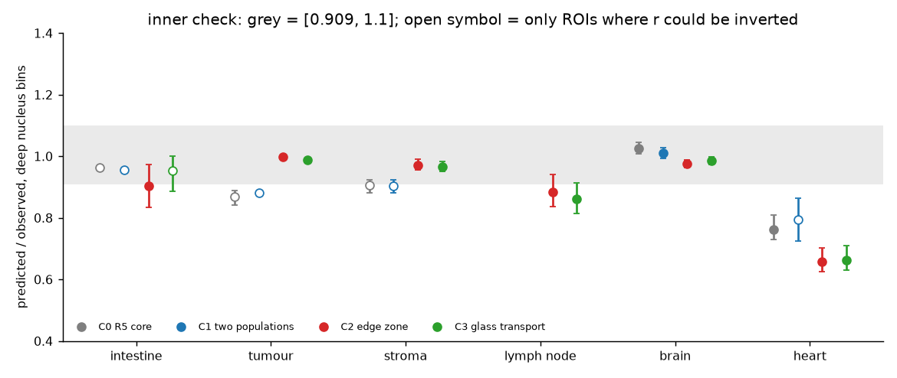
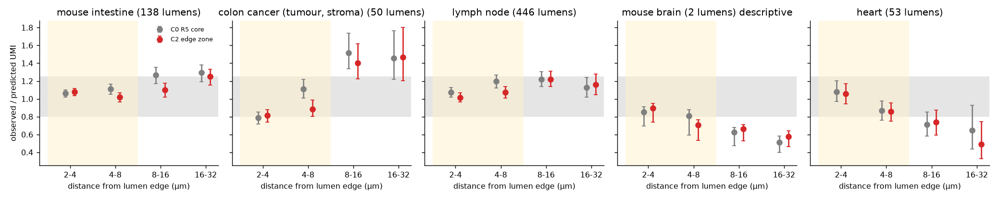
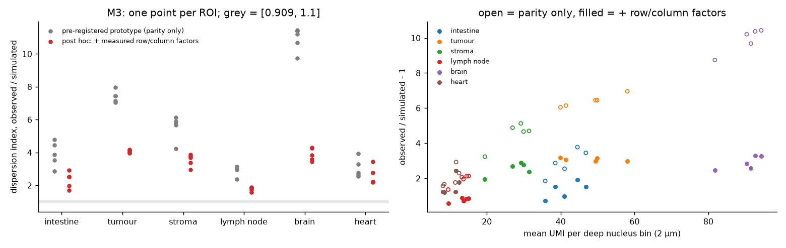
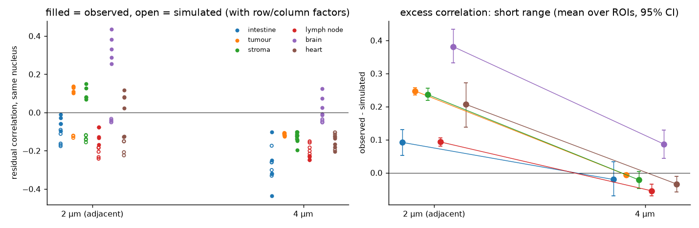

```{r setup}
#| include: false
.libPaths("~/2025.geo_spatialtrans/renv/library/linux-ubuntu-noble/R-4.6/x86_64-pc-linux-gnu")
suppressPackageStartupMessages({ library(knitr); library(jsonlite) })
R <- "../results/S2.0"; rd <- function(f) read.csv(file.path(R, f), stringsAsFactors = FALSE, check.names = FALSE)
RW <- "../results/S2.0/wfix"; rw <- function(f) read.csv(file.path(RW, f), stringsAsFactors = FALSE, check.names = FALSE)
SEC <- c(A1 = "intestino di topo", A23 = "tumore del colon (e stroma)", A4 = "linfonodo", A5 = "cervello di topo", A6 = "cuore")
TIS <- c(A1 = "intestino di topo", A2 = "tumore del colon", A3 = "stroma del tumore", A4 = "linfonodo", A5 = "cervello di topo", A6 = "cuore")
NM <- c(SEC, TIS); f3 <- function(x) ifelse(is.na(x), "—", formatC(as.numeric(x), digits = 3, format = "f"))
lt <- function(f) { p <- file.path(R, f); if (file.exists(p)) tail(readLines(p, warn = FALSE), 1) else "—" }
```



# Decisioni e verifiche di Luca



# Dubbi rinviati



# Cancelli

```{r gates}
kable(data.frame(
  id = c("G-1", "G-2", "G-3", "G-4", "G-5"),
  controllo = c("batteria di test su sezioni sintetiche e mutanti (`tools/S2.0_test.py`)",
                "md5 di ogni file letto, prima e dopo (`tools/S2.0_md5.sh`)",
                "il documento di design contro i dati e le fonti (`tools/S2.0_design_check.py`)",
                "riproducibilità: seconda esecuzione completa (`tools/S2.0_chain.sh`, `tools/S2.0_repro.sh`)",
                "revisione avversariale (quattro revisori indipendenti)"),
  esito = c(lt("S2.0_G1.txt"), lt("S2.0_G2.txt"), lt("S2.0_G3.txt"), lt("S2.0_G4.txt"), "vedi «Revisione avversariale»")), caption = "Cancelli")
```

# Previsioni e controprova

Pre-registrazione: `docs/steps/S2.0.md` (commit `afef06b`, correzioni AM-1...AM-5 prima del calcolo); ok di Luca sulle previsioni e sulle soglie il 2026-11-03.

```{r preds}
P <- rd("S2.0_predictions.csv")
kable(data.frame(id = P$id, unità = ifelse(P$unit %in% names(NM), NM[P$unit], P$unit), quantità = P$quantity, stima = f3(P$estimate), lo = f3(P$lo), hi = f3(P$hi),
                 intervallo = P$interval, esito = P$verdict, note = P$extra, check.names = FALSE), row.names = FALSE,
      caption = "Previsioni pre-registrate, come calcolate (stima con intervallo bootstrap al 95 %, B = 2000, seme 20261103)")
W <- rw("S2.0_predictions.csv"); key <- function(d) paste(d$id, d$unit, d$quantity)
M <- merge(data.frame(k = key(P), id = P$id, unità = P$unit, prima = f3(P$estimate), esito_prima = P$verdict),
           data.frame(k = key(W), dopo = f3(W$estimate), lo = f3(W$lo), hi = f3(W$hi), esito_dopo = W$verdict), by = "k")
kable(M[, -1], row.names = FALSE, caption = paste0("Le stesse previsioni con le soluzioni dei bordi corrette (post hoc PH-6): esiti identici in ", sum(M$esito_prima == M$esito_dopo), "/", nrow(M)))
```

# Strisce della griglia (M1, P-1, P-2, regola R-B)



*Cosa guardare*: in alto, il fattore di ogni riga stimato sulla metà sinistra contro quello stimato sulla metà destra: i punti stanno sulla diagonale, quindi la parte non periodica è riproducibile. In basso, lo stesso fattore sul vetro lontano dal tessuto: è correlato (analisi post hoc PH-1).



*Cosa guardare*: la potenza riproducibile sta soprattutto a periodi corti (≤ 4 bin), come una cattura che cambia da riga a riga.

```{r rb}
kable(rd("S2.0_PH5_sections.csv"), digits = 4, caption = "Post hoc PH-5: parte fine dei fattori (scarto dalla media mobile su 21), righe e colonne a zero UMI tolte, a 10 e 20 iterazioni")
kable(rd("S2.0_PH5_calib.csv") |> aggregate(cbind(sd_true_hp_sample, sd_repro_hp, lag1_true_hp_sample, lag1_repro_hp) ~ amp + rho_true, data = _, FUN = mean), digits = 3,
      caption = "Post hoc PH-5: calibrazione su sezioni sintetiche con fattori noti (media di 4 semi e due assi)")
kable(rd("S2.0_PH4_lag.csv") |> aggregate(cbind(lag1_true_sample, lag1_repro, sd_true_np, sd_repro) ~ amp + rho_true, data = _, FUN = mean), digits = 3,
      caption = "Post hoc PH-4: passo 1 e deviazione standard restituiti dallo stimatore su sezioni sintetiche con fattori noti (media di 4 semi e due assi)")
```

# Regola d'uscita dei trascritti dal tessuto (M2, regola R-A)

```{r edges}
E <- rw("S2.0_edges_sections.csv"); E <- E[E$param %in% c("sigma", "sigma_e", "D", "w", "ell", "q", "p", "sigma_m", "sigma_g", "dAIC_vs_C0_per_window", "sum_AIC"), ]
kable(data.frame(sezione = SEC[E$key], regola = E$rule, parametro = E$param, mediana = f3(E$median), lo = f3(E$lo), hi = f3(E$hi), finestre = E$n_tiles, check.names = FALSE), row.names = FALSE,
      caption = "Parametri per sezione dopo PH-6 (mediana delle finestre, intervallo bootstrap) e differenza di AIC per finestra contro il nucleo di R5; prima di PH-6: results/S2.0/S2.0_edges_sections.csv")
RA <- fromJSON(file.path(RW, "S2.0_RA.json"))
kable(do.call(rbind, lapply(names(RA$per_section), function(k) data.frame(sezione = SEC[k], C1 = RA$per_section[[k]]$sum_aic$C1, C2 = RA$per_section[[k]]$sum_aic$C2, C3 = RA$per_section[[k]]$sum_aic$C3, vincente = RA$per_section[[k]]$winner))),
      digits = 1, row.names = FALSE, caption = paste("R-A: somma degli AIC per sezione; vincente:", RA$winner))
```



*Cosa guardare*: la zona di bordo (rosso) sta sotto lo zero (meglio del nucleo di R5) in quasi tutte le finestre di intestino, tumore e cervello; nel linfonodo le regole non si distinguono; il trasporto sul vetro (verde) è sempre peggiore.



```{r inner}
I <- rw("S2.0_inner_summary.csv")
kable(data.frame(tessuto = TIS[I$archetype], regola = I$rule, `previsto/osservato` = f3(I$ratio_mean), lo = f3(I$lo), hi = f3(I$hi), esito = I$verdict,
                 `ROI non invertibili` = I$n_not_invertible, `solo ROI riuscite` = f3(I$ratio_mean_ok_only), r = f3(I$r_median), check.names = FALSE), row.names = FALSE,
      caption = "Controllo interno: contrasto fra nucleo e citoplasma senza i bin entro 2 µm dal bordo del nucleo (pre-registrato in tumore e cervello, descrittivo altrove)")
```



# Lumi interni (controprova CP-1)

```{r lumens}
L <- rw("S2.0_CP1_lumens.csv")
kable(data.frame(sezione = SEC[L$key], regola = L$rule, fascia = L$band, lumi = L$n_lumens, tessere = L$n_tiles, `osservati/previsti` = f3(L$obs_over_pred), lo = f3(L$lo), hi = f3(L$hi),
                 esito = L$verdict, `giudicata in CP-1` = L$judged_CP1, check.names = FALSE), row.names = FALSE, caption = "Lumi interni dopo PH-6: UMI osservati/previsti per fascia di distanza dal bordo del lume (bootstrap per tessere, come R5)")
```



# Variabilità dentro il nucleo (M3, P-4, regola R-C) e analisi post hoc

```{r disp}
D <- rd("S2.0_disp_roi.csv")
kable(data.frame(ROI = D$tag, r = f3(D$r), `ψ osservato` = f3(D$psi_obs), `ψ simulato` = f3(D$psi_sim), rapporto = f3(D$ratio), `UMI per bin profondo` = f3(D$mbar_obs), v = f3(D$v), nuclei = D$n_nuclei, check.names = FALSE),
      row.names = FALSE, caption = "Prototipo pre-registrato: indice di dispersione dei bin profondi dei nuclei per ROI")
kable(rd("S2.0_PH23_disp.csv"), digits = 3, caption = "Post hoc PH-2 (con i fattori di riga e colonna) e PH-3 (correlazione in più fra bin dello stesso nucleo a 2 e 4 µm), per tessuto")
```





*Cosa guardare*: i punti grigi (prototipo pre-registrato) stanno lontano da 1; con le strisce (rosso) scendono ma restano sopra 2; l'eccesso rimasto è correlato fra bin adiacenti e quasi sparisce a 4 µm.



# Cosa è girato



# Appendice

## Da dove vengono i numeri del riassunto


