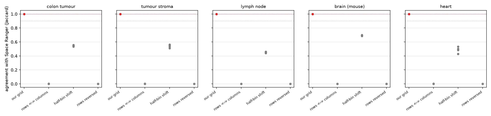
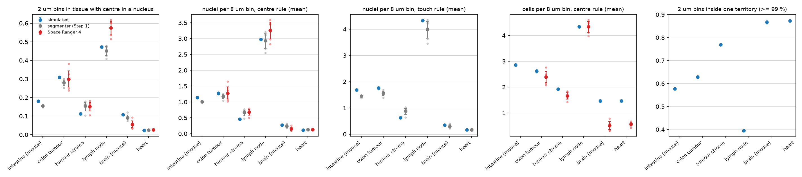
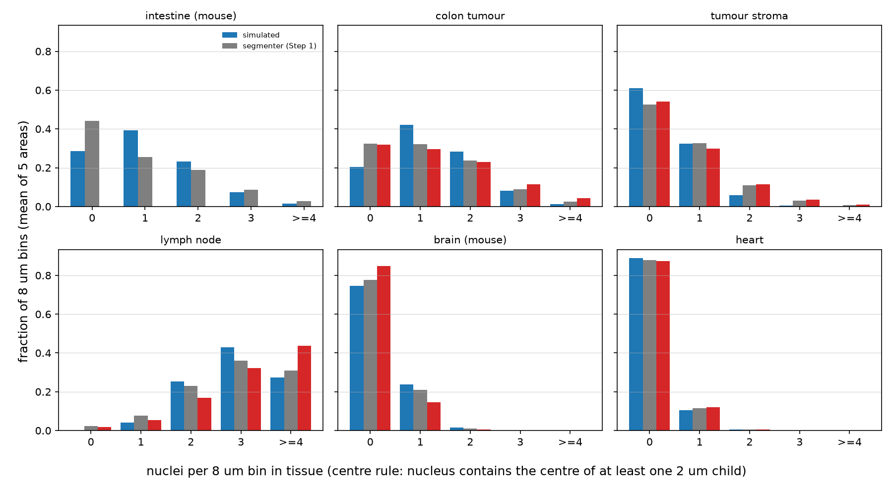

```{r setup}
#| include: false
.libPaths("~/2025.geo_spatialtrans/renv/library/linux-ubuntu-noble/R-4.6/x86_64-pc-linux-gnu")
suppressPackageStartupMessages({ library(knitr) })
R <- "../results/S2.1"; rd <- function(f) read.csv(file.path(R, f), stringsAsFactors = FALSE, check.names = FALSE)
TIS <- c(A1 = "intestino di topo", A2 = "tumore del colon", A3 = "stroma del tumore", A4 = "linfonodo", A5 = "cervello di topo", A6 = "cuore")
f3 <- function(x, d = 3) ifelse(is.na(x), "—", formatC(as.numeric(x), digits = d, format = "f"))
M <- "/mnt/micron/geo_spatialtrans/S2.1"; lt <- function(f, n = 1) { p <- file.path(M, f); if (file.exists(p)) tail(readLines(p, warn = FALSE), n) else "—" }
```



# Decisioni e verifiche di Luca



# Dubbi rinviati



# Cancelli e controprova

Non ci sono previsioni con intervallo di rilevanza biologico (scelta di Luca sul perimetro): la griglia non ha parametri biologici. Esiti come pre-registrati, con le tre correzioni prima del calcolo.



Righe dei log: `r lt("run1/test_S2.1.log")`; `r lt("run1/mutants.log")`; `r lt("run1/panel_check.log")`; `r lt("run1/ph1.log")`; `r lt("repro.log")`; `r paste(lt("md5_after.log", 4), collapse = "; ")`.

## Invarianti per area (G-2) e regioni senza cellule (PH-1)

```{r g2}
g <- rd("S2.1_G2.csv"); p <- rd("S2.1_PH1_G2c_cells_only.csv"); g <- merge(g, p[, c("tag", "n_regions_no_cells", "area_no_cells_um2", "c_ratio_cells_only")], by = "tag")
kable(data.frame(area = g$tag, tessuto = TIS[g$archetype], cellule = g$n_cells, `(a)` = f3(g$a_ratio), `(c) come scritto` = formatC(g$c_ratio, format = "g", digits = 3),
                 `(c) solo regioni con cellule` = formatC(g$c_ratio_cells_only, format = "g", digits = 2), `(d)` = formatC(g$d_ratio, format = "g", digits = 2),
                 `(d) solo bordo` = f3(g$d_ratio_strict), `(e)` = f3(g$e_ratio), `regioni senza cellule` = g$n_regions_no_cells,
                 `area senza cellule (µm²)` = f3(g$area_no_cells_um2, 1), check.names = FALSE),
      caption = "Rapporto errore/tolleranza (≤ 1 = entro la tolleranza a n pezzi di DEC-038). (c) fallisce come scritto solo dove ci sono regioni senza cellule.")
```

## Controprova CP-1: la nostra griglia contro Space Ranger

```{r cp}
cp <- rd("S2.1_CP1_roi.csv"); ok <- cp[cp$grid == "none", ]
GR <- c(none = "nostra griglia", transpose = "righe e colonne scambiate", half = "mezzo quadratino", reverse = "righe al contrario")
agg <- do.call(rbind, lapply(split(cp, list(cp$archetype, cp$grid), drop = TRUE), function(x) data.frame(tessuto = TIS[x$archetype[1]], griglia = GR[x$grid[1]],
  aree = nrow(x), `accordo min` = f3(min(x$jaccard), 4), `accordo max` = f3(max(x$jaccard), 4), `quota a metà max` = f3(max(x$frac_mid), 4),
  `scarto affine max (px)` = f3(max(x$affine_max_dist_px), 3), check.names = FALSE)))
agg <- agg[order(agg$tessuto, match(agg$griglia, GR)), ]; rownames(agg) <- NULL; kable(agg, caption = "Per tessuto e griglia; scarto dell'affine per area come distanza.")
gr <- rd("S2.1_CP1_grid.csv")
kable(data.frame(sezione = gr$dataset, `passo (µm)` = f3(gr$pitch_um, 5), `scarto affine sezione (px, componente)` = f3(gr$affine_max_res_um / gr$mpp, 2),
                 `come distanza` = f3(gr$affine_max_dist_um / gr$mpp, 2), `blocchi diversi` = gr$n_bm_block_mismatch, `blocchi incompleti` = gr$n_partial_8um,
                 `di cui ultima riga/colonna` = gr$n_partial_on_last_row_col, `scarto centri 8 µm (px)` = f3(gr$max_dev_8um_px_16, 4), check.names = FALSE),
      caption = "Controlli per sezione. Lo scarto dell'affine sull'intera sezione, giudicato come scritto (< 0.5 pixel), fallisce nel tumore del colon e nel linfonodo: per questo CP-1 usa una trasformazione per area (correzione 2).")
```



## Correzioni prima del calcolo, post hoc e deviazioni





### Deviazioni dichiarate



# Descrittivi: simulato contro vero alla scala dei quadratini

```{r desc}
d <- rd("S2.1_desc_tissue.csv")
d$valore <- sprintf("%s [%s, %s]", f3(d$mean), f3(d$lo), f3(d$hi))
w <- reshape(d[, c("tissue", "archetype", "label", "source", "valore")], idvar = c("archetype", "label"), timevar = "source", direction = "wide", drop = "tissue")
names(w) <- sub("valore.", "", names(w)); w$archetype <- TIS[w$archetype]; w <- w[order(w$label, w$archetype), ]; rownames(w) <- NULL
kable(w, caption = "Media delle 5 aree per tessuto, intervallo bootstrap delle aree (B = 2000, seme 20261105). Regola del centro: nucleo o cellula che contiene il centro di almeno uno dei 16 figli; regola del tocco: area > 0.")
```





```{r ph2}
p2 <- rd("S2.1_PH2_density_area.csv"); a <- aggregate(p2[, c("sim_n_per_mm2", "seg_n_per_mm2", "sim_nuc_area", "seg_nuc_area", "ratio_d1", "ratio_density", "ratio_area")], list(t = p2$archetype), mean)
kable(data.frame(tessuto = TIS[a$t], `nuclei/mm² simulato` = round(a$sim_n_per_mm2), `nuclei/mm² segmentatore` = round(a$seg_n_per_mm2),
                 `area nucleo simulato (µm²)` = f3(a$sim_nuc_area, 1), `area nucleo segmentatore (µm²)` = f3(a$seg_nuc_area, 1), `rapporto D-1` = f3(a$ratio_d1),
                 `rapporto densità` = f3(a$ratio_density), `rapporto area` = f3(a$ratio_area), check.names = FALSE),
      caption = sprintf("PH-2 (post hoc). Correlazione fra rapporto di D-1 e rapporto della copertura nucleare sulle 30 aree: %.3f.", cor(p2$ratio_d1, p2$ratio_cover)))
tt <- rd("S2.1_D4_time.csv")
kable(do.call(rbind, lapply(split(tt, tt$archetype), function(x) data.frame(tessuto = TIS[x$archetype[1]], cellule = median(x$n_cells), `tempo mediano (s)` = f3(median(x$elapsed_s), 1),
  `tempo max (s)` = f3(max(x$elapsed_s), 1), `picco residente max (MB)` = round(max(x$vm_hwm_mb)), `quota di vetro` = f3(median(x$n_bins_glass_margin / x$n_bins), 2), check.names = FALSE))),
  caption = "D-4: tempo e memoria di build_hd_grid() per area di 1 mm² (server condiviso, 5 processi; non per un manoscritto).", row.names = FALSE)
```

# Revisione avversariale



Cartelle dei revisori: `/mnt/micron/geo_spatialtrans/S2.1/review/G5ac` (geometria), `review/g5bc` (Space Ranger), `review/` codice (sonde `g5d_*`).

# Cosa è girato

- Commit: vedi `git log` del ramo `step2-visium-grid` (messaggio «S2.1: chiusura» e precedenti); codice `R/05b1_build_hd_grid.R`, `R/testing/test_S2.1.R`, `tools/S2.1_*`.
- Nessun seme nella griglia (deterministica); bootstrap con seme 20261105, B = 2000.
- Pannello: 30 livelli U6 di S1.6, 5 processi (run1) e 3 processi (run2); controprova e descrittivi veri in un processo. Durata del calcolo finale circa 2 ore compresa la riproduzione.
- md5 dei 173 file letti prima e dopo in `/mnt/micron/geo_spatialtrans/S2.1/md5_{before,after}{,_extra}.txt`.
- Perimetro:



# Appendice

## Da dove vengono i numeri del riassunto


