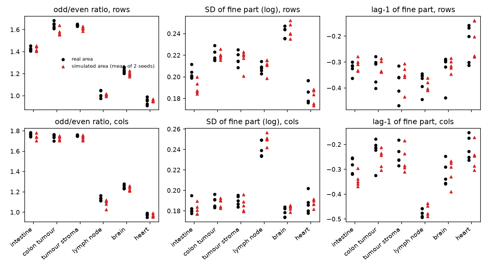
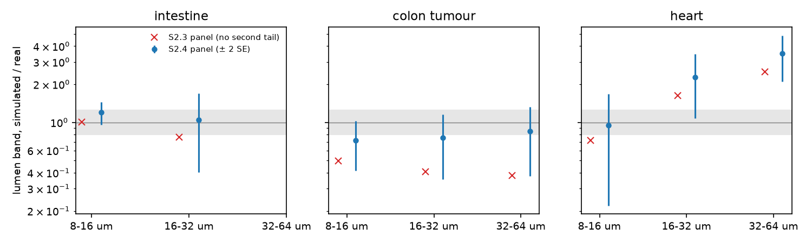
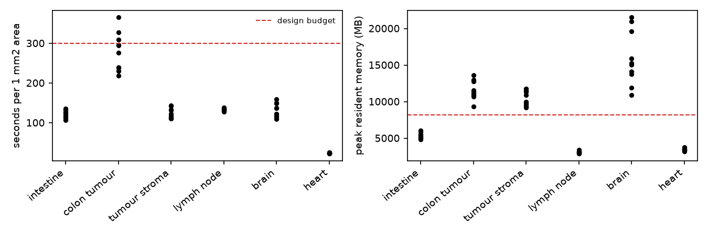

# In breve



# Dubbi rinviati



# Cancelli, regole e previsioni

Pre-registrazione: cancelli `c3181ac`; ok di Luca sulle previsioni, sugli intervalli e sulle regole il 2026-11-06 («Ok, come proposte (Recommended)»; regola R-3: «Riadattare fondo e coda insieme (Recommended)»), commit `045bb47`. File dello step: `docs/steps/S2.4.md`.



## Tutti i giudizi

Stima ± 2 errori standard fra le aree (per P-5, intervallo bootstrap al 95 % delle tessere di 300 µm). Tabella: `results/S2.4/S2.4_verdicts.csv`.



## Figure

**Cosa guardare**: in ogni tessuto i triangoli cadono fra i cerchi; l'unico scarto visibile è la parità delle righe del tumore (il simulatore usa la parità della sezione intera).

![Vetro osservato / previsto per fasce di distanza dal tessuto sulle cinque sezioni intere: croci rosse, fondo del vetro lontano di R5 più la coda di S2.3 (E-3); cerchi blu, fondo e coda adattati insieme (R-3) con intervallo bootstrap. Banda grigia: intervallo di rilevanza [0.8, 1.25].](figures/S2.4/fig2_glass.png)

**Cosa guardare**: dopo R-3 il vetro lontano di intestino, linfonodo e cervello torna nella banda; nel tumore e stroma oltre 256 µm resta sotto.

**Cosa guardare**: nel tumore del colon la seconda coda porta le fasce da circa 0.4-0.5 a 0.7-0.85; nel cuore (controllo negativo) l'eccesso cresce.

# Controprova e misure

Vedi «Controprove» e «Misure» nella sezione precedente; analisi post hoc:



# Revisione avversariale



# Cosa è girato

- Commit dei cancelli `c3181ac`, ok di Luca `045bb47`, codice e regole `83ebaed`, pannello `6724265`; ramo `step2-visium-grid`; R 4.6.2, Python del progetto (`.venv`).
- Funzioni: `R/05b4_capture_and_bin.R` (`capture_params`, `simulate_stripes`, `capture_and_bin`), seconda coda in `R/05b3_place_and_move_transcripts.R`; batteria `R/testing/test_S2.4.R`, `tools/S2.4_test.py`, mutanti `tools/S2.4_mutants.py`.
- Regole: `tools/S2.4_R1_calib.py`, `tools/S2.4_R2_slow.py`, `tools/S2.4_R3_glass.py`, `tools/S2.4_R3_boot.py`; esplorazioni `tools/S2.4_explore.py`, `tools/S2.4_E12_summary.py`.
- Pannello: `tools/S2.4_panel.R` (semi estratti con Mersenne-Twister dal seme 20261114), statistiche `tools/S2.4_explore.py sim`, esiti `tools/S2.4_analysis.py`, `tools/S2.4_verdicts.py`; uscite in `/mnt/micron/geo_spatialtrans/S2.4/`.
- Processi: al più 6 per lavoro; server condiviso con un'altra utente (carico medio da 5 a circa 740). Pannello principale (60 esecuzioni) circa 25 minuti con 6 processi; varianti 15 minuti; R-3 circa 2 minuti per sezione; bootstrap di R-3 circa 1.5 ore.
- md5 dei 362 file letti identici prima e dopo (`results/S2.4/S2.4_md5_before.txt`, `_after.txt`).

## Esplorazioni prima della pre-registrazione



## Correzioni prima del calcolo



## Deviazioni dichiarate



# Appendice: da dove vengono i numeri del riassunto

| frase del riassunto | fonte | valore letto |
|---|---|---|
| strisce: nessuno scarto rilevante | `results/S2.4/S2.4_verdict_counts.csv` (P-1...P-3) | 24 confermate, 12 indeterminate, 0 smentite |
| lo stimatore non trova strisce quando le spegniamo | `results/S2.4/S2.4_CP12.csv` (CP-1) | deviazione standard della parte fine 0.013-0.031; parità entro 1 ± 0.002; 6/6 |
| fondo costante sparisce in intestino, linfonodo e cuore; coda a 1-2 mm (cuore un decimo di mm) | `results/S2.4/S2.4_R3_fits.csv` | b = 0 in A1, A4, A6; ℓ₂ 1 826, 1 575, 113 µm |
| vetro del tumore 7 decimi fra un quarto e mezzo mm, meno della metà oltre | `results/S2.4/S2.4_P5_glass.csv` (A23) | 0.698 (256-512 µm); 0.418 (≥ 512 µm) |
| quattro sezioni su cinque descritte a ogni distanza | `results/S2.4/S2.4_P5_glass.csv` | nessuna fascia smentita in A1, A4, A5, A6 |
| lumi profondi del tumore da circa metà a 7-9 decimi; la coda raddoppia | `S2.4_E12_summary.csv`, `S2.4_predictions.csv` (P-4 A2), `S2.4_CP12.csv` | S2.3: 0.50, 0.41, 0.39; S2.4: 0.72, 0.76, 0.85; con / senza coda 0.046 / 0.024 |
| parte lenta in due sezioni su cinque | `results/S2.4/S2.4_R2_slow.csv` | identificata in A1 e A23 (entrambi gli assi) |
| vuoti: da un decimo a quattro decimi | `results/S2.4/S2.4_predictions.csv` (P-6) | 0.11, 0.10, 0.40 |
| si generano da 3 a 6 volte i trascritti | `results/S2.4/S2.4_measures.csv`, `/mnt/micron/geo_spatialtrans/S2.4/panel/G2.csv` | M 2.91-5.78 (media per tessuto 3.20-5.00) |
| memoria fino a 15-20 GB nel cervello | `S2.4_predictions.csv` (P-7), log di `tools/S2.4_mem_stages.R` | media del cervello 15 888 MB; A5_r1 19 848 MB |
| a blocchi piccoli 6 GB e meno di 3 minuti | log di `tools/S2.4_mem_stages_chunk.R` | 5 845 MB, 145 s |
| una simulazione su 120 a 3.01 | `results/S2.4/S2.4_G2.csv` | max \|z\| 3.011 (A4_f1, senza seconda coda) |
| semi consecutivi legati | `results/S2.4/S2.4_C1_seeds.txt` | 12.4 e 18.3 contro 3.84 (casuali) |
| tempi da 24 s a 280 s | `S2.4_predictions.csv` (P-7) | cuore 23.7 s, tumore 279.6 s |
