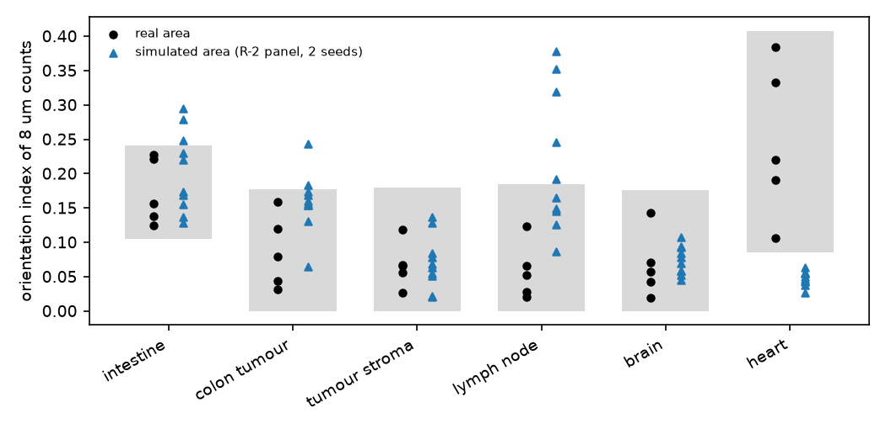

# In breve



# Dubbi rinviati



# Cancelli, regole e previsioni

Pre-registrazione: cancelli e funzione `3badae6`; ok di Luca sulle previsioni, sulle soglie, sulla regola R-2 e sulle controprove il 2026-11-09 («Ok, come proposte (Recommended)»), commit `e155d62`; calcolo, revisione e correzioni `5eed7c8`. File dello step: `docs/steps/S2.5.md`.



## Tutti i giudizi

Per ogni tessuto: valore vero sugli stessi quadratini dei due lati (definizione reg, [DEC-064](../docs/decisions/DEC-064.md)) con l'intervallo corretto di R7; simulato con l'intervallo bootstrap delle 10 esecuzioni (5 aree × 2 semi) per il fattore delle poche aree (1.632). Tabelle: `results/S2.5/S2.5_verdicts_main.csv`, `S2.5_verdicts_main_r2.csv`. P-8 (tempo e memoria) è nella sezione «Previsioni» qui sopra.



## Figure

**Cosa guardare**: dopo R-2 i cerchi blu stanno sull'1 per trascritti e geni in tutti i tessuti; restano fuori i quadratini vuoti di intestino e tumore (P-2, un decimo e meno) e il rapporto nucleo/corona del tumore (P-7).

**Cosa guardare**: nel cuore le aree vere sono orientate (le fibre), le simulate no (controllo negativo, CP-2). Nel linfonodo e nell'intestino il simulato è più orientato del vero (bordi delle regioni e strisce; BL-236).

**Cosa guardare**: la memoria cresce con i trascritti generati; con blocchi più piccoli scende da 8.9 a circa 7 GB e poi non più; a macchina libera tutte le aree del tumore stanno nel bilancio.

# Controprova

CP-1: P-1 con il fattore di profondità spento (`results/S2.5/S2.5_verdicts_depth_off.csv`).



CP-2 è il giudizio P-9 nel cuore (tabella dei giudizi e figura 2).

# Analisi post hoc



# Revisione avversariale



# Cosa è girato

- Commit dei cancelli `3badae6`, ok di Luca `e155d62`, calcolo, revisione e correzioni `5eed7c8`; ramo `step2-visium-grid`; R 4.6, Python del progetto (`.venv`).
- Funzione: `R/05b5_simulate_visium_hd.R` (`simulate_visium_hd`, `visium_hd_archetype`, `visium_hd_chunk_size`, `visium_hd_depth_factor`); batteria `R/testing/test_S2.5.R` (40/40), mutanti `tools/S2.5_mutants.py` (16/16).
- Lato vero: `tools/S2.5_real.py`, `tools/S2_5_common.py`; statistiche `tools/S2.5_stats.py`; pannello `tools/S2.5_panel.R` (semi estratti con Mersenne-Twister dal seme 20261109), esiti e regola R-2 `tools/S2.5_analysis.py`, verità a 8 µm `tools/S2.5_truth8_check.R`; riproduzione e identità `tools/S2.5_repro.sh`, `tools/S2.5_identity.sh`; post hoc `tools/S2.5_PH1_memory.R`, `tools/S2.5_PH2_timing.R`; uscite in `/mnt/micron/geo_spatialtrans/S2.5/`.
- Processi: al più 6; server condiviso. Pannello main (60 esecuzioni) circa 18 minuti; depth_off (30) circa 10 minuti; main_r2 (60) circa 26 minuti, insieme ai mutanti e ai revisori.
- md5 dei 230 file letti identici prima e dopo (`results/S2.5/S2.5_md5_before.txt`, `_after.txt`, `_diff.txt` vuoto).
- A metà della chiusura il server non era raggiungibile dalla VPN; il lavoro è proseguito con un secondo accesso alla stessa macchina.

## Esplorazioni prima della pre-registrazione



## Attese pre-registrate



## Decisioni chieste a Luca prima del calcolo



## Correzioni dopo il calcolo



## Deviazioni dichiarate



# Appendice: da dove vengono i numeri del riassunto

| frase del riassunto | fonte | valore letto |
|---|---|---|
| dopo la ritaratura trascritti e geni tornano sul vero in tutti e sei i tessuti, a 2 e a 8 µm | `results/S2.5/S2.5_verdict_counts_main_r2.csv` (P-1, P-3, P-4, P-6) | 6 confermate su 6 per ciascuna |
| l'intestino aveva 14 trascritti su 100 in meno, il cervello 12 | `S2.5_verdicts_main.csv` (P-1, colonna ratio) | 0.856 (intestino), 0.877 (cervello) |
| il fattore nuovo cambia di 1 % in meno nello stroma, 17 % in più nell'intestino | `S2.5_R2_depth.csv` | 1.584 → 1.561; 0.867 → 1.013 |
| geni e blocchi da 8 µm, non tarati, tornano | `S2.5_verdicts_main_r2.csv` (P-3, P-4, P-6) | geni a 8 µm simulato / vero 1.005-1.064 |
| senza fattore di profondità fuori dal vero in linfonodo, cervello, cuore | `S2.5_verdicts_depth_off.csv` (P-1) | 14.08 contro 8.76-13.56; 31.23 contro 40.43-47.77; 1.21 contro 2.06-5.05 |
| vuoti da un diciassettesimo a un tredicesimo in intestino e tumore | `S2.5_verdicts_main_r2.csv` (P-2) | simulato / vero 0.059, 0.076 |
| contrasto nucleo/citoplasma del tumore 0,90 contro 0,82-0,88; con ±10 % sarebbe giusto | `S2.5_verdicts_main_r2.csv` (P-7 A2); `S2.5_sensitivity_main_r2.csv` (star_ratio) | 0.901 [0.888, 0.917] contro [0.818, 0.883]; banda ±10 % confermata 6/6 |
| cuore: vero 0,25, simulato 0,05 | `S2.5_verdicts_main_r2.csv` (P-9 A6, real_est e sim_est) | 0.247 e 0.048 |
| il tumore a macchina libera da 2 minuti e mezzo a 4 minuti, picco da 6 a 7,2 GB | `results/S2.5/PH2/*.json` | 149.3-232.4 s; 6 009-7 225 MB |
| con i blocchi di prima un'area del tumore arrivava a 8,9 GB; sotto 7 GB non si scende | `results/S2.5/PH1/*.json` | 8 909 MB (4 × 10⁶), 7 108 MB (2 × 10⁶), 7 211 MB (1 × 10⁶) |
| con i quadratini di Space Ranger l'intestino risulterebbe sopra il vero nei geni | `S2.5_sensitivity_main_r2.csv` (A1, mean_genes) | 2 µm: 27.58-28.41 contro 23.02-27.39; 8 µm: 372.1-382.5 contro 299.4-347.4 |
| tre revisori, due difetti corretti; due esiti del cervello decisi dal caso del ricampionamento | `/mnt/micron/geo_spatialtrans/S2.5/review/*/`; `review/esiti/summary_nrep20000.txt` | P-1 e P-4 del cervello (pannello main): probabilità di smentita 0.872 e 0.777 |
| tempi del pannello: circa 18, 10 e 26 minuti | `/mnt/micron/geo_spatialtrans/S2.5/run_main.log`, `run_r2.log` | main 16:50:32-17:08:21; depth_off 17:08:21-17:17:50; main_r2 17:20:38-17:46:39 |
