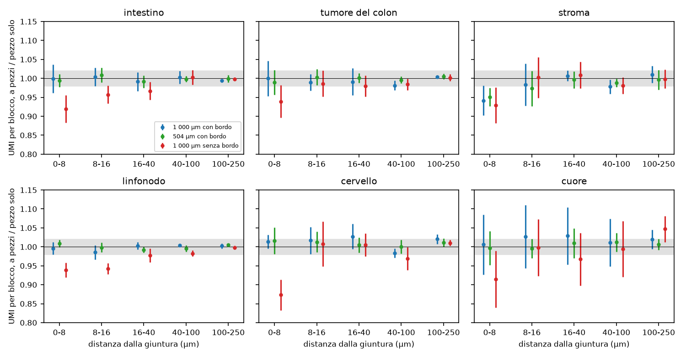
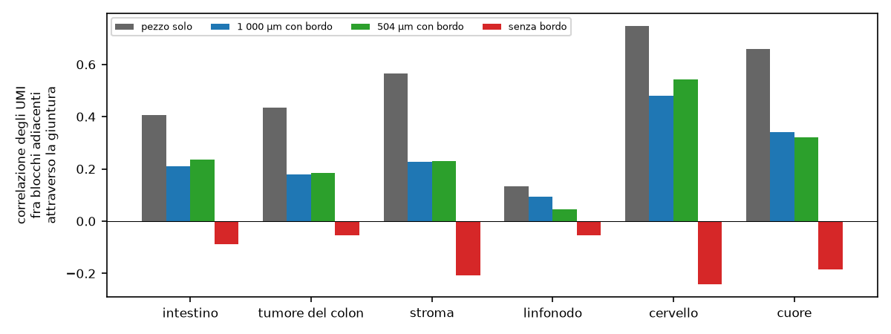
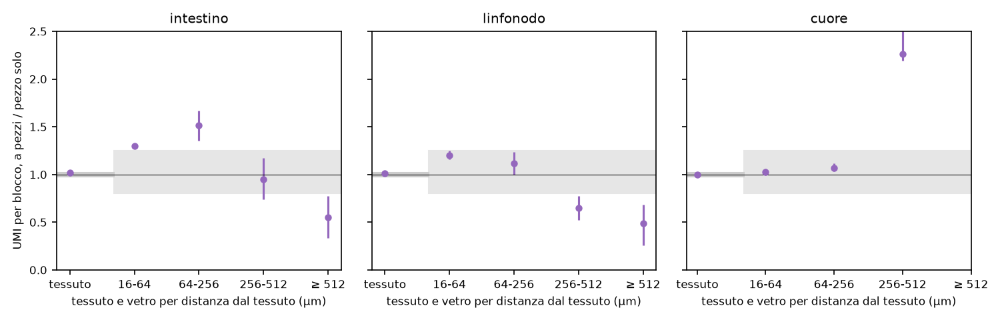

# In breve



# Dubbi rinviati



# Cancelli, previsioni e controprove

Pre-registrazione: cancelli e strumenti `ffc521d` («S2.6: perimetro, esplorazioni, strumenti, cancelli»); ok di Luca sulle previsioni, sulle soglie, sulle regole R-1 e R-2 e sul calcolo il 2026-11-10 («Ok, come proposte (Recommended)»), commit `ee928fb`. File dello step: `docs/steps/S2.6.md`.



## Figure

**Cosa guardare**: il tempo per mm² resta piatto da 1 a 9 mm² in tutti i tessuti; la memoria cresce in linea retta, da 0.5 GB per mm² nel cuore a 6.5 nel tumore del colon.

**Cosa guardare**: con il bordo (blu, verde) i punti stanno sull'1 ma le barre superano spesso il margine (precisione di 3 semi); senza bordo (rosso) il primo blocco cala in tutti i tessuti. Nello stroma il calo con bordo è il caso (PH-2).

**Cosa guardare**: nell'intestino e nel linfonodo il vetro lontano a pezzi ha la metà dei trascritti e quello vicino ne ha di più; nel cuore coincidono, salvo la fascia 256-512 µm (108 blocchi all'angolo dell'area di cattura, PH-3).

## Tutti i giudizi

Tabella `results/S2.6/S2.6_verdicts.csv`.



# Correzioni dopo il calcolo



# Analisi post hoc



# Revisione avversariale



# Cosa è girato

- Commit: cancelli `ffc521d`, ok di Luca `ee928fb`, calcolo e chiusura nel commit «S2.6: esiti, revisione, In breve, decisioni DEC-072 e DEC-073, BACKLOG, report».
- Script: `tools/S2.6_run.py` (pannello), `tools/S2.6_pieces.R`, `tools/S2.6_explore.R`, `tools/S2.6_section_layer.R`, `tools/S2.6_measures.R`, `tools/S2.6_section_measures.py`, `tools/S2.6_analysis.py`, `tools/S2.6_report_parts.py`; post hoc `tools/S2.6_PH3_edge.py` (PH-1 e PH-2 con `tools/S2.6_pieces.R`, semi da 20261216 e 20261217).
- Semi: livelli dei quadrati 20261209; simulazioni della domanda 1 20261210; domanda 2 20261211; pezzi del disegno 20261212; livelli delle sezioni 20261213; simulazioni delle sezioni 20261214; bootstrap 20261215 (B = 2000).
- Durata: 52 ore-processo, circa 7 ore e 45 minuti di orologio (2026-11-10, dalle 06:35 alle 14:20, più le analisi successive), fino a 25 processi, temperatura massima 84 °C.
- md5: 69 file letti identici prima e dopo (`results/S2.6/S2.6_md5_before.txt`, `S2.6_md5_after.txt`); `R/` invariato.

## Esplorazioni prima della pre-registrazione



## Attese pre-registrate



## Deviazioni dichiarate



# Appendice: da dove vengono i numeri del riassunto

| frase del riassunto | fonte (tabella o file, riga) | valore letto |
|---|---|---|
| da 1 minuto per mm² nel cuore a 4 minuti e mezzo nel tumore | `S2.6_verdicts.csv`, P-4b, cuore e tumore | 59.4 s; 278 s |
| intestino 107 GB, quasi 2 ore; linfonodo 87 GB; cuore 26 GB | `S2.6_q3_runs.csv`, one_peak_gb, one_s | 107.4 GB, 6 830 s; 87.4 GB; 26.3 GB |
| 251 GB del server | `free -g` sul server | 251 |
| 7,6 volte sul linfonodo intero, 3-6 volte sui quadrati di 9 mm² | `q3/one_A4/run.json` M; `S2.6_q1_runs.csv` M a 3 000 µm | 7.58; 3.38-5.63 |
| 4,5 volte l'area utile | `q1/design_*/cut.json`: box_mm2 / useful_mm2 | 1.132 / 0.254 = 4.46 |
| da quasi 2 a più di 4 volte il bilancio, in cinque tessuti su sei | `S2.6_verdicts.csv`, P-4a | 527-1 325 s contro 300; cuore 272 s confermata |
| da 2 a 7 ore-processo per sezione con pezzi da 1 mm | `S2.6_q3_runs.csv`, pieces_process_s | 7 289 s (cuore), 25 128 s (tumore) |
| da un sesto a due quinti dei trascritti accanto alla giuntura | `S2.6_q2_J1_J2.csv`, dup_frac, fascia 0-8, P1000 e P504 | 0.161-0.392 |
| la somiglianza cala da un terzo a più della metà | `S2.6_q2_J3.csv`, pearson, ONE contro P1000 | linfonodo 0.134 → 0.093; stroma 0.566 → 0.228 |
| senza bordo calano dal 6 al 13 % | `S2.6_verdicts.csv`, CP-1 | 0.873-0.939 |
| nel linfonodo entro il 2 % in 8 fasce su 10 | `S2.6_verdicts.csv`, P-5, linfonodo | 8 confermate, 2 indeterminate |
| calo del 5 % nello stroma, con nove semi sparisce | `S2.6_verdicts.csv` P-5 stroma 504 µm 0-8; PH-2 | 0.951 ± 0.024; 9 semi 0.974 ± 0.037 (1 000 µm) |
| senza bordo il calo si vede in quattro tessuti su sei | `S2.6_verdicts.csv`, CP-1 | 4 smentite, 2 indeterminate |
| vetro oltre mezzo millimetro: la metà | `S2.6_section_A1.csv`, `S2.6_section_A4.csv`, glass_512plus | 0.548; 0.487 |
| vetro vicino fino alla metà in più | `S2.6_section_A1.csv`, glass_64_256 | 1.513 |
| nel cuore coincidono, salvo un angolo | `S2.6_section_A6.csv`; `S2.6_PH3_edge.csv` | 1.026, 1.069; 256-512 µm 2.26 (100 blocchi su 108 al bordo) |
| un secondo più 0,7 millesimi di secondo per cellula | `S2.6_q1_runs.csv`, retta step1_s contro n_cells | 0.78-1.06 s + 0.62-0.74 ms (linfonodo −0.70 s + 0.74 ms) |
| intestino 36 minuti, quasi tutti nel ritaglio | `S2.6_q3_step1.csv`, A1 | 2 172 s; tassellazione 1 876 s |
| linfonodo 10,5 GB | `S2.6_q3_step1.csv`, A4 step1_peak_gb | 10.51 |
| 631 000 cellule, spigolo di meno di un decimillesimo di micron | `tools/S2.6_fix_cell.R` (uscita), `S2.6_tri_scan.R` | 631 291 cellule; spigolo 8e-5 µm, 1 geometria |
| 52 ore-processo (9, 16, 25, 2); 44 stimate | somma dei tempi dei run.json (sessione); stima in docs/steps/S2.6.md | 9.3, 15.7, 25.2, 1.9 |
| 7 ore e tre quarti, fino a 25 processi, sotto 85 °C | `run_q1.log`, `run_q23.log`, `guard.log` | 06:35-14:20; 16 + 9; 84 °C |
| vetro vicino del linfonodo circa tre volte il vero rapportato al tessuto | `S2.6_section_A4.csv`, ratio_one_real | 6.92 / 2.32 = 2.98 |
