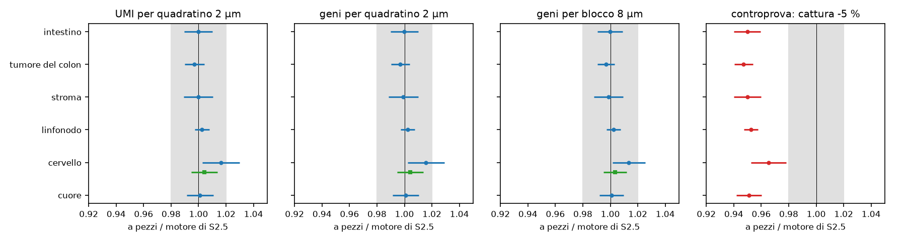
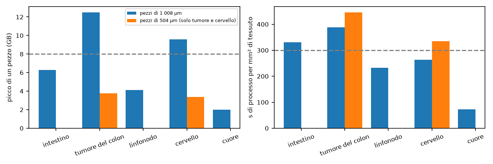

# In breve



# Dubbi rinviati



# Cancelli, previsioni e controprova

Pre-registrazione: cancelli `371a1ea`; ok di Luca sulle previsioni, sulle soglie, sul tetto fisso per tessuto e sul calcolo il 2026-11-10 («Ok, come proposte (Recommended)»; «Tetto fisso per tessuto (Recommended)»), commit `12aec8a`. Correzioni prima dei calcoli `c8d6c5e`. Codice delle esecuzioni `d5e0cfa`. File dello step: `docs/steps/S2.7.md`.



## Figure

**Cosa guardare**: tutti i punti blu stanno nella banda; il cervello con 9 semi tocca il bordo e con 27 torna su 1; la controprova rossa sta fuori in tutti i tessuti.

**Cosa guardare**: il vetro lontano dell'intestino e del linfonodo, che in S2.6 a pezzi aveva la metà dei trascritti, ora coincide; resta largo solo l'angolo del cuore (108 blocchi, 34 contro 27 UMI).

**Cosa guardare**: con pezzi di 504 µm la memoria sta nel bilancio in tutti i tessuti; il tempo del tumore e dell'intestino resta sopra i 300 s.

## Tutti i giudizi di P-1



## Tutti i giudizi di P-2



## P-3 e P-4

Tabella `results/S2.7/S2.7_P3_P4.csv` (una riga per sezione e lato dei pezzi).

# Analisi post hoc



# Revisione avversariale



# Cosa è girato

- Commit: cancelli `371a1ea`, ok di Luca `12aec8a`, codice `d5e0cfa`, correzioni `c8d6c5e`; chiusura nel commit «S2.7: esiti, revisione, In breve, DEC-076, BACKLOG, report».
- Script: `R/05b6_simulate_visium_hd_pieces.R`; `tools/S2.7_run.R`, `S2.7_tasks.R`, `S2.7_sched.py`, `S2.7_identity.R`, `S2.7_p1_analysis.py`, `S2.7_section_measures.py`, `S2.7_md5.sh`, `S2.7_mutants.py`, `S2.7_PH_A1.R`, `S2.7_ph_tasks.R`, `S2.7_E0_stripes.R`, `S2.7_report_parts.py`; misure di S2.5 con `tools/S2.5_stats.py`.
- Semi: G-2 da 20261218; P-1 da 20261219 (tabella 27 × 2 × 6, PH-1 dalla stessa tabella); sezioni da 20261220; bootstrap 20261221 (B = 2000).
- Durata e risorse: vedi «Deviazioni dichiarate» (D-5).
- md5: 192 file letti identici prima e dopo (`results/S2.7/S2.7_md5_before.txt`, `S2.7_md5_after.txt`).

## Perimetro



## Attese pre-registrate



## Correzioni prima dei calcoli e anomalie



## Deviazioni dichiarate



# Appendice: da dove vengono i numeri del riassunto

| frase del riassunto | fonte (tabella o file, riga) | valore letto |
|---|---|---|
| file identici bit per bit a pezzi e in un pezzo solo | `S2.7_G2_identity.csv`; `S2.7_PH2_md5.txt` | 210 su 210 identici; tumore e cervello 504 = 1 008 µm |
| fra i pezzi passano da 5 a 52 milioni di trascritti | json delle sezioni, `n_sent` | 4.56 milioni (cuore), 52.3 milioni (cervello) |
| UMI e geni entro il 2 % nei sei tessuti | `S2.7_P1.csv` | 21 confermate, 3 indeterminate (cervello) |
| cervello +1,6 % con nove ripetizioni, 0,4 % con 27 | `S2.7_P1.csv`, `PH1/S2.7_P1.csv`, A5 mean_umi2 | 1.0162; 1.0044 |
| cattura abbassata del 5 % vista in 6 tessuti su 6 | `S2.7_P1.csv`, CP-1 | 6 smentite per difetto |
| tessuto entro l'1 %, vetro lontano entro il 2 % | `S2.7_section_A1.csv`, `A4`, `A6` | tessuto 0.9993, 1.0009, 1.0016; ≥ 512 µm 1.0177, 1.0133 |
| prima a pezzi il vetro lontano aveva la metà | `results/S2.6/S2.6_section_A1.csv`, `A4` | 0.548; 0.487 |
| tumore 12,5 GB, cervello 9,6 con pezzi da 1 mm; sotto 4 con mezzo mm | `S2.7_P3_P4.csv` | 12.49, 9.58; 3.78, 3.39 |
| tumore 6 minuti e mezzo, intestino 5 e mezzo per mm² | `S2.7_P3_P4.csv`, s_per_mm2_tissue | 388.5 s; 330.5 s |
| una sezione del tumore 3 ore e mezza di processore, mezz'ora con 8 processi | `S2.7_P3_P4.csv`, sec_A2_p1008w8 | 12 851 s; 1 894 s |
| da un sesto a due terzi del tempo nel calcolo delle coperture | json delle sezioni, stage_time_sum_s fase 0 | 17 % (tumore) - 69 % (cuore) |
| 265 milioni di trascritti invece di 496 | json di sec_A4_p1008w8 `n_generated`; `S2.6/q3/one_A4/run.json` | 264 853 011; 496 057 390 |
| un quadratino su 100 000, meno di 6 UMI su un milione | `S2.7_P3_P4.csv` | 142-267 quadratini; quota massima 5.3e-6 |
| circa l'1,3 % dei trascritti con il gene sbagliato | `S2.7_PH_A1.txt` | linfonodo 1.29 %, intestino 1.36 % |
| 26 ore-processo contro 21, più 9 post hoc; 4 ore; 16 processi; 82 °C | json delle esecuzioni; `sched_*.log` | 8.7 + 7.5 + 9.9; 9.0; 18:07-22:17; 16; 82.1 °C |
