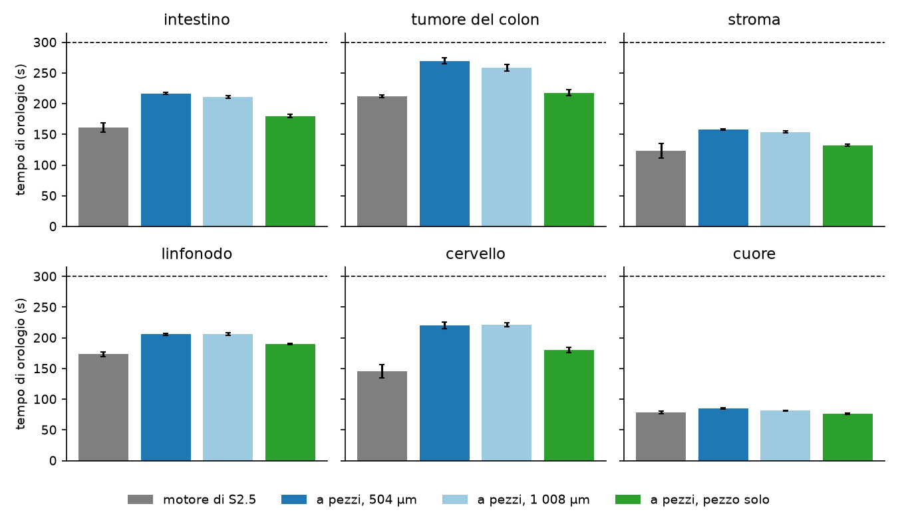
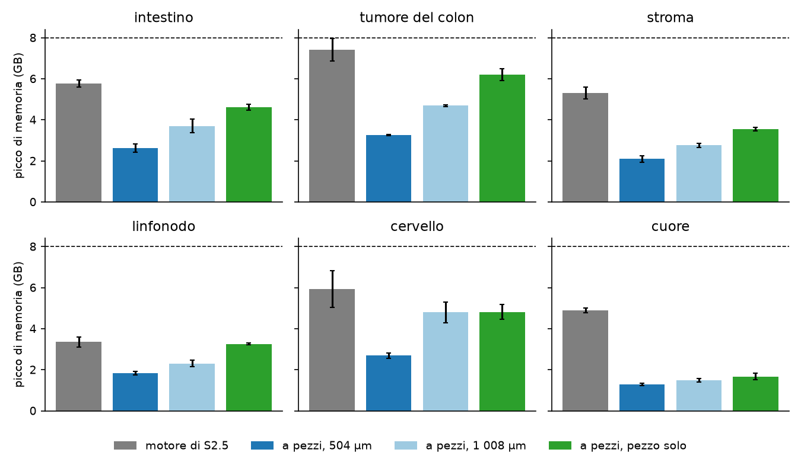

# In breve



# Dubbi rinviati



# Cancelli, previsioni e controprova

Pre-registrazione: cancelli `e03f6bd`; ok di Luca sulle previsioni, sulla regola dell'ingresso con la soglia di 1.5 e sul calcolo il 2026-11-11 («Ok, come proposte (Recommended)»), commit `466563f`. Codice delle esecuzioni `1ecf81c`; codice finale dopo la revisione `64cf92f` e successivi (G-2 bis). File dello step: `docs/steps/S2.8.md`.



## Figure

**Cosa guardare**: le barre blu (valore predefinito, P-1) stanno sotto il tratteggio in tutti i tessuti; la barra verde (pezzo solo) è la più bassa delle configurazioni a pezzi e vicina a quella grigia del motore di S2.5 (regola R-1).

**Cosa guardare**: tutte le configurazioni a pezzi stanno sotto 8 GB (P-2, P-3); il pezzo solo arriva a 6.2 GB nel tumore del colon, il motore di S2.5 con blocchi di 4 × 10⁶ trascritti a 7.4 GB.

# Correzioni dichiarate prima dei verdetti



# Revisione avversariale



# Cosa è girato

- Commit: cancelli `e03f6bd`, ok di Luca `466563f`, codice delle esecuzioni `1ecf81c`, correzioni della documentazione e test del gruppo d `21fc08f`, documento v0.6 e decisioni `0bb19ad`, correzioni dalla revisione `64cf92f`; chiusura nel commit «S2.8: esiti, revisione, In breve, report».
- Script: `tools/S2.8_run.R` (esecuzioni), `tools/S2.8_sched.py` (al più 6 processi), `tools/S2.8_analysis.py`, `tools/S2.8_identity.R`, `tools/S2.8_G2bis.py`, `tools/S2.8_md5.sh`, `tools/S2.8_mutants.sh`, `tools/S2.8_report_parts.py`; batteria `R/testing/test_S2.8.R` e `test_S2.8_d.R`.
- Semi: quelli di P-1 di S2.7 e del pannello di S2.5 (`/mnt/micron/geo_spatialtrans/S2.8/seeds.json`).
- Durata: 81 esecuzioni, 3.9 ore-processo, 19:59-20:43 del 2026-11-11.
- Integrità: 375 file letti, md5 identici prima e dopo (`results/S2.8/S2.8_md5_before.txt`, `_after.txt`).

# Appendice

## Perimetro



## Stime di preparazione



## Regola dell'ingresso



## Attese pre-registrate



## Deviazioni



## Verifiche di Luca



## Da dove vengono i numeri del riassunto


